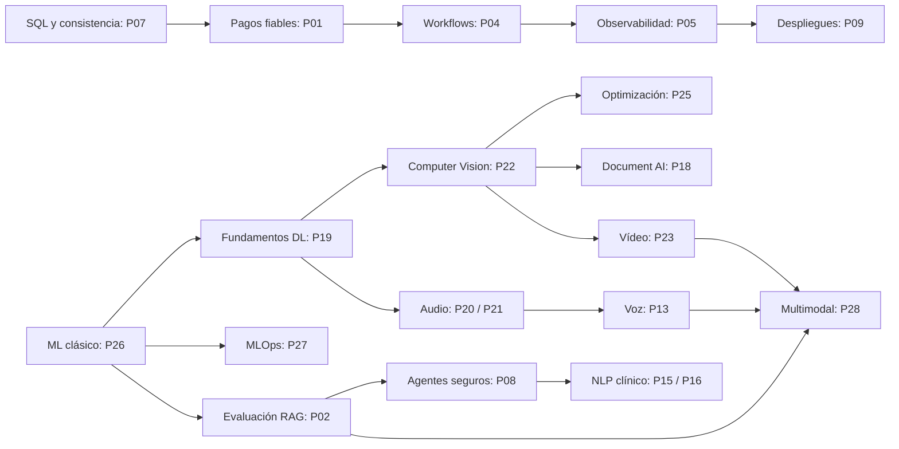

# Plan maestro de proyectos de portafolio: ingeniería de software, sistemas distribuidos y Applied AI

> **Versión:** 1.0 · **Idioma:** español · **Naturaleza:** especificación de implementación para un agente y guía de aprendizaje.  
> **Relación con el documento editorial:** complementa `roadmap-editorial-ingenieria-paysafe-ia.md`. Conserva **los mismos 28 proyectos y sus identificadores originales P01–P28**. Los números P son identificadores estables, **NO el orden de desarrollo**.  
> **Público:** ingeniero con formación universitaria en Informática, experiencia profesional en TypeScript/Node.js/React/SQL y conocimientos en evolución de Python/ML. Se explican profundamente los conceptos nuevos; no se dedican capítulos a sintaxis trivial.  
> **Estado:** diseños propuestos. Ningún rendimiento, precisión, disponibilidad ni nivel de seguridad indicado como objetivo constituye una medición realizada. No atribuir estos sistemas a experiencia laboral profesional hasta que exista evidencia verificable.  
> **Uso previsto:** emplear este documento como `PROJECTS_SPEC.md` o referencia para un agente de desarrollo. Un proyecto se implementa de forma incremental: planificación → pruebas que reproduzcan el fallo → solución mínima → medición → documentación → demostración.

---

## 0. Objetivo y criterios de selección

Construir un portafolio que permita a un Engineering Manager o Staff Engineer comprobar, mediante repositorios y demos reproducibles, que su autor puede:

1. **Resolver problemas empresariales concretos:** cobros duplicados, datos entre tenants, pérdida de eventos, procesos inconclusos, errores de IA, latencia, deriva de modelos o documentos clínicos desestructurados.
2. **Explicar el mecanismo real:** invariantes, mecanismos de concurrencia, garantías y no-garantías, fundamentos matemáticos, arquitectura y fallos previsibles.
3. **Comparar alternativas:** monolito/servicios; SQL/NoSQL; reglas/ML/LLM; modelo entrenado/preentrenado; CPU/GPU; coste/latencia/calidad.
4. **Demostrar con evidencias:** tests de integración y concurrencia, conjuntos de prueba, trazas, métricas, matrices de confusión, experimentos y evaluación independiente.
5. **Comunicar decisiones:** contexto, restricciones, alternativas descartadas, riesgos, límites y resultados medidos, sin usar términos de moda como sustitutos de ingeniería.

### 0.1. Principios no negociables

- **Small scope, deep engineering.** Un único problema nuclear por proyecto. La complejidad debe aparecer en la garantía técnica, no en crear decenas de pantallas o servicios.
- **Baseline antes de optimizar.** Implementar y medir primero el método más sencillo; documentar por qué el siguiente merece la pena.
- **Resultados verificados.** No inventar benchmarks, mejoras porcentuales, tasas de éxito, costes, métricas clínicas o cumplimiento normativo. Las cifras de carga solicitadas en pruebas son **escenarios de ensayo**, no promesas de capacidad.
- **Trazabilidad completa.** Dataset, licencia, versión, semilla, hardware, commit, configuración y metodología de evaluación deben poder reproducirse.
- **Sin secretos ni datos sensibles reales.** Sanidad: documentos y pacientes sintéticos para demos; audios/imágenes/vídeos propios o con licencia compatible. Nunca subir a Git información personal o restringida.
- **Seguridad por diseño.** El LLM no toma decisiones de autorización, el OCR no garantiza desidentificación, un rollback de código no revierte automáticamente datos, y la recepción de un timeout no determina si se ejecutó un cobro.
- **No sobrediseñar.** Empezar en monolito modular, base de datos y un proceso cuando basten. Kafka, Kubernetes, Temporal, GPU, microservicios, agentes o servicios cloud solo si el objetivo didáctico lo exige.
- **Inglés en la vitrina pública.** Documentación interna y posts pueden escribirse en español; `README` y case study de proyectos seleccionados deberán contar con versión inglesa cuidada.
- **Aprendizaje transferible.** Elegir proveedores, frameworks y modelos como implementaciones, no como definición de los conceptos.

### 0.2. Entregables obligatorios para **cada** proyecto

```text
<nombre-proyecto>/
├── README.md                        # qué resuelve, quickstart, estado real, demo, limitaciones
├── docs/
│   ├── problem.md                  # escenario de negocio, usuarios, restricciones y no-objetivos
│   ├── architecture.md             # C4 simplificado + flujo principal + límites de confianza
│   ├── decisions/                  # ADR de decisiones no triviales
│   ├── testing.md                  # estrategia y escenarios adversariales
│   ├── results.md                  # métricas REALES, dataset/hardware/fecha/commit
│   └── lessons-learned.md          # trade-offs, problemas detectados, mejoras pendientes
├── src/ o apps/ y packages/         # estructura proporcional al proyecto
├── tests/                           # unitarias, integración, casos límite y contratos según caso
├── experiments/ o notebooks/        # solo donde proceda; reproducibles
├── scripts/                         # fixtures, seed, generación y limpieza
├── .github/workflows/               # lint, tests, build y chequeos mínimos
├── .env.example                     # sin credenciales ni datos reales
└── LICENSE                          # licencia propia y atribuciones de dependencias/datos
```

La estructura puede ajustarse a Python, TypeScript o laboratorios científicos; **no crear directorios vacíos solo por cumplir un esquema**.

**El `README` debe incluir:** problema en un párrafo; vídeo/GIF o demo que muestre el caso de fallo y su corrección; arquitectura; instalación con un comando cuando sea razonable; tabla de garantías; límites de la implementación; enlace a los posts del roadmap editorial; evidencias de pruebas.

**Criterios generales de terminado (Definition of Done):**

- Código ejecutable con instrucciones reproducibles y datos sintéticos/permitidos.
- Tests que reproducen al menos un **fallo relevante** y demuestran su mitigación; suite de regresión automatizada.
- No existen afirmaciones de rendimiento sin scripts, hardware y resultados accesibles.
- Documentación de una alternativa descartada y explicación del coste de mantener la elegida.
- Seguridad, privacidad y licencias revisadas; sin credenciales, PHI, PCI o materiales sin permiso.
- Una demo de 2–5 minutos enseña el problema, el mecanismo técnico y la verificación del resultado.
- El proyecto se enlaza con los conceptos del documento editorial mediante identificadores de post.
- Ningún diseño asumido como «exactly-once» universal, infalible o «listo para uso clínico» sin demostración y acreditación exigible.

### 0.3. Entregables adicionales para ML, NLP, visión, voz e IA

- **Dataset card:** origen, licencia, restricciones, tamaño real, clases, procedimiento de división, sesgos/limitaciones y datos excluidos.
- **Model card:** objetivo, arquitectura/base preentrenada, pesos/licencia, entrenamiento, métricas por segmento, limitaciones, seguridad y usos desaconsejados.
- Baseline y al menos una alternativa; separación **train/validation/test** correcta, con estratificación/tiempo/grupo de sujeto cuando corresponda.
- Registro de seed, dependencias, GPU/CPU, versiones, hiperparámetros, curvas, checkpoints y evaluación independiente.
- Casos adversariales/OOD; especificar incertidumbre y umbrales de abstención cuando la tarea lo requiera.
- Prohibido llamar «probabilidad calibrada» a cualquier softmax sin comprobar calibración.
- Modelos médicos: ejemplos para investigación y portafolio, **no decisión clínica autónoma**.

### 0.4. Flujo operativo que seguirá el agente implementador

1. Identificar `project_id` y **su lugar en el orden de ejecución** (sección 2).
2. Leer ficha de proyecto y posts prerrequisito del otro documento. Si no existe un post, comprender el concepto antes de implementarlo y proponer el enlace pendiente; no bloquear todo el desarrollo editorial.
3. Abrir `docs/problem.md`: problema, tres historias de usuario, restricciones, invariantes, amenazas y una lista explícita `Out of scope`.
4. Elaborar diseño mínimo: entidades/datos, contratos, eventos, componentes, dependencias externas y diagrama del recorrido feliz + fallo principal.
5. Preparar fixtures y tests que fallen en la implementación naïve; registrar su resultado.
6. Construir baseline; corregir la falla; ejecutar pruebas de integración y adversariales.
7. Introducir mejoras opcionales **solo** si el baseline no cubre las necesidades o como comparación experimental.
8. Medir con scripts/versiones y guardar evidencias; nunca incluir gráficas inventadas.
9. Redactar `README`, ADR y case study. Mantener issues `MVP`, `Research`, `Stretch` diferenciados.
10. Marcar proyecto `completed` solo si satisface los criterios específicos de su ficha y los transversales.

---

## 1. Catálogo completo de los 28 proyectos (identificadores estables)

| ID | Nombre | Problema principal | Especialidad | Proyecto demostrativo estrella |
|---|---|---|---|---|
| P01 | **PaySafe** | Cobros repetidos y resultados inciertos | Backend / Fintech | **Sí** |
| P02 | **EvalForge** | Regresiones silenciosas de calidad en RAG | Applied AI / Evaluation | **Sí** |
| P03 | **TenantShield** | Filtración cruzada de datos entre organizaciones | Seguridad / SaaS | **Sí** |
| P04 | **DurableFlow** | Procesos multi-etapa que no se recuperan | Sistemas distribuidos | **Sí** |
| P05 | **TraceOps** | Incidentes cuya causa raíz no se identifica | Observabilidad / SRE | **Sí** |
| P06 | **SyncBridge** | Divergencias entre ecommerce y ERP | Integración de datos | Complementario |
| P07 | **QueryDoctor** | Consultas SQL que degradan con el volumen | PostgreSQL / Performance | Laboratorio |
| P08 | **AgentGuard** | Acciones no autorizadas o erróneas de agentes | AI Security | **Sí** |
| P09 | **ReleaseGuard** | Despliegues y migraciones que rompen servicios | Platform / DevOps | Complementario |
| P10 | **FrontendScale** | Interfaces inservibles con muchos registros | Frontend / Performance | Complementario |
| P11 | **CollabBoard** | Conflictos en edición simultánea | CRDT / Realtime | Especialización |
| P12 | **StreamLab** | Eventos duplicados/desordenados y replay | Kafka / Event streaming | Especialización |
| P13 | **VoiceFlow** | Latencia e interrupciones en voz conversacional | Speech / Realtime | **Sí** |
| P14 | **ExperimentLab** | Cambios de producto sin evidencia estadística | Product analytics | Laboratorio |
| P15 | **ClinicShield** | Identificadores personales en documentos clínicos | Privacy NLP | **Sí** |
| P16 | **ClinicStruct** | Historias clínicas desestructuradas a FHIR | Clinical NLP / Interop | **Sí** |
| P17 | **MedTerm** | Mención médica sin código interoperable | Medical entity linking | Complementario |
| P18 | **MedDocVision** | PDFs y documentos clínicos difíciles de extraer | OCR / Document AI | Especialización |
| P19 | **NeuralLab** | Uso de redes sin entender gradientes | Fundamentos DL | Laboratorio |
| P20 | **AcousticSense** | Clasificar sonidos bajo ruido | Audio ML | Especialización |
| P21 | **SpeechBench** | ASR inconsistente según acento/ruido | Speech ML | **Sí** |
| P22 | **VisionInspect** | Defectos escasos en inspección industrial | Computer Vision | **Sí** |
| P23 | **MotionTrack** | Pérdida de identidad temporal de objetos | Video / Tracking | Especialización |
| P24 | **MedImageLab** | Evaluación débil de clasificadores biomédicos | Medical imaging | Especialización |
| P25 | **EdgeInfer** | Modelos demasiado pesados para edge/CPU | Model optimization | **Sí** |
| P26 | **PredictLab** | Riesgo de retrasos mal anticipado | Classical ML / Data | Laboratorio |
| P27 | **MLFactory** | Modelos irreproducibles o que degradan | MLOps | **Sí** |
| P28 | **MultiModalLens** | Hallazgo de información en vídeo/audio/imagen | Multimodal AI | **Sí** |

**Nota sobre prioridad:** «estrella» indica capacidad de demostrar una competencia diferenciadora si se ejecuta bien, no necesidad de completar todos. Recomendación de exhibición pública inicial: **P01 + P02 + P16 + P22**, acompañados de tus tres estudios de caso profesionales; incorporar P04/P05/P27 según las vacantes objetivo.

---

## 2. Orden recomendado de ejecución: 28 proyectos sin confundir identificador con prioridad

La numeración P01–P28 procede de la conversación original y se conserva para permitir referencias estables. Esta secuencia ordena por **dependencias prácticas de aprendizaje**. Los bloques pueden solaparse; los proyectos de especialización no necesitan esperar a que se terminen absolutamente todos los anteriores.

| Paso | Proyecto | Fase | Motivo para hacerlo aquí | Dependencia mínima entre proyectos |
|---:|---|---|---|---|
| 01 | **P07 QueryDoctor** | A · Data & reliability | Profundizar SQL, planes, locks y medición | Ninguna |
| 02 | **P01 PaySafe** | A · Data & reliability | Concurrencia, invariantes e idempotencia | P07 recomendado, no obligatorio |
| 03 | **P03 TenantShield** | A · Data & reliability | Aislamiento, amenazas, multi-tenancy | P07 |
| 04 | **P06 SyncBridge** | B · Distributed | Idempotencia y sincronización externa | P01 recomendado |
| 05 | **P04 DurableFlow** | B · Distributed | Sagas y recuperación tras fallos | P01/P06 conceptualmente |
| 06 | **P05 TraceOps** | B · Distributed | Instrumentar y diagnosticar fallos de proyectos anteriores | P01 o P04 como servicio observado |
| 07 | **P09 ReleaseGuard** | B · Distributed | Entrega segura de servicios ya probados | P05 recomendado |
| 08 | **P12 StreamLab** | B · Distributed | Streaming y replay, una vez comprendidas las colas | P04/P06 recomendados |
| 09 | **P10 FrontendScale** | C · Product experience | Rendimiento de la capa cliente | Ninguna estricta |
| 10 | **P11 CollabBoard** | C · Product experience | Concurrencia visible y convergencia | P10 y conceptos de P04 recomendados |
| 11 | **P14 ExperimentLab** | C · Product experience | Medición y A/B testing | Ninguna estricta |
| 12 | **P26 PredictLab** | D · ML foundations | Datos, estadística, pipelines y modelos clásicos | P14 útil |
| 13 | **P19 NeuralLab** | D · ML foundations | Backpropagation y matemáticas de redes | P26 básico y matemáticas |
| 14 | **P27 MLFactory** | D · ML foundations | Ciclo de vida reproducible de un modelo real | **P26** |
| 15 | **P02 EvalForge** | E · AI systems | Métricas de IR/LLM y experimentos controlados | P26/P27 como disciplina de evaluación |
| 16 | **P08 AgentGuard** | E · AI systems | Acciones de IA seguras tras comprender evaluación | P02 recomendado, P03 para autorización |
| 17 | **P15 ClinicShield** | F · Clinical AI | Privacidad antes de ingestión clínica estructurada | NLP/NER; P08 solo conceptualmente |
| 18 | **P16 ClinicStruct** | F · Clinical AI | Extracción clínica, evidencia y FHIR | **P15** para pipeline integrado |
| 19 | **P17 MedTerm** | F · Clinical AI | Vincular entidades extraídas a terminologías | **P16** |
| 20 | **P18 MedDocVision** | F · Clinical AI | Extender de texto a documentos escaneados | P15–P17; visión básica |
| 21 | **P22 VisionInspect** | G · Vision | Primer modelo visual sólido con benchmark | P19 |
| 22 | **P24 MedImageLab** | G · Vision | Evaluación rigurosa de imágenes biomédicas | **P22** recomendado |
| 23 | **P25 EdgeInfer** | G · Vision | Optimización cuantificada de modelos existentes | **P22** o P24 |
| 24 | **P20 AcousticSense** | H · Audio & multimodal | Señales, espectrogramas, CNN de audio | P19; FFT |
| 25 | **P21 SpeechBench** | H · Audio & multimodal | ASR, fine-tuning y evaluación WER/CER | **P20** recomendado |
| 26 | **P13 VoiceFlow** | H · Audio & multimodal | Orquestar voz real-time con cancelación | P21 ayuda en mediciones de ASR |
| 27 | **P23 MotionTrack** | H · Audio & multimodal | Introducir temporalidad del vídeo | P22 |
| 28 | **P28 MultiModalLens** | H · Audio & multimodal | Integrar recuperación sobre varios medios | P02 + P21 + P23 recomendados |

### 2.1. Paralelismo válido

- **Ruta Backend/Staff (principal para contratación a corto plazo):** P07 → P01 → P03 → P04 → P05 → P09. P06 y P12 opcionales.
- **Ruta Applied AI / Healthcare:** P26 → P02 → P08 → P15 → P16 → P17; sumar P18 cuando haya base de visión.
- **Ruta ML/Deep Learning:** P26 → P19 → P22 → P25; en paralelo P27. Extender a P20 → P21 → P13 y P23 → P28.
- **Ruta Frontend/Product:** P10 → P11 y P14 como línea independiente.

**Puntos de publicación temprana:** al completar P01, publicar un case study aun sin otros proyectos; al completar P02, añadir evaluación reproducible; al completar P16, publicar una demo **solo con pacientes sintéticos**. El objetivo son 6–8 casos excelentes, no 28 MVP incompletos.

### 2.2. Cadena de aprendizaje reutilizable



### 2.3. Correspondencia con el plan editorial de 175 posts

Los números de posts siguientes se corresponden con el documento complementario, que incluye la ficha editorial completa de cada concepto. **No son tickets de implementación**.

- **Persistencia:** 032–041; **arquitectura distribuida:** 042–054; **tests/operaciones/cloud:** 055–066.
- **Frontend/realtime:** 067–075; **matemáticas/estadística:** 076–085; **ML:** 086–095; **Deep Learning:** 096–105.
- **NLP/RAG/agentes:** 106–121; **sanidad:** 122–134; **visión:** 135–145; **audio/vídeo:** 146–156.
- **MLOps/inferencia:** 157–167; **producto/Staff:** 168–175.
- **PaySafe:** además existe serie editorial abreviada **PS01–PS10**, que tiene prioridad sobre el orden lineal de posts 001–175 cuando se implemente P01.

---

# 3. Fichas de implementación de los 28 proyectos

> Cada ficha expresa un **MVP verificable**, las extensiones que no pertenecen al MVP y la demostración que una empresa podría inspeccionar. Adaptar nombres de API/entidades a la implementación real mediante ADR; conservar la semántica. En las fichas, «objetivo de ensayo» no es una medición real.

## P07 — QueryDoctor · Laboratorio de rendimiento y concurrencia de PostgreSQL

**Orden de ejecución:** 01/28 · **Área:** SQL y performance · **Posts:** 032–038, 058.  
**Problema empresarial:** la API se vuelve lenta al crecer la tabla, aparecen bloqueos y el equipo cambia índices o aumenta recursos sin comprender el origen de la degradación.  
**Resultado esperado:** un laboratorio reproducible de diagnóstico SQL, con consultas problemáticas, planes de ejecución y mejoras contrastables.

**MVP funcional**
1. Generador determinista de un esquema de ecommerce/logística y datos sintéticos escalables, con dos tamaños de dataset seleccionables.
2. Al menos cuatro consultas: paginación OFFSET alta, búsqueda con filtro selectivo, agregación con JOIN y N+1 desde ORM; añadir caso de actualización concurrente.
3. Benchmark CLI que ejecuta warm-up, repeticiones, guarda duración y planes `EXPLAIN (ANALYZE, BUFFERS, FORMAT JSON)` antes/después.
4. Experimentar con índices compuestos/parciales, keyset pagination y reescritura de consultas; comparar el coste de escrituras e índices.
5. Página simple que muestre consulta, plan, intervención y mediciones de los experimentos ejecutados.

**Diseño y datos.** PostgreSQL, SQL y Node.js/TypeScript (Drizzle opcional); `orders`, `customers`, `order_items`, `deliveries`, `events`. Scripts `seed`, `benchmark`, `reset`. Ejecutar con Docker. Separar tiempos de generación de datos del benchmarking. No comparar planes de bases con distribuciones distintas sin indicarlo.

**Investigaciones:** B-tree, selectividad/cardinalidad, estadística del planner, MVCC, deadlocks, `pg_stat_statements` y límites de `EXPLAIN`. Contrastar índices frente a read/write amplification.

**Fallos y pruebas:** paginación errónea con inserciones concurrentes; resultados SQL incorrectos al optimizar JOIN; deadlock reproducible; cambios de plan por cardinalidad; regresión de escritura por índices excesivos.

**Criterio de aceptación:** scripts repetibles, comparaciones reales con entorno fijado, mismas salidas semánticas para consulta inicial y optimizada, análisis de un caso donde el índice **no** mejora el rendimiento.

**Demo de portafolio:** «esta consulta tarda más al crecer el dataset → inspecciono el plan → elijo un índice/rewrite → vuelvo a medir». No publicar speedups hasta medirlos.  
**Fuera de alcance:** construir un APM comercial, clúster PostgreSQL HA o motor SQL propio.

## P01 — PaySafe · Procesamiento de pagos robusto bajo concurrencia y fallos

**Orden:** 02/28 · **Área:** Backend/Fintech · **Posts:** serie **PS01–PS10**; también 021–023, 032–038, 044–054, 055–059.  
**Problema:** el cliente repite un pago, un worker cae, el proveedor responde tarde o los webhooks se duplican. No deben aparecer efectos económicos duplicados ni estados falsamente definitivos.

**MVP funcional**
1. Crear pedido e intención de pago con importe exacto (`amount_minor` + `currency`), identificadores internos y externos separados.
2. Endpoint de creación idempotente con clave, fingerprint de request, ámbito de retención, control de concurrencia y respuesta coherente a reintentos.
3. Máquina de estados de pago e intentos: creado, procesando, confirmado, fallido, cancelado y resultado incierto/requiere reconciliación; transiciones explícitas.
4. Proveedor ficticio configurable: éxito, rechazo, respuesta tardía, timeout tras aceptar la operación, desconexión y duplicación de webhook.
5. Webhook con HMAC, deduplicación, registro duradero y transiciones válidas; Outbox para eventos de negocio.
6. Worker de reconciliación: consultar al proveedor antes de decidir qué hacer con operaciones ambiguas.

**Arquitectura.** Monolito modular TypeScript/Node/NestJS opcional, PostgreSQL y tests de integración reales. Introducir Redis/BullMQ solo donde aporte valor. Dominio (`Payment`, `PaymentAttempt`, `Order`, `Money`, `IdempotencyRecord`, `IncomingEvent`, `OutboxEvent`), puertos de PSP y adaptadores fake/sandbox. Eventos `PaymentRequested`, `PaymentSucceeded`, `PaymentFailed`, `PaymentRequiresReconciliation`; distinguir dominio y mensajería.

**Contratos sugeridos:** `POST /orders`, `POST /payments` (Idempotency-Key), `GET /payments/{id}`, `POST /webhooks/fake-provider`, `POST /admin/reconcile/{paymentId}` en entorno controlado. Una sola demo de checkout y panel de línea temporal.

**Tests de fallos:** 100 requests concurrentes con la misma clave; misma clave con payload distinto; timeout tras cargo aceptado; dos webhooks idénticos; webhook tardío; worker que cae antes/después del commit; retorno de resultado incierto; reejecución de outbox sin doble efecto comercial. Verificar efectos de negocio, no solo HTTP 200.

**Criterio de aceptación:** reglas e invariantes probados, recuperación determinista de los escenarios cubiertos, comandos para repetir pruebas y documentación explícita de garantías/no-garantías. **No** procesar tarjetas reales; no proclamar cumplimiento PCI.  
**Demo:** simulación de fallos con trazas y estado final. **Fuera de alcance:** antifraude, disputas, card vault, pasarela certificada o contabilidad general completa.

## P03 — TenantShield · Aislamiento SaaS multi-tenant comprobable

**Orden:** 03/28 · **Área:** Seguridad de datos · **Posts:** 026–030, 032–038, 044–045 y 124–125 como contexto de privacidad.  
**Problema:** una consulta, URL de almacenamiento, worker o política defectuosa permite acceder a documentos de otra organización.

**MVP funcional**
1. Organizaciones, usuarios, memberships y roles (`owner`, `admin`, `member`, `viewer`) con escenarios de pertenencia múltiple.
2. CRUD pequeño de documentos y proyectos, aislamiento a nivel HTTP, aplicación y PostgreSQL Row-Level Security.
3. Roles SQL separados para migración/propiedad y conexión runtime; evitar bypass accidental de RLS por owner o privilegios especiales.
4. Contexto del tenant fijado por transacción, con pruebas de conexiones reutilizadas/pooling y transacciones abortadas.
5. Permisos de objetos en S3/MinIO mediante claves por tenant y enlaces firmados de corta duración; auditoría de operaciones sensibles.
6. Batería adversarial: modificar IDs, consultar otras organizaciones, acceder a URLs antiguas, enviar jobs con tenant equivocado.

**Diseño.** NestJS, TypeScript, PostgreSQL, Drizzle, MinIO, Playwright. Entidades `Organization`, `Membership`, `Document`, `AccessGrant`, `AuditEvent`. Diferenciar autenticación de autorización; cada acceso requiere permiso sobre objeto y tenant.

**Pruebas:** lectura/escritura cruzada, elevación de rol, fuga de contexto por pool, acceso a objetos almacenados, ejecución asíncrona y auditoría. Añadir una amenaza documentada y su test específico.

**Criterio de aceptación:** suite automatizada que detecta una política RLS o un guard eliminados; una demo de dos sesiones sin acceso cruzado. No declarar «seguridad absoluta»; detallar límites y configuración exacta del rol PostgreSQL.  
**Fuera de alcance:** IAM corporativo, SSO de todos los proveedores y certificación de cumplimiento.

## P06 — SyncBridge · Sincronización resiliente entre ecommerce y ERP

**Orden:** 04/28 · **Área:** Integraciones/Data engineering · **Posts:** 025, 031, 037–041, 049–054, 157.  
**Problema:** un sistema de pedidos y un ERP difieren por errores parciales, rate limits, eventos duplicados, modelos incompatibles y actualizaciones concurrentes.

**MVP funcional**
1. Dos APIs simuladas (ecommerce y ERP) con esquemas distintos, cursores, cambios incrementales y fallos parametrizables.
2. Pipeline de sincronización inicial e incremental con mappings tipados, validación y registro de estado por conector.
3. Reintentos con backoff, límites, checkpoints persistentes, DLQ lógica y reejecución manual.
4. Decidir y documentar política de propiedad de campos y conflictos (fuente de verdad por campo; evitar last-write-wins universal).
5. Reconciliación por snapshots/hash/consultas comparables e informe de discrepancias.
6. Pequeño dashboard: backlog, últimas sincronizaciones, discrepancias, registros con error y operación de retry.

**Arquitectura.** Node/TS, PostgreSQL, Redis/BullMQ opcional. Contratos `Connector`, `ChangeCursor`, `Mapping`, `SyncRun`, `SyncCheckpoint`, `Conflict`, `RetryJob`. Eventos `SyncStarted`, `RecordMapped`, `SyncFailed`, `ConflictDetected`, `SyncReconciled`.

**Pruebas:** cortar la conexión tras un batch, repetir un cursor, entregar cambios fuera de orden, invalidar un registro, aplicar rate limiting y procesar un dataset sintético con 10.000 registros. Comparar estado final por invariantes, no por número de reintentos.

**Criterio de aceptación:** los procesos pueden reanudarse sin pérdida ni duplicación lógica para los casos definidos; discrepancias insolubles quedan visibles para revisión.  
**Fuera de alcance:** integración con datos reales sin permisos, catálogo universal de conectores y sincronización bidireccional sin reglas de conflicto.

## P04 — DurableFlow · Workflows duraderos y sagas compensables

**Orden:** 05/28 · **Área:** Sistemas distribuidos · **Posts:** 042–054, 059–061.  
**Problema:** reservar stock, cobrar y emitir factura no es una única transacción SQL: cada etapa puede producir un efecto externo y fallar de forma independiente.

**MVP funcional**
1. Workflow de compra: `ReserveInventory → ChargePayment → IssueInvoice → Notify`; actividades idempotentes, estado persistente.
2. Política explícita de reintentos, plazos, timeouts, fallos permanentes/transitorios y circuit breaker donde proceda.
3. Compensaciones razonables (`ReleaseInventory`, `Refund` solo si se ha cobrado); diferenciar compensación de rollback perfecto.
4. Persistencia de progreso, reanudación tras caída de worker y auditoría de transiciones.
5. Dashboard con timeline y botones de simulación de fallos en actividades concretas.
6. Comparación acotada entre orquestación con Temporal y alternativa simple basada en colas/DB; no desarrollar tu propio Temporal.

**Diseño.** TypeScript, Temporal SDK + dev server o implementación instructiva pequeña con PostgreSQL/BullMQ; fake services independientes para inventario/pagos/facturas. Entidades `WorkflowInstance`, `ActivityAttempt`, `Compensation`, `ExternalEffect`, `WorkflowEvent`.

**Pruebas:** caída antes/después de registrar efecto, actividad que responde tarde, compensación que falla, doble señal y replay del workflow. Verificar que ningún resultado incierto se convierte en éxito/fallo definitivo sin comprobar el sistema externo.

**Criterio de aceptación:** ejecución recuperable que termina en estado válido o estado de intervención explícito; diagrama de saga, ADR y ensayo de fallos ejecutable.  
**Fuera de alcance:** crear framework completo de orquestación generalista o demostrar atomicidad global entre proveedores.

## P05 — TraceOps · Investigación de incidentes con telemetría correlacionada

**Orden:** 06/28 · **Área:** SRE/Observabilidad · **Posts:** 055–061, 064–066.  
**Problema:** una operación tarda segundos pero los logs no revelan qué servicio, dependencia o consulta causa la degradación.

**MVP funcional**
1. API → PostgreSQL → cola/worker → proveedor simulado con propagación de contexto de trazas.
2. Instrumentación de logs estructurados, métricas de servicio (rate/errors/duration) y spans distribuidos mediante OpenTelemetry.
3. Stack local con OpenTelemetry Collector, Prometheus, Grafana y backend de trazas (Tempo/Jaeger); añadir logs en Loki si es útil.
4. Vista de tasas, p50/p95/p99, errores, saturación, colas y dependencias lentas, diferenciando medidas servidor/cliente.
5. SLI/SLO de laboratorio, alertas con umbrales sustentados y runbook de diagnóstico.
6. Inyector de latencia, timeout, fallo SQL, saturación de worker y pérdida de dependencia.

**Diseño.** Reutilizar P01/P04 o un servicio mínimo; evitar construir nuevas funcionalidades de negocio. Correlation IDs, propagación W3C Trace Context, atributos de spans sin PII/secretos.

**Pruebas:** una regresión controlada debe aparecer en métrica, traza y alerta; identificar causa raíz **sin editar código para añadir logs**. Revisar cardinalidad y datos sensibles de etiquetas.

**Criterio de aceptación:** playbook que un tercero ejecuta para localizar el componente culpable; capturas reales, consultas y postmortem fechado.  
**Fuera de alcance:** monitorización de una infraestructura masiva, dashboards de vanidad sin hipótesis y claims de SLO sobre producción real.

## P09 — ReleaseGuard · Despliegues progresivos, migraciones y reversión

**Orden:** 07/28 · **Área:** Platform/DevOps · **Posts:** 055–066, 167.  
**Problema:** un deploy rompe endpoints; la versión previa ya no entiende el esquema nuevo y el rollback no soluciona la caída.

**MVP funcional**
1. CI con lint/typecheck/tests, build reproducible, escaneo de dependencias y artefactos versionados.
2. Desplegar un servicio API pequeño en entorno local controlado o AWS ECS/Fargate si hay presupuesto; IaC con Terraform en modo adecuado al entorno.
3. Despliegue progresivo blue/green o canary con health/readiness y smoke tests.
4. Migración PostgreSQL `expand → migrate → contract`, conservando compatibilidad simultánea de versión antigua y nueva durante la transición.
5. Feature flag que separa release de activación; rollback automatizado si la verificación del servicio falla.
6. Informe de cambios, revisión de secretos, control de permisos mínimos y coste operativo aproximado **estimado, no confundido con factura real**.

**Diseño.** GitHub Actions, Docker, PostgreSQL, Terraform, ECS o Kubernetes local (elegir **uno** en el MVP), OpenTelemetry. ADR sobre infraestructura seleccionada.

**Pruebas:** versión defectuosa, rollback, migración incompleta recuperable, reinicio de instancia, fallos de readiness y validación de contrato entre versiones.

**Criterio de aceptación:** reproducir un despliegue fallido que mantiene la versión válida sirviendo tráfico y no corrompe datos existentes.  
**Fuera de alcance:** construir PaaS completa, multi-región o HA certificada.

## P12 — StreamLab · Eventos logísticos, replay y consumidores de Kafka

**Orden:** 08/28 · **Área:** Event Streaming · **Posts:** 048–054, 059–060.  
**Problema:** eventos de seguimiento llegan duplicados, atrasados o fuera de orden, mientras consumidores de analítica y notificaciones necesitan procesarlos independientemente.

**MVP funcional**
1. Generador sintético de eventos `PackageRegistered`, `OutForDelivery`, `Delivered`, `DeliveryFailed` y correcciones válidas.
2. Publicación Kafka/Redpanda particionada por `delivery_id`, con claves de evento y schema versionado.
3. Dos consumidores: proyección de estado de entrega en PostgreSQL y cálculo simple de métricas.
4. Deduplicación lógica, versionado/secuencia por agregado cuando exista, política para eventos retrasados y DLQ para eventos no interpretables.
5. Replay completo desde eventos retenidos hacia una proyección nueva.
6. Visualizar lag, throughput, errores y estado de cada proyección.

**Diseño.** Kafka/Redpanda, TypeScript o Go como segundo lenguaje **opcional**, PostgreSQL, Docker, Prometheus. Separar contrato del evento de transporte y no asumir orden global entre particiones.

**Pruebas:** ráfaga sintética de 100.000 eventos como prueba de estrés configurable, parada/reinicio de consumidor, replay, evento duplicado, offset incorrecto y cambio de versión de esquema.

**Criterio de aceptación:** proyección final conforme a las invariantes del dominio tras recuperar lag y repetir eventos, con limitaciones documentadas.  
**Fuera de alcance:** exactly-once de efectos externos, procesamiento de streaming masivo o varios clústeres productivos.

## P10 — FrontendScale · Dashboard fluido con grandes volúmenes de datos

**Orden:** 09/28 · **Área:** Frontend/Performance · **Posts:** 058, 067–072.  
**Problema:** un equipo operativo necesita filtrar, seleccionar y actualizar decenas de miles de registros sin que la interfaz bloquee el hilo principal.

**MVP funcional**
1. Dashboard de operaciones con dataset sintético de 100.000 registros generado de forma reproducible y API paginada/filtrada.
2. Tabla virtualizada, ordenación y filtros server-side, selección, estados vacíos y accesibilidad de teclado.
3. Actualizaciones incrementales por WebSocket o SSE con número de secuencia; evitar volver a renderizar toda la tabla.
4. Optimistic update con cancelación/rollback por fallo y gestión de carreras por datos obsoletos.
5. Diagnóstico de renders y long tasks; comparar baseline naïve y solución optimizada.
6. Tests visuales y E2E de flujos críticos; estados loading/error/reconnect.

**Diseño.** React + TS, TanStack Table/Virtual y Query; API Node, PostgreSQL o fixture local de tamaño grande; Playwright. Introducir Web Worker solo si profiling muestra un cálculo CPU-bound real.

**Pruebas:** filtros rápidos consecutivos, reconexión, cambios simultáneos servidor/cliente, navegación solo teclado y mediciones con throttling definido. Observar INP y tiempos de render sin atribuir números universales.

**Criterio de aceptación:** mismos resultados funcionales en baseline y optimización, trazas/métricas reproducibles, una interacción de alto coste corregida y accesibilidad básica auditada.  
**Fuera de alcance:** clon de un CRM entero, charting masivo no relacionado con el problema.

## P11 — CollabBoard · Documento colaborativo con convergencia

**Orden:** 10/28 · **Área:** Tiempo real/CRDT · **Posts:** 048–049, 073–075.  
**Problema:** varios usuarios editan el mismo texto mientras algunos pierden conectividad; las actualizaciones no deben borrarse silenciosamente ni producir réplicas permanentemente divergentes.

**MVP funcional**
1. Editor de notas compartidas por documento y organización, con dos o tres clientes simultáneos.
2. Sincronización de cambios mediante Yjs y proveedor WebSocket; presencia y cursores remotos opcionales tras la edición básica.
3. Persistencia de snapshots/documentos y replay de actualizaciones necesarias para recuperación.
4. Soporte limitado de edición temporal offline y posterior reconexión; estados claros de sincronización.
5. Permisos por documento validados en servidor, no solo en la interfaz.
6. Panel pequeño para inspeccionar versiones, conexiones y divergencias hipotéticas.

**Diseño.** React o Vue, Yjs, WebSockets, PostgreSQL; `Workspace`, `Document`, `Membership`, `ChangeLog/Snapshot`. Explicar CRDT frente a OT y el coste de sincronización. No desarrollar CRDT propio dentro del MVP.

**Pruebas:** ediciones concurrentes, particiones de red simuladas, duplicación y reorder de actualizaciones, reconexiones repetidas, usuario revocado y persistencia tras reinicio. La convergencia debe evaluarse tras comunicación suficiente entre réplicas.

**Criterio de aceptación:** clientes terminan con contenido lógico equivalente después de recuperar conexión, con pruebas deterministas; documento sobre límites de presencia y offline.  
**Fuera de alcance:** suite completa tipo Google Docs, funciones de office y edición colaborativa en múltiples formatos.

## P14 — ExperimentLab · A/B testing con métricas verificables

**Orden:** 11/28 · **Área:** Product/Statistics · **Posts:** 080–083, 169–170.  
**Problema:** un equipo modifica el onboarding y confunde fluctuaciones aleatorias o errores de instrumentación con mejoras reales de conversión.

**MVP funcional**
1. Dos variantes de un flujo de activación (A/B) con asignación estable por usuario y salt/versión del experimento.
2. Registro correcto de exposición y eventos (sin duplicaciones accidentales) más embudo `visit → signup → activation`.
3. Dashboard que visualice denominadores, conversiones, tamaño muestral, grupos y desvío de asignación (SRM).
4. Notebook en Python que explique intervalo de confianza y tamaño del efecto para una comparación elegida; aclarar supuestos.
5. Métrica guardrail adicional (por ejemplo errores del flujo o tiempo hasta completar).
6. Experimentos sintéticos controlados: sin efecto, mejora simulada y sesgo de instrumentación.

**Diseño.** React + TS, PostgreSQL/SQL, Python/pandas/scipy/scikit-learn si necesario. `Experiment`, `Variant`, `Assignment`, `ExposureEvent`, `ConversionEvent`, `AnalysisRun`.

**Pruebas:** un usuario mantiene variante, eventos duplicados no inflan conversiones, SRM se detecta, resultados reproducibles con semilla; evitar detener experimentos solo porque p<0.05 en una observación intermedia sin método secuencial adecuado.

**Criterio de aceptación:** informe distingue claramente medición, incertidumbre y causalidad asumida; no presenta simulaciones como resultados empresariales reales.  
**Fuera de alcance:** plataforma completa de feature flags o motor de experimentación estadística universal.

## P26 — PredictLab · Predicción de retrasos logísticos con ML clásico

**Orden:** 12/28 · **Área:** Data Science/ML clásico · **Posts:** 076–095.  
**Problema:** operaciones necesita priorizar entregas con mayor riesgo de retraso, sin basarse en heurísticas inestables ni probabilidades mal calibradas.

**MVP funcional**
1. Dataset público adecuado o sintético claramente declarado: estado de pedido, distancia, franja, región, clima simulado solo si está permitido por origen del dato, volumen y eventos disponibles *antes* de la predicción.
2. EDA, missingness, outliers, classes imbalance, análisis temporal, data lineage y split temporal o por entidad correcto.
3. Baseline (regla empresarial o regresión logística), Random Forest y boosting (XGBoost/LightGBM), con pipeline de transformaciones entrenadas **solo** sobre train.
4. Comparación validada por PR-AUC, recall@capacity, calibración/Brier score y error por segmento.
5. Model card, análisis de variables, posibles sesgos y threshold elegido según objetivo operativo declarado.
6. API/demo con predicción de riesgo, entrada validada y explicación prudente de sus limitaciones.

**Diseño.** Python, pandas, NumPy, scikit-learn, XGBoost/LightGBM opcional, matplotlib, FastAPI. Artefactos deterministas de dataset, features y modelos.

**Pruebas:** leakage por información futura, train/test contamination, drift de distribuciones sintéticas, inferencia sobre categorías desconocidas y métricas inestables en clases pequeñas.

**Criterio de aceptación:** baseline y modelos comparados en test separado; resultados y configuraciones reproducibles; probabilidad solo llamada «calibrada» cuando se comprueba.  
**Fuera de alcance:** predicción comercial real sin datos válidos ni despliegue predictivo autónomo en logística.

## P19 — NeuralLab · Red neuronal y autodiferenciación desde cero

**Orden:** 13/28 · **Área:** Fundamentos Deep Learning · **Posts:** 076–079, 096–100.  
**Problema formativo:** una red entrenada desde un framework de alto nivel puede funcionar sin que el desarrollador comprenda el origen de sus gradientes, el flujo de información o su inestabilidad.

**MVP funcional**
1. Motor pequeño de autodiferenciación reverse-mode para escalares, o implementación matricial con gradientes documentados; elegir uno y explicar límites.
2. Soporte de operaciones esenciales, grafo computacional, backpropagation y gradient checking por diferencias finitas.
3. MLP de dos capas, activaciones (ReLU/tanh) y pérdidas (MSE/cross-entropy según problema).
4. SGD y Adam **si** el grafo soporta los gradientes correspondientes; experimentos con learning rate, inicialización y regularización.
5. Resolver XOR/dataset bidimensional no lineal; comparar con PyTorch usando las mismas condiciones.
6. Visualización de función de pérdida, frontera de decisión y gradientes, con resultados calculados desde entrenamiento real.

**Diseño.** Python + NumPy para implementación didáctica, PyTorch para verificación, matplotlib/notebook y tests. Módulos `tensor/autograd`, `layers`, `losses`, `optimizers`, `experiments`.

**Pruebas:** gradientes correctos, acumulación sobre ramas compartidas, broadcasting si se soporta, estabilidad en inputs extremos, convergencia en casos controlados; documentar funciones no derivables en puntos concretos.

**Criterio de aceptación:** el lector puede derivar manualmente un gradiente, comprobarlo numéricamente y ejecutar el entrenamiento de una red sin PyTorch; sin afirmar que se ha construido framework competitivo.  
**Fuera de alcance:** CUDA desde cero o entrenar un LLM.

## P27 — MLFactory · Pipeline reproducible y monitorizado de modelos

**Orden:** 14/28 · **Área:** MLOps · **Posts:** 092–095, 099, 157–167.  
**Problema:** un modelo desplegado carece de relación verificable con su dataset y código, y el equipo no puede reproducirlo ni detectar degradación tras cambios de datos.

**MVP funcional**
1. Reutilizar PredictLab como modelo y dataset; versionado de datos (DVC o mecanismo documentado) y pipeline de transformaciones estable.
2. Tracking de experimentos con MLflow: parámetros, métricas, artefactos, hash de datos, commit y entorno.
3. Script/pipeline `prepare → train → evaluate → register → serve` que aborta si falla validación/umbrales definidos.
4. Model registry con etapas o alias explícitos y API FastAPI para servir versión identificable.
5. Monitorizar esquema, entradas inválidas, distribución de features, tiempos, errores y métricas de calidad solo cuando existan etiquetas.
6. Reentrenamiento controlado y despliegue con reversión demostrable hacia versión anterior.

**Diseño.** Python, scikit-learn, MLflow, DVC opcional, FastAPI, Docker, GitHub Actions; Evidently opcional para drift. Mantener la infraestructura pequeña y reproducible en local.

**Pruebas:** drift sintético conocido, dataset con columnas cambiadas, regresión del modelo, cambio incorrecto de feature ordering, registry con versiones y rollback.

**Criterio de aceptación:** un tercero reproduce una versión registrada con la misma entrada, recupera su linaje y detecta un cambio controlado; no confundir drift con degradación demostrada de accuracy.  
**Fuera de alcance:** sistema de entrenamiento distribuido masivo o feature store empresarial completa.

## P02 — EvalForge · Evaluación reproducible de búsqueda RAG

**Orden:** 15/28 · **Área:** Retrieval/LLMOps · **Posts:** 092–095, 106–117, 159–162.  
**Problema:** al cambiar embeddings, prompts o modelo, las respuestas parecen buenas en demos pero empeoran en casos reales, con mayor latencia/coste y errores silenciosos.

**MVP funcional**
1. Corpus público o propio permitido, versionado y procesado con dos estrategias de chunking.
2. Baseline BM25, búsqueda dense con embeddings y recuperación híbrida; estrategia de reranking opcional y controlada.
3. Dataset con al menos 100 preguntas anotadas manualmente o por revisión humana: hechos, negativas, contradicciones, sin respuesta y documentos similares.
4. Respuestas con evidencia/citas; medir recuperación y generación por separado, con modo de abstención.
5. Harness de evaluación con Recall@k, MRR/nDCG, groundedness/factualidad evaluada por rúbrica, latencia, tokens y coste real/estimado.
6. Comparación de modelos/prompts por versión, regresiones en CI y dashboard de ejemplos fallidos y comparaciones pareadas.

**Diseño.** TypeScript/Node o Python, PostgreSQL+pgvector, BM25 simple o motor léxico, LLM API o modelo local, Pydantic/Zod; Langfuse/MLflow opcional. `CorpusVersion`, `Chunk`, `Question`, `ReferenceAnswer`, `RetrievalRun`, `GenerationRun`, `Evaluation`.

**Pruebas:** cita inexistente, no-answer, contexto incorrecto, documento actualizado no reindexado, perturbaciones del prompt, diferencias por chunking. No aceptar LLM-as-judge como única verdad; contrastar con muestras humanas.

**Criterio de aceptación:** comparar dos pipelines sobre exactamente el mismo test y señalar no solo el ganador en una métrica, sino fallos y compromisos (coste/latencia/fidelidad).  
**Demo:** introducir una pregunta, inspeccionar chunks recuperados, citas, respuesta, métricas y regresiones. **Fuera de alcance:** chatbot generalista masivo sin evaluación.

## P08 — AgentGuard · Agente con herramientas y controles deterministas

**Orden:** 16/28 · **Área:** AI security/Agentic workflows · **Posts:** 026–030, 109–121.  
**Problema:** un agente puede interpretar incorrectamente la intención de un usuario o seguir instrucciones maliciosas dentro de documentos y ejecutar acciones con efectos empresariales.

**MVP funcional**
1. Dominio ficticio de facturas con tres herramientas tipadas: leer facturas, preparar recordatorios y proponer cambio de estado.
2. Ejecución LLM con tool calling; los argumentos se validan con JSON Schema/Zod/Pydantic antes de pasarlos al dominio.
3. Autorización RBAC/ownership/tenant verificada **fuera del modelo**, para cada llamada y objeto.
4. `dry-run` y confirmación humana obligatoria para cualquier escritura con impacto; idempotencia de acciones aprobadas.
5. Límite de pasos, tiempo, presupuesto de tokens, rate limits, manejo de errores de herramientas, cancelación y trazas.
6. Suite adversarial: prompt injection en documento, intento de exfiltrar facturas de otro tenant, petición ambigua, herramientas con respuestas engañosas y cambios sin aprobación.

**Diseño.** TypeScript + SDK de LLM, NestJS/React, PostgreSQL, Zod, OpenTelemetry; MCP opcional, con límites de confianza explícitos. Entidades `UserIntent`, `ToolCall`, `AuthorizationDecision`, `ApprovalRequest`, `ExecutionRecord`, `AuditEvent`.

**Pruebas:** la tool nunca puede saltarse el guard; el modelo no puede aprobar su propio cambio; replay de tool call; escenarios donde el modelo se abstiene o pide aclaración.

**Criterio de aceptación:** todos los casos de ejecución no autorizada del threat model quedan bloqueados por controles deterministas, aunque el LLM los solicite; documentar ataques no cubiertos.  
**Fuera de alcance:** agente general de escritorio con permisos ilimitados y autonomía no auditable.

## P15 — ClinicShield · Desidentificación de texto clínico con evaluación de riesgo

**Orden:** 17/28 · **Área:** Privacy NLP · **Posts:** 106–110, 122–126, 134.  
**Problema:** un registro clínico puede revelar identidad por nombre, números, fechas, centros, localizaciones e identificadores indirectos; reemplazar nombres no garantiza anonimato.

**MVP funcional**
1. Corpus de notas clínicas **completamente sintéticas** en español e inglés, con gold labels por tipo de entidad sensible.
2. Pipeline comparativo: regex/reglas, detector NER preentrenado/ajustado y combinación híbrida.
3. Redacción de spans con conservación de offsets o mapa seguro; pseudonimización coherente en un modo separado, con mapeo protegido y no publicado.
4. Interfaz para revisar falsos negativos y errores de límites de entidad; separación de original y derivados.
5. Evaluación precision/recall/F1 por clase, documentos con PHI residual y ataques de reidentificación indirecta simulados.
6. Política de tratamiento y retención con límites del prototipo; validación de que logs, caches, trazas y archivos exportados no contienen identificadores originales en casos de test.

**Diseño.** Python, spaCy, Presidio, Transformers/PyTorch, FastAPI y UI React. Objetos `ClinicalNote`, `SensitiveSpan`, `DeidentificationRun`, `ReviewDecision`, `MappingVault` (solo para modo seudónimo); almacenamiento cifrado opcional si se trabajan casos sensibles autorizados.

**Pruebas:** apellidos coincidentes con enfermedades, entidades compuestas, fechas parcialmente ocultas, textos OCR imperfectos, ubicaciones indirectas y errores del modelo.

**Criterio de aceptación:** comparación reproducible entre técnicas, errores documentados y **ninguna afirmación de anonimización garantizada**. Toda demo pública usa datos sintéticos.  
**Fuera de alcance:** desidentificar historias reales sin base legal, DPIA, autorizaciones y revisión institucional aplicables.

## P16 — ClinicStruct · Notas médicas a recursos HL7 FHIR R4

**Orden:** 18/28 · **Área:** Clinical NLP/Interoperability · **Posts:** 106–117, 122–134.  
**Problema:** datos clínicos decisivos están dispersos en narrativa; su extracción puede confundir síntomas negados, antecedentes familiares, sospechas, valores y unidades.

**MVP funcional**
1. Entrada de notas sintéticas (texto) ya sometidas a evaluación de privacidad; corpus con gold truth anotado y casos adversariales.
2. Tres extractores comparables: reglas, modelo NER especializado y LLM con salida JSON/Pydantic tipada.
3. Estructura intermedia: `ClinicalAssertion(type, value, unit?, subject, negated, temporality, certainty, evidence_span)`; no convertir toda mención en diagnóstico.
4. Revisión humana de entidades ambiguas, validación de evidencia y mapeo limitado de términos frecuentes con codificación controlada.
5. Transformación a recursos FHIR R4 apropiados (`Observation`, `Condition`, `MedicationStatement`, `DiagnosticReport`, `DocumentReference`, `Provenance` cuando proceda); empaquetar en `Bundle` coherente.
6. Validación FHIR formal y métricas separadas: F1 extracción, negación/temporalidad, códigos correctos, referencias, cobertura, errores semánticos y formato válido.

**Arquitectura.** `SyntheticNote → PrivacyGate → Extractor → AssertionValidator → TerminologyAdapter → FHIRMapper → FHIRValidator → HumanReview → Export`. Python/FastAPI, PyTorch/Transformers, Pydantic, PostgreSQL y React; servicio de terminologías acotado.

**Contratos:** `POST /extract`, `GET /runs/{id}`, `POST /runs/{id}/review`, `GET /runs/{id}/fhir` (API de investigación con casos ficticios). Mecanismo para mostrar la afirmación y su span de origen.

**Pruebas:** `Niega diabetes`, `madre con cáncer`, diagnóstico sospechado, unidades equivocadas, informe sin datos relevantes, campos con baja confianza, citas inventadas por LLM, combinaciones de varias medicaciones.

**Criterio de aceptación:** no hay conversión automática de afirmaciones negadas/familiares a enfermedades activas del paciente; las salidas pasan validación de esquema aplicable, con reportes de corrección semántica revisados sobre el corpus sintético.  
**Fuera de alcance:** diagnóstico, decisiones de tratamiento, codificación clínica certificada, producción con PHI y afirmación de equivalencia clínica real.

## P17 — MedTerm · Enlace de lenguaje clínico a terminologías

**Orden:** 19/28 · **Área:** Clinical entity linking · **Posts:** 076, 107, 111, 128–130.  
**Problema:** «hipertensión», abreviaturas y nombres comerciales no son códigos interoperables. Un enlace incorrecto puede alterar el significado clínico.

**MVP funcional**
1. Vocabulario pequeño licenciado o subconjunto permitido: términos clínicos, variantes, sinónimos, códigos y versiones.
2. Recuperación candidata mediante coincidencia léxica, normalización lingüística y embeddings.
3. Reranker contextual sencillo que considera la frase, negación, sujeto y tipo de concepto; salida top-k.
4. Abstención explícita para menciones ambiguas, fuera del vocabulario o evidencia insuficiente.
5. Integración con ClinicStruct como adaptador de terminologías, sin modificar el texto clínico original.
6. Evaluación de top-1/top-k accuracy, cobertura, tasa de abstención y errores por tipo de entidad.

**Diseño.** Python, sentence-transformers, FAISS/pgvector, scikit-learn, FastAPI. `TerminologyVersion`, `TermEntry`, `Mention`, `Candidate`, `LinkDecision`. Diferenciar SNOMED CT, LOINC, RxNorm y clasificación ICD; declarar jurisdicción y licencias de cada vocabulario.

**Pruebas:** abreviatura polisémica, medicamentos homónimos, término fuera de dominio, unidades incompatibles y traducción bilingüe.

**Criterio de aceptación:** no inventar códigos ausentes; cada asignación conserva candidata, contexto, versión y motivo de abstención; validar licencia antes de distribuir el vocabulario.  
**Fuera de alcance:** distribuciones de terminologías no autorizadas o substitución automática de codificación clínica profesional.

## P18 — MedDocVision · Documentos clínicos escaneados a estructura verificable

**Orden:** 20/28 · **Área:** Document AI/Computer Vision · **Posts:** 122–134, 135–145.  
**Problema:** un PDF o fotografía clínica contiene texto, tablas, encabezados y coordenadas; una extracción lineal pierde relación entre etiqueta y valor.

**MVP funcional**
1. Generador de informes **sintéticos** (laboratorios/altas) en PDF con varias plantillas, escaneos ruidosos y anotaciones gold por campo.
2. Detectar si el PDF tiene texto embebido; si no, OCR con preprocesamiento (rotación, perspectiva, contraste), boxes y orden de lectura.
3. Reconstruir tablas de analítica y relaciones etiqueta–valor–unidad, separando parser visual de normalización clínica.
4. Comparar OCR+reglas, modelo de document layout y extracción multimodal en pequeño test independiente.
5. Redacción segura de identificadores tanto en texto subyacente como en la representación visual; comprobar con extractor de PDF que no persisten capas ocultas.
6. Mostrar anotaciones con bounding boxes, errores y valores exportados hacia ClinicStruct, con revisión humana.

**Diseño.** Python, PyMuPDF/pypdf, OpenCV, PaddleOCR/Tesseract, modelos de layout, FastAPI/React. Objetos `Document`, `Page`, `LayoutRegion`, `TextSpan`, `TableCell`, `ExtractedField`, `ReviewStatus`.

**Pruebas:** 90° de rotación, blur, PDF de texto oculto, tablas partidas, separador decimal distinto, nombres similares a analitos, columna desplazada.

**Criterio de aceptación:** comparar CER/WER y F1 de campos con etiquetas correctas; no inferir clínicamente valores ausentes ni afirmar que el documento quedó anónimo por oscurecer la vista.  
**Fuera de alcance:** digitalizar archivos médicos reales sin permisos o validar por sí solo información diagnóstica.

## P22 — VisionInspect · Detección de anomalías en inspección industrial

**Orden:** 21/28 · **Área:** Computer Vision/DL · **Posts:** 086–105, 135–141, 145.  
**Problema:** los defectos industriales son poco frecuentes y variados; un clasificador con pocas etiquetas defectuosas puede fallar en anomalías no vistas.

**MVP funcional**
1. Utilizar MVTec AD u otro dataset de anomalías con licencia comprobada; documentar categorías, máscaras disponibles y uso permitido.
2. Baseline visual o autoencoder pequeño entrenado en ejemplos normales; explicar reconstructive loss, mapas de error y limitaciones.
3. Método basado en features preentrenadas o PatchCore/Anomalib como segunda referencia, con pesos y licencia identificables.
4. Puntuación de anomalía de imagen + mapa de calor; calibrar umbral exclusivamente con validación.
5. Evaluación por categoría: AUROC de imagen, AUROC de píxel donde existan máscaras, precisión/recall al umbral fijado, latencia y falsos positivos.
6. Demo de selección de imagen y comparación visual baseline vs mejor modelo, incluyendo errores reales.

**Diseño.** Python, PyTorch/torchvision, OpenCV, Anomalib opcional, FastAPI y React. Directorios `data_manifest`, `training`, `inference`, `evaluation`, `visualization`. No servir dataset restringido desde el backend público.

**Pruebas:** dataset split reproducible, transformación que cambia tamaño y afecta máscaras, controles para normal/anómalo, ruido e iluminación, umbral escogido con test por accidente.

**Criterio de aceptación:** método simple y avanzado evaluados sobre la misma partición fija; se publican errores y hardware, no solo un heatmap atractivo.  
**Fuera de alcance:** decisiones automáticas en una línea de producción real y garantía de detectar todos los defectos.

## P24 — MedImageLab · Benchmark de clasificación biomédica y calibración

**Orden:** 22/28 · **Área:** Medical Imaging · **Posts:** 086–105, 135–145.  
**Problema:** una accuracy alta puede ocultar sensibilidad baja en categorías minoritarias o confianza mal calibrada, especialmente en datasets médicos.

**MVP funcional**
1. Elegir una tarea 2D asequible de MedMNIST v2; documentar clases, origen, tamaños, licencia, condiciones y uso no clínico.
2. Entrenar CNN pequeña desde cero y comparar con backbone preentrenado ajustado en el dataset permitido.
3. EDA de balance de clases; establecer particiones y método que evite fuga por sujeto cuando existan identificadores.
4. Evaluar AUROC, sensibilidad, especificidad, macro-F1, matriz de confusión e incertidumbre de estimaciones; justificar elección de umbral.
5. Realizar calibración de probabilidades si resulta apropiada y analizar degradación con blur/iluminación/OOD.
6. Inspeccionar explicaciones saliency/Grad-CAM únicamente como herramienta exploratoria, no como validación causal.

**Diseño.** PyTorch, torchvision, scikit-learn, NumPy, matplotlib, FastAPI opcional. `DatasetCard`, `TrainingRun`, `Evaluation`, `ErrorCase`, `ModelCard`. Experimentos con configuración fija y checkpoints.

**Pruebas:** leakage, train/test mixing, clases raras, entrada inválida, predicciones en imágenes degradadas y consistencia del preprocesamiento entrenamiento/inferencia.

**Criterio de aceptación:** informe crítico con intervalos, per-class metrics, límites del dataset y declaración **no apto para diagnóstico**.  
**Fuera de alcance:** validación médica prospectiva, inferencia clínica o promesas regulatorias.

## P25 — EdgeInfer · Optimización y evaluación de inferencia ML

**Orden:** 23/28 · **Área:** Inference/Systems/Edge · **Posts:** 096–105, 163–165.  
**Problema:** los modelos entrenados en GPU pueden resultar inviables por coste, latencia y memoria en CPU, navegador o dispositivos con recursos limitados.

**MVP funcional**
1. Elegir el modelo real de P22 o P24 y fijar inputs/dataset de referencia de inferencia.
2. Exportar y validar el grafo ONNX, garantizando equivalencia numérica dentro de tolerancias documentadas.
3. Comparar PyTorch eager, ONNX Runtime CPU y cuantización INT8/FP16 **solo si están soportadas** por arquitectura y runtime.
4. Escribir un benchmark con warm-up, batch sizes, repeticiones, percentiles, throughput, peak RSS/VRAM y tamaño de artefacto.
5. Medir variación de la métrica de ML sobre el mismo test y describir el intercambio accuracy/latencia/memoria.
6. Demo que permita seleccionar runtime/modelo disponible y muestre resultados reales de las mediciones reproducibles.

**Diseño.** Python, PyTorch, ONNX, ONNX Runtime, pytest, scripts CLI; Docker opcional y CPU como entorno básico. TensorRT/OpenVINO solo extensiones si existe hardware compatible.

**Pruebas:** diferencias de preprocesamiento, dtype, shape dinámico, versiones de opset, degradación tras cuantización, warm-up insuficiente y resultados no comparables entre máquinas.

**Criterio de aceptación:** gráfico/tabla verificado de trade-offs con hardware, versiones y pérdida de calidad exacta; si el modelo cuantizado es peor en todos los ejes relevantes, reportarlo sin maquillarlo.  
**Fuera de alcance:** fabricar hardware edge o crear motor de inferencia propio.

## P20 — AcousticSense · Clasificación de eventos acústicos con CNN

**Orden:** 24/28 · **Área:** Audio ML/Signal processing · **Posts:** 085, 093, 096–105, 146–149.  
**Problema:** clasificar eventos acústicos en audio real sin que el modelo dependa del volumen, del dispositivo o del ruido de grabación.

**MVP funcional**
1. Seleccionar ESC-50 u otro corpus con licencia de uso compatible; conservar folds oficiales y declarar limitaciones de distribución comercial.
2. Estudiar sampling rate, normalización, STFT, Mel-spectrogram y MFCC mediante visualizaciones y tests de unidades.
3. Baseline con MFCC + clasificador clásico y CNN pequeña sobre log-Mel; opcional comparación con embeddings preentrenados.
4. Entrenar con data augmentation respetando la separación de grabaciones y folds.
5. Evaluar macro-F1, recall por clase, matriz de confusión, tamaño, latencia y degradación por ruido medido.
6. UI que graba o acepta un audio permitido, dibuja espectrograma y muestra hipótesis del clasificador y incertidumbre.

**Diseño.** Python, librosa/torchaudio, PyTorch, scikit-learn, FastAPI, React; preparar audio real de demo grabado por el autor y sin voces identificables de terceros.

**Pruebas:** clip silencioso, muy corto, distinta frecuencia de muestreo, clipping, ruido blanco, mono/estéreo y formato no soportado.

**Criterio de aceptación:** baseline y modelo neural con cross-validation o folds oficiales, análisis por clase y condiciones de ruido; no prometer que identifica todos los sonidos reales.  
**Fuera de alcance:** vigilancia masiva mediante micrófonos, identificación biométrica de hablantes.

## P21 — SpeechBench · Evaluación y adaptación de reconocimiento de voz

**Orden:** 25/28 · **Área:** Speech/ASR · **Posts:** 093, 096–105, 146–153.  
**Problema:** un modelo ASR funciona con voz limpia, pero degrada al introducir acentos, vocabulario técnico, solapamiento o ruido.

**MVP funcional**
1. Seleccionar subconjuntos permitidos de Common Voice y/o LibriSpeech; documentar idiomas, licencias, consentimientos disponibles y divisiones oficiales.
2. Pipeline audio de resampling, VAD/segmentación con timestamps y normalización de transcripciones para evaluación, explicitando normas del idioma.
3. Baseline preentrenado (p.ej. Whisper pequeño) y otro ASR; comparar ambos antes de entrenar.
4. Fine-tuning de modelo pequeño o adaptación acotada del vocabulario con datos autorizados; registrar memoria y compute.
5. Evaluar WER, CER, tiempo hasta primer resultado, latencia de transcripción y desviación por ruido/acento/longitud; evitar mezclar datasets en train y test.
6. Web demo con audio reproducible, vista alineada de referencia/predicción y resaltado de sustituciones, borrados e inserciones.

**Diseño.** Python, PyTorch, torchaudio, Hugging Face Transformers, FFmpeg, FastAPI, React; scripts de entrenamiento y benchmarking.

**Pruebas:** silencio, varios hablantes, ruido, clipping, idioma no soportado, vocabulario out-of-domain, diferentes sample rates, transcripciones vacías; comparar transformaciones de normalización.

**Criterio de aceptación:** baseline, adaptación y test independiente registrados; si fine-tuning empeora, identificar en qué particiones y por qué puede haber ocurrido.  
**Fuera de alcance:** reconocimiento perfecto, identificación de personas, entrenamiento de un gran modelo de voz desde cero.

## P13 — VoiceFlow · Conversación de voz en streaming e interrupciones

**Orden:** 26/28 · **Área:** Realtime/Speech product · **Posts:** 073–075, 146–153.  
**Problema:** una conversación con IA parece antinatural por la espera al transcribir, generar y sintetizar o porque el sistema no detiene la respuesta cuando la persona interviene.

**MVP funcional**
1. Sesión web con audio en tiempo real y dos voces configurables; permitir demostración con diálogos sintéticos o voz propia.
2. Pipeline explícito VAD → STT → LLM → TTS o speech-to-speech, eligiendo **uno** para MVP y comparando después.
3. Parciales de transcripción, turn IDs, timestamps, respuestas streaming y estados `listening/thinking/speaking/interrupted`.
4. Barge-in: detectar interrupción, cancelar generación/síntesis pendiente, detener playback y descartar chunks obsoletos mediante IDs/secuencia.
5. Recuperación simple de fallos de red y gestión de colas y backpressure; controles de micrófono y autorización.
6. Telemetría de latencia end-to-end y por etapa, coste/minuto de sesión y eventos de cancelación.

**Diseño.** React, TypeScript, WebSocket/WebRTC según proveedor, servicios STT/TTS y LLM con versiones identificadas, backend Node, OpenTelemetry. Aprovechar Dialoglume solo cuando sea apropiado; no convertir el laboratorio en reconstrucción del producto.

**Pruebas:** interrupción en distintos puntos del turno, desconexión, chunks atrasados, silencio, doble voz, error STT/TTS y limpieza de sesiones. No prometer baja latencia sin medir bajo condiciones concretas.

**Criterio de aceptación:** al interrumpir, no se reproduce audio del turno cancelado después de la barrera definida; logs/timeline reproducen causalidad y latencias observadas.  
**Fuera de alcance:** clon comercial completo de contact center o modificación de voz de terceros sin consentimiento.

## P23 — MotionTrack · Detección y seguimiento multiobjeto en vídeo

**Orden:** 27/28 · **Área:** Computer Vision temporal · **Posts:** 096–105, 135–139, 154–155.  
**Problema:** detectar objetos en un frame es distinto de mantener su identidad cuando salen y entran del plano o quedan temporalmente ocultos.

**MVP funcional**
1. Reproducir vídeos propios/permitidos y opcionalmente evaluar con MOT17 bajo condiciones de uso apropiadas.
2. Detector preentrenado para generar boxes/clases; conectar tracker ByteTrack o BoT-SORT como baseline.
3. Mantener identificadores anónimos, trayectorias y eventos de entrada/salida; registrar cambios de ID y oclusiones.
4. Streaming de fotogramas anotados con control de FPS y procesamiento por lotes o asíncrono.
5. Evaluación con HOTA/IDF1, IDs cambiados, detecciones perdidas, precisión de detección, throughput y latencia.
6. UI con línea temporal de frames, trayectorias y comparador entre tracker base y variante seleccionada.

**Diseño.** Python, OpenCV, PyTorch, detector YOLO u otro con licencia comprobada, ByteTrack/BoT-SORT, FFmpeg, FastAPI/React. `Video`, `Frame`, `Detection`, `Track`, `TrackerRun`, `TrackingMetric`.

**Pruebas:** oclusiones, objetos cruzados, frame drops, cambios de escala, FPS variable, scene cuts y vídeos corruptos; no confundir ID del tracker con identidad real.

**Criterio de aceptación:** evaluación temporal reproducible y demo donde se observan errores y recuperaciones, no solamente cajas animadas.  
**Fuera de alcance:** reconocimiento facial, seguimiento de personas identificadas, vigilancia individual y despliegue en espacios públicos.

## P28 — MultiModalLens · Recuperación semántica de segmentos de vídeo

**Orden:** 28/28 · **Área:** Multimodal retrieval · **Posts:** 106–116, 135–139, 146–156, 161.  
**Problema:** una biblioteca audiovisual no se puede buscar con una transcripción textual cuando la información importante es visual, temporal o distribuida entre imagen y audio.

**MVP funcional**
1. Ingesta de pequeña biblioteca de vídeos permitidos, con segmentación temporal consistente y metadatos de origen/licencia.
2. Extraer audio y transcribir con timestamps; muestrear keyframes bajo política reproducible y almacenar relaciones segmento–frame–transcripción.
3. Embeddings visuales/semánticos con modelo tipo CLIP y embeddings textuales; índice vectorial en pgvector/FAISS.
4. Recuperación de segmentos por texto usando canal audio, canal imagen y fusión de rankings; introducción de reranking cuando esté justificado por evaluación.
5. Dataset de consultas anotadas manualmente con rango temporal esperado, negativas y consultas que requieren las dos modalidades.
6. UI con consulta, resultados citados a segmentos/timestamps, reproductor desde el instante recuperado y explicación de por qué apareció cada resultado.

**Diseño.** Python, FFmpeg, ASR de P21 o equivalente, PyTorch, modelo visual preentrenado con licencia apta, PostgreSQL/pgvector o FAISS, FastAPI/React. `VideoAsset`, `Segment`, `TranscriptChunk`, `Keyframe`, `Embedding`, `SearchRun`, `RelevanceJudgment`.

**Pruebas:** escena visible sin mención verbal, mención verbal sin imagen, consulta sin respuesta, timestamps desfasados, vídeos con subtítulos, idiomas y cambios de escena.

**Métricas y aceptación:** Recall@k/nDCG, exactitud de localización temporal con tolerancia declarada, coste de indexación, latencia de búsqueda y límites de calidad por modalidad. Comparar texto solo, visión sola y combinación bajo el mismo dataset; documentar si la fusión perjudica algún caso.  
**Fuera de alcance:** plataforma general de almacenamiento de vídeo, copyright no autorizado, indexación automática de contenido privado de terceros.

---

# 4. Criterios de «estar preparado» y prioridades por perfil profesional

## 4.1. Publicar primero y desarrollar después según valor

No conviene esperar a completar todos los proyectos para obtener valor laboral. Los **tres estudios de caso de experiencia profesional real** (salud, logística, ecommerce/modernización) deben publicarse paralelamente a los primeros proyectos; nunca presentar detalles confidenciales ni cifras no acreditables. Prioridad sugerida:

1. **Case study profesional** sobre SaaS sanitario: permisos, reglas de datos sensibles, operaciones y diseño. **P01 PaySafe** con fallo reproducido + resiliencia.
2. **P02 EvalForge** mostrando evaluación de RAG con dataset, no solo interfaz de chatbot.
3. **P16 ClinicStruct + P15 ClinicShield** como caso fuerte de interoperabilidad y privacidad clínica sobre datos sintéticos.
4. **P22 VisionInspect** para acreditar ML/DL visual con benchmarks independientes.
5. **P04 DurableFlow o P05 TraceOps** si las ofertas buscan backend/platform/Staff.
6. **P27 MLFactory o P25 EdgeInfer** para puestos ML Engineering/Inference.
7. **P21 SpeechBench + P13 VoiceFlow** para equipos de speech/conversational AI.

Publicar los demás como **labs** o como evidencia secundaria. La portada del portafolio no debe parecer una lista de 28 productos SaaS abandonados.

## 4.2. Matriz por puesto

| Perfil al que se aplica | Casos protagonistas | Evidencia que debe verse rápidamente |
|---|---|---|
| Senior Backend / Full-Stack | P01, P03, P06, P07, P10 | Invariantes, concurrencia, APIs, SQL, tests y UX útil |
| Tech Lead / Staff | P01, P04, P05, P09 + experiencia profesional | ADR, alternativas, SLO, recuperación, cambio incremental |
| Applied AI / AI Product | P02, P08, P16, P28 | Evals, grounding, seguridad, coste, calidad y datos |
| Healthcare AI | P15, P16, P17, P18, P24 | Privacidad, NER, semántica, FHIR, revisión humana |
| ML Engineer / MLOps | P26, P19, P27, P25 | Entrenamiento, baseline, reproducibilidad, serving, drift |
| Computer Vision | P22, P23, P24, P25 | Datasets, métricas visuales, error analysis, optimización |
| Speech / Audio AI | P20, P21, P13 | DSP, WER/CER, fine-tuning, streaming, interrupciones |
| Frontend / Product | P10, P11, P14 | Rendimiento, CRDT, accesibilidad, experimentación |

## 4.3. Ranking de dificultad técnica para planificar recursos (cualitativo)

- **Iniciación controlada:** P07, P14, P26, P19 (requieren rigor, pero datasets/infra manejables).
- **Intermedio:** P01, P03, P06, P05, P10, P20, P22, P27.
- **Avanzado:** P04, P08, P09, P11, P12, P15, P16, P17, P18, P21, P23, P24, P25.
- **Integración multimodal compleja:** P13 y P28 por simultaneidad de latencia, modelos y sincronización.

No representar esta graduación como dificultad objetiva o universal: dependerá del nivel inicial, licencias, capacidad de cómputo y alcance elegido.

---

# 5. Guía de planificación para un agente que implementa un proyecto concreto

El agente deberá descomponer cada ficha en **fases de ingeniería observables**, sin iniciar implementación hasta fijar invariantes, modelo de datos y estrategia de verificación. Documento recomendado `docs/implementation-plan.md` por proyecto:

```markdown
# Implementation plan — <ID> <Proyecto>

## Scope
- Problema / ICP:
- Hipótesis que se demostrará:
- MVP (3 a 6 capacidades):
- Fuera de alcance:

## Requirements and invariants
- R1 ...
- Invariant I1 ...
- Failure mode F1 ...
- Security/privacy assumption S1 ...

## Architecture
- Context/C4 diagram:
- Components & trust boundaries:
- Data model and contracts:
- Async events/workflows:
- Dependencies and ADRs:

## Milestones
### M0 — Environment, fixture, failing baseline test
- [ ] Reproducir problema con test
### M1 — Minimal correct domain/data model
- [ ] Tests e invariantes
### M2 — Core flow end-to-end
- [ ] API/UI/CLI demuestra el flujo
### M3 — Faults and adversarial evaluation
- [ ] Recovery / malformed input / concurrency / OOD
### M4 — Reproducible measurement
- [ ] Benchmarks / model evaluation / failure reports
### M5 — Case study and release
- [ ] README bilingüe cuando corresponda; demo; ADR; enlaces a posts

## Acceptance
- Tests a ejecutar:
- Métricas y comparaciones:
- Evidencia exacta:
- Riesgos conocidos:
```

### 5.1. Reglas para agentes de código

1. **No inventar funcionalidades.** Si una opción aparece bajo «fuera de alcance», no construirla sin decisión explícita de cambiar alcance.
2. **No saltar de concepto a framework.** Antes de usar BullMQ, explicar semántica de reintentos; antes de RAG, elegir retrieval baseline; antes de GPU, medir CPU.
3. **Entregas pequeñas y auditables.** Cada milestone debe cerrar un flujo que compila y pasa tests; commits/tags `m0`, `m1`, etc., más número de experimento cuando proceda.
4. **Rutas de archivos explícitas.** Los posts que documenten código deben mostrar qué fichero contiene cada fragmento y explicar las decisiones; no escribir tutoriales con pseudocódigo incompleto que se presenta como ejecutable.
5. **Experimentación honesta.** Diferenciar `Expected` de `Observed`; escribir `not measured` si no se ejecutó el ensayo; usar gráficos solo con datos reales o claramente marcados como esquemas hipotéticos.
6. **Seguridad y datos personales.** No persistir PHI real, imágenes restringidas, grabaciones de terceros sin derechos, tokens, claves ni logs con contenido confidencial en el repositorio. Revisar licencia de pesos/dataset y acceso antes de descargar/distribuir.
7. **No overengineering.** Arquitectura hexagonal o DDD solo donde los límites de dominio aporten claridad; en laboratorios de matemáticas priorizar código comprensible y reproducible.
8. **Investigar fuentes primarias** al implementar. Verificar documentación oficial y versiones recientes de PostgreSQL, Temporal, Kafka, FHIR, SDKs, bibliotecas de ML, licencias y políticas de proveedor antes de fijar detalles; este documento define **alcance**, no garantiza que una API siga teniendo el mismo nombre.
9. **No alterar otras aplicaciones innecesariamente.** Preferir mocks/sandboxes y reproducir casos de fallo localmente. Integrar servicios cloud/pagos reales solo en modo de pruebas y con controles de gastos.
10. **Revisar independientemente.** El agente autor debe producir checklist de revisión; un proceso o agente revisor valida arquitectura, tests, seguridad, reproducibilidad y afirmaciones técnicas sin aceptar solo texto de marketing.

### 5.2. Plantilla para case study de portafolio

```markdown
# <Nombre> — <problema concreto resuelto>

## The problem
Situación de negocio, qué falla y cuál es su coste/riesgo.

## Constraints & invariants
Qué se debe garantizar y qué NO se puede garantizar.

## Design
Diagrama + elecciones + ADR + alternativas descartadas.

## Failure demo / Experiment
Pasos reproducibles, entrada, entorno, versión y salida observada.

## How the solution works
Componentes, datos, transacciones, modelos y eventos; enlaces a código.

## Validation
Tests, métricas, dataset, hardware y resultados obtenidos.

## Trade-offs
Complejidad, coste, latencia, precisión, operabilidad y riesgos residuales.

## Lessons learned
Qué funcionó, qué no y qué cambiarías al escalar.

## Explore
Repositorios, demo, documentación y artículos relacionados.
```

### 5.3. Plantilla de evaluación específica para proyectos de ML/IA

| Aspecto | Pregunta que debe responder el agente | Evidencia |
|---|---|---|
| Datos | ¿De dónde vienen? ¿Se pueden usar y distribuir? | Dataset card, licencia, splits |
| Baseline | ¿Qué opción sencilla se probó antes? | Resultados medidos comparables |
| Entrenamiento | ¿Cómo se reproduce el modelo? | Código, config, seed, versión |
| Evaluación | ¿Qué métrica responde al problema de negocio? | Test congelado, resultados, intervalos si procede |
| Robustez | ¿Qué ocurre ante entradas adversariales/OOD? | Tabla de casos y fallos reales |
| Inferencia | ¿Qué cuesta servirlo? | Latencia, memoria, hardware, coste si se dispone |
| Riesgos | ¿Qué errores serían graves? | Model card, abstención, revisión humana |
| Actualización | ¿Cómo se identifica una regresión? | Run IDs, trazas, comparación de versiones |

---

# 6. Datos, licencias y normas de seguridad relevantes

Estos recursos son **candidatos a investigar antes de usar**; sus condiciones pueden variar con el tiempo. El agente debe revisar los términos vigentes y las restricciones de redistribución, incluso cuando los repositorios sean públicos.

- **Pagos:** documentación oficial de pruebas, webhooks e idempotencia del PSP elegido (p. ej. Stripe); el prototipo nunca recibe PAN/CVV de tarjetas reales.
- **PostgreSQL:** `https://www.postgresql.org/docs/current/`; consultar específicamente transacciones, niveles de aislamiento, locking, RLS, índices y `EXPLAIN`.
- **Mensajería:** `https://docs.temporal.io/`, `https://kafka.apache.org/documentation/`, `https://docs.aws.amazon.com/` para patrones de integración y reintentos.
- **Observabilidad:** `https://opentelemetry.io/docs/`; no adjuntar PHI/secretos a atributos de span.
- **ML:** `https://scikit-learn.org/stable/user_guide.html`, `https://docs.pytorch.org/`, `https://mlflow.org/docs/latest/`, `https://onnxruntime.ai/docs/`.
- **RAG:** documentación de pgvector/FAISS, Hugging Face y modelos elegidos, contrastando tamaños de ventana/contexto y licencia.
- **Interoperabilidad:** `https://hl7.org/fhir/R4/`; revisar perfiles y validadores del país/implementación objetivo.
- **Datos clínicos sintéticos:** `https://synthetichealth.github.io/synthea/`. MIMIC no es sustituto abierto y libre de requisitos; exige controles de acceso/licencia según dataset.
- **Privacidad:** RGPD UE en EUR-Lex; autoridades de protección de datos; HIPAA/HHS para el contexto estadounidense. Desidentificación automatizada no equivale automáticamente a anonimización legal.
- **Terminologías:** SNOMED CT, LOINC y RxNorm; revisar licencias, jurisdicción y derechos de redistribución antes de guardar catálogos completos en GitHub.
- **Visión:** MVTec AD, MedMNIST, MOT17; verificar licencias/datasets y si se permite uso comercial/redespliegue del material.
- **Audio:** ESC-50, Common Voice, LibriSpeech; verificar términos, atribución y uso de voces reales. No asumir que una licencia de investigación permite redistribuir audios.
- **IA responsable:** `https://www.nist.gov/itl/ai-risk-management-framework`; el prototipo de IA clínica requiere revisión competente si se plantea un uso asistencial real.

---

# 7. Prompt de trabajo para un agente implementador

Copiar el siguiente encargo y rellenar solo los parámetros indicados. El agente debe consultar este documento **y** el plan editorial antes de codificar.

```text
Actúa como Staff Software Engineer y ML Engineer (si el proyecto lo requiere),
con responsabilidad de seguridad, reproducibilidad y documentación.

Fuentes de alcance:
- plan-proyectos-portafolio-ingenieria-ia.md (este documento)
- roadmap-editorial-ingenieria-paysafe-ia.md (posts y conceptos)

Proyecto: <Pxx — Nombre>
Entorno disponible: <hardware/sistema/servicios/contenedores>
Idioma documentación: español; README/case study público también en inglés.

INSTRUCCIONES:
1. Lee el objetivo, MVP, arquitectura sugerida, amenazas, pruebas,
   criterios de aceptación, dependencias y fuera de alcance del Pxx.
2. Comprueba la existencia de código previo y reutiliza solo componentes
   que reduzcan complejidad. No asumas que existen repositorios o credenciales.
3. Verifica documentación oficial, versiones, licencias y restricciones vigentes.
4. Produce docs/implementation-plan.md con invariantes, componentes,
   contratos, pruebas y milestones M0–M5. Si un detalle no está definido,
   elige un valor sencillo y explícitalo, sin inventar resultados.
5. Implementa milestone por milestone. Para cada cambio:
   - reproduce la falla o define la hipótesis con test/experimento;
   - explica la solución y su alternativa principal;
   - ejecuta pruebas y registra evidencia exacta;
   - deja el proyecto ejecutable con README y scripts.
6. Distingue completamente mocks/simulaciones de integraciones reales.
7. En ML, separa train/validation/test, usa baselines,
   versiona datasets/configs y documenta hardware, licencia y métricas.
8. Mantén una lista de riesgos y de garantías/no-garantías.
9. Entrega diagramas, ADR, resultados observados, demo y artículos
   asociados con rutas de ficheros y explicación de código.
10. No marques completado el proyecto sin ejecutar y acreditar
    sus criterios de aceptación; indica claramente bloqueos reales.

PRIMER ENTREGABLE:
- Resumen del problema e hipótesis verificable.
- Dependencias y conceptos/posts de lectura.
- Diseño mínimo (C4/flujo/datos/amenazas).
- Backlog M0–M5 con test demostrable en cada fase.
- Matriz de fallos y evidencias previstas.
- Exclusiones expresas y decisiones pendientes.
```

---

# 8. Decisión de ejecución recomendada

**Empezar por P07 (QueryDoctor) como laboratorio breve y después P01 (PaySafe), que debe seguir la serie especial PS01–PS10.** A la vez, redactar los estudios de caso profesionales reales. La primera combinación fuerte de portafolio es **P01 + P02 + P15/P16 + P22**, pero **su orden de aprendizaje** debe seguir las dependencias descritas arriba: SQL/concurrencia para pagos; fundamentos de evaluación y NLP para RAG/clínica; matemáticas, ML y PyTorch para visión.

No es necesario terminar los 28. El propósito del catálogo es ofrecer rutas para aspirar a distintos tipos de trabajo y, sobre todo, demostrar que las habilidades declaradas están respaldadas por **código, decisiones, experimentos y pruebas reproducibles**.
