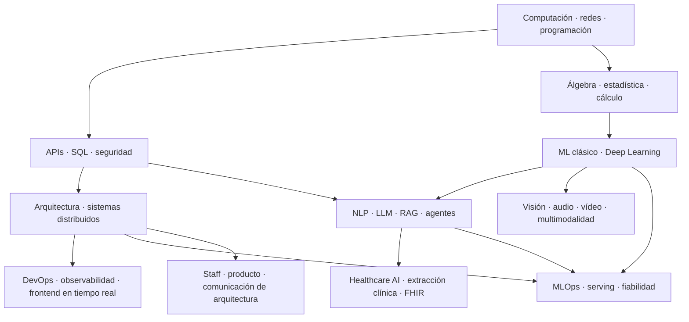

# Plan maestro de artículos de ingeniería y especialización en IA

> **Documento de especificación para agentes redactores y revisores**. Idioma principal: español. El público dispone de formación universitaria en informática; se asume programación, HTTP y SQL elemental, **no** profundidad en transacciones, concurrencia, seguridad, sistemas distribuidos ni ML. El plan general conserva los **175 artículos originales**; a continuación se desarrolla una **ruta editorial abreviada de 10 artículos para PaySafe**, que reutiliza y reordena conceptos del plan general.
>
> **Estado:** backlog editorial y plan de aprendizaje, no contenido publicado ni resultados experimentales. **Nunca presentar ejercicios hipotéticos como benchmarks medidos.**

## 0. Finalidad y criterios de éxito

Crear una base de conocimiento pública que demuestre capacidad para explicar, implementar y defender decisiones técnicas, y que conecte teoría y práctica con un portafolio de 28 proyectos (backend, distribuidos, IA, visión, audio, vídeo, MLOps y clínica).

Un buen artículo debe permitir a otra persona:

1. Entender el problema real que motiva el concepto, sin un tutorial genérico de framework.
2. Explicar su mecanismo interno y **los límites reales de las garantías**.
3. Reproducir un ejemplo mínimo, provocar un error y verificar la corrección.
4. Elegir entre alternativas y defender el coste/beneficio.
5. Aplicar lo aprendido a un proyecto del portafolio.

### 0.1. Qué **no** debe hacer el agente

- No empezar desde «qué es una variable» ni reiterar sintaxis elemental de SQL/TypeScript; recuperar solo el fundamento necesario para el tema.
- No sustituir teoría por snippets superficiales de NestJS, React, LangChain o PyTorch.
- No inventar fuentes, estudios, números de rendimiento, capacidades de proveedores ni resultados de experimentos.
- No afirmar que una técnica garantiza «exactly once» para efectos externos, anonimización perfecta, seguridad total, precisión clínica o ausencia de alucinaciones.
- No exponer datos reales de pacientes, identificadores, secretos ni historias bajo acuerdos restringidos.
- No publicar tablas de parámetros o cifras de rendimiento como universales: registrar versiones, condiciones, dataset y hardware.
- No hacer depender los artículos de servicios de pago cuando exista una alternativa local suficiente para demostrar el concepto.
- No elegir microservicios, Kafka, Kubernetes o agentes autónomos si un diseño sencillo permite explicar mejor el problema.
- No convertir la bibliografía en texto copiado: sintetizar y atribuir hechos relevantes a fuentes primarias.

### 0.2. Tono y pedagogía

- Español técnico claro; presentar término inglés al primer uso y mantenerlo cuando sea el estándar del sector.
- Explicar **por qué**, **cómo**, **cuándo**, **qué falla**, **qué garantiza** y **qué no garantiza**.
- Partir de un escenario concreto que provoque una pregunta, no de una lista de definiciones.
- Introducir matemáticas con intuición geométrica, fórmula, deducción y experimento; no omitir dimensiones ni supuestos.
- Separar evidencia, hipótesis, trade-offs y recomendaciones del autor.
- En temas clínicos, distinguir validez de formato, corrección semántica, desidentificación y viabilidad de uso real.
- En ejemplos de dinero, usar enteros en unidades menores o decimal exacto, definir moneda y evitar floats de precisión binaria para importes.

## 1. Instrucciones operativas para el agente

### 1.1. Entrada para cada encargo

El agente recibe: `post_id`, modalidad (`general` o `paysafe`), idioma, proyecto asociado, stack/versión, entorno local disponible y artículos ya escritos (si hay). Si faltan elementos no bloqueantes, elegir defaults simples documentados. Consultar este fichero como **fuente de alcance** y documentación oficial actualizada como **fuente de hechos**.

### 1.2. Pasos obligatorios de trabajo

1. Leer ficha y dependencias del artículo. Identificar conceptos definidos en entradas previas, sin volver a escribirlas completas.
2. Formular una pregunta guía, tres objetivos verificables y tres errores conceptuales frecuentes.
3. Investigar **fuentes primarias** actualizadas (especificaciones, docs oficiales, papers originales). Anotar versión, fecha de consulta y enlaces en la bibliografía. Comprobar URLs y afirmaciones antes de publicar.
4. Diseñar un escenario reproducible con entradas, precondiciones, resultado esperado y escenario de fallo.
5. Crear **primero** los tests que demuestran el problema; luego el código de solución. Si el tutorial no es de TDD, al menos garantizar un test/benchmark reproducible.
6. Implementar ejemplo con ruta del archivo **antes de cada bloque** y explicar código, operación y decisiones. No ocultar piezas esenciales tras «etcétera».
7. Ejecutar pruebas y benchmarks. Si no puedes ejecutarlos, no presentar salidas inventadas: escribir «resultado esperado; no verificado» y no afirmar que pasó.
8. Escribir el artículo según plantilla; incorporar al menos un diagrama de secuencia, estados, arquitectura, fórmula o gráfica según tema.
9. Añadir alternativas, casos límite, costes, riesgos y una sección explícita de **garantías y no-garantías**.
10. Pasar la revisión técnica, editorial, de seguridad y de reproducibilidad. Marcar estado `draft` hasta completar las verificaciones.

### 1.3. Entregables por artículo

- `content/posts/<slug>.mdx` o `.md`: artículo principal, front matter y enlaces cruzados.
- `examples/<post-id>-<slug>/`: código mínimo ejecutable o notebook, `README.md`, archivos de dependencias, fixtures y tests.
- `assets/<post-id>/`: diagramas Mermaid/SVG, capturas reales y gráficas obtenidas por código reproducible.
- `docs/adr/` si se decide entre arquitecturas; `results.md` para benchmarks (entorno, muestras, método y resultados).
- Glosario actualizado, sin duplicar conceptos de otros artículos.
- Para posts puramente conceptuales donde ejecutar código sería artificial, proveer experimento interactivo o trazas calculadas y documentar la excepción.

### 1.4. Plantilla de artículo (contrato editorial)

```yaml
---
id: "049"
title: "Idempotencia: cómo evitar operaciones duplicadas"
slug: "idempotencia-operaciones-duplicadas"
series: "05-arquitectura-sistemas-distribuidos"
level: "intermedio"
status: "draft"
prerequisites: ["021", "037", "038", "048"]
related: ["050", "052", "053"]
projects: ["PaySafe"]
tags: ["idempotencia", "sistemas-distribuidos", "api"]
last_verified: null
---
```

Orden de secciones del texto:

1. `# Título` y resumen preciso (2–4 líneas).
2. **El problema:** escenario de negocio, condición inicial, qué rompe y por qué importa.
3. **Qué aprenderás:** capacidades comprobables, no objetivos vagos.
4. **Prerrequisitos:** conceptos con enlaces, solo los imprescindibles.
5. **Modelo mental:** explicación intuitiva y vocabulario con definiciones exactas.
6. **Cómo funciona:** secuencia temporal, estado, algoritmo o deducción matemática.
7. **Primera solución ingenua y por qué falla:** mini-lab que produzca el problema.
8. **Diseño correcto paso a paso:** decisiones y código completo en archivos identificados.
9. **Tests y experimentos:** casos normales, límites, concurrencia/fallo; resultado real comprobado o marcado no ejecutado.
10. **Alternativas y trade-offs:** mínimo dos cuando existan alternativas razonables.
11. **Garantías y no-garantías:** en especial ante caídas, concurrencia, seguridad, datos personales y generalización de ML.
12. **Antipatrones y errores frecuentes.**
13. **Aplicación en el proyecto del portafolio:** qué cambio introduce y cómo demostrarlo.
14. **Ejercicio del lector con criterios de aceptación.**
15. **Conclusión:** una idea central y la pregunta que conecta con el siguiente post.
16. **Referencias primarias verificables:** enlace y, si aplica, versión consultada.

### 1.5. Código y estilo de ejemplos

- **Backend:** TypeScript estricto, Node.js, SQL PostgreSQL, Fastify o NestJS según necesidad; Vitest y Testcontainers si corresponde.
- **Frontend:** React/TypeScript; Playwright para escenarios visuales. Accesibilidad básica obligatoria.
- **ML/NLP/audio/visión:** Python tipado, NumPy, scikit-learn, PyTorch, Jupyter solo cuando ayude a explicar experimentos; pytest, datasets versionados y semillas documentadas.
- Indicar **ruta de cada archivo** antes del bloque, por ejemplo `apps/api/src/payments/create-payment.ts`.
- Explicar los argumentos y el funcionamiento de los métodos importantes; no saltar código decisivo con pseudocódigo disfrazado de implementación.
- Mantener ejemplos autocontenidos, tests deterministas cuando sea factible y dependencias fijadas o rangos compatibles.
- No divulgar claves reales; usar `.env.example` y gestores de secretos fuera de la demo.
- Escribir SQL explícito para enseñar aislamiento, constraints o locks. Introducir ORM solo cuando la abstracción no oculte lo explicado.
- Para introducir un error reproducible, aislarlo bajo `examples/broken/`; **nunca** presentarlo como patrón seguro.
- No usar un sistema clínico real en los laboratorios: datos ficticios o datasets cuyo uso y licencia estén permitidos.

### 1.6. Criterios de aceptación del artículo (Definition of Done)

- [ ] Título y pregunta central describen un problema real.
- [ ] Prerrequisitos se enlazan y no se introducen circularidades.
- [ ] Definiciones y ejemplos distinguen correctamente garantías y límites.
- [ ] Código, ejemplos y tests se pueden ejecutar con instrucciones y versiones.
- [ ] Todas las cifras pertenecen a mediciones reales o están marcadas como hipotéticas.
- [ ] El lector puede reproducir el error antes de la corrección cuando proceda.
- [ ] Hay al menos un recurso visual que aclara el mecanismo, no solo decoración.
- [ ] Hay comparación con alternativas/trade-offs razonados.
- [ ] Aporta un incremento verificable al proyecto enlazado, si aplica.
- [ ] El ejercicio final tiene entrada, criterio de éxito y criterios de fallo.
- [ ] Fuentes primarias revisadas y enlaces funcionales.
- [ ] No hay datos sensibles, licencias incumplidas ni afirmaciones regulatorias sin contexto.

### 1.7. Relaciones entre artículos

- `prerequisites` es un grafo acíclico de conceptos, no necesariamente la lista de **todos** los artículos anteriores.
- `related` conecta conceptos próximos, aunque puedan estudiarse después.
- `projects` identifica los laboratorios integradores.
- Cada artículo presenta **una sola pregunta dominante**. Subconceptos inseparables pueden agruparse; conceptos con experimentos propios deben separarse.
- El orden 001–175 es pedagógico global; **el plan corto de PaySafe reordena y agrupa** artículos generalistas como una serie basada en un único proyecto, para una audiencia con carrera de Informática.

## 2. Mapa conceptual general



El diagrama es una simplificación: cada ficha más abajo incluye prerrequisitos concretos para el agente. No aprender todo para empezar a construir: desarrollar ejemplos en paralelo al estudio.

## 3. Catálogo completo de artículos (plan inicial)

**Convención de fichas:** `Objetivo` indica el resultado de aprendizaje; `Temario obligatorio` reúne los asuntos que el texto no puede omitir; `Laboratorio verificable` define el mínimo demostrable; `Prerrequisitos` identifica artículos conceptualmente necesarios. Cada post **también** debe cumplir la plantilla editorial común de la sección 1, incluso cuando aquí se describa sintéticamente.


### Serie 01. Computación, sistemas y redes (posts 001–009)

**Propósito de la serie:** Comprender funcionamiento de hardware, SO, red y navegador sin convertirlo en un curso básico de informática.

**Relación con proyectos:** Base para APIs, rendimiento, streaming y fallos de red.

#### P001. Cómo funciona un ordenador: CPU, memoria y almacenamiento

- **Objetivo:** Comprender dónde se ejecutan las instrucciones y de dónde sale el coste de acceso a datos.
- **Temario obligatorio:** CPU, registros, ciclos de instrucción, cachés L1/L2/L3, RAM, almacenamiento persistente; diferencias de latencia y localidad de referencia.
- **Laboratorio verificable:** Leer y procesar un fichero, comparar acceso a memoria y almacenamiento; documentar límites de la medición.
- **Prerrequisitos conceptuales:** ninguno específico dentro de esta biblioteca; conocimientos universitarios generales.
- **Instrucciones al agente:** abrir con una incidencia o decisión técnica ligada al objetivo; profundizar en el mecanismo, explicar cada elemento del temario con ejemplos; aportar diagrama/fórmula y código con rutas, pruebas, trade-offs y fallos; cerrar con evidencia obtenida en el laboratorio y referencias oficiales.

#### P002. Cómo representan los ordenadores la información

- **Objetivo:** Entender cómo la codificación incorrecta causa errores observables en aplicaciones reales.
- **Temario obligatorio:** Bits y bytes, binario y hexadecimal, enteros con signo, coma flotante IEEE 754, Unicode/UTF-8, representación de fechas, serialización.
- **Laboratorio verificable:** Reproducir error de decimales en cantidades monetarias y un error por codificación de caracteres; presentar correcciones.
- **Prerrequisitos conceptuales:** P001
- **Instrucciones al agente:** abrir con una incidencia o decisión técnica ligada al objetivo; profundizar en el mecanismo, explicar cada elemento del temario con ejemplos; aportar diagrama/fórmula y código con rutas, pruebas, trade-offs y fallos; cerrar con evidencia obtenida en el laboratorio y referencias oficiales.

#### P003. Sistemas operativos: procesos, hilos y memoria

- **Objetivo:** Explicar el aislamiento y las decisiones de ejecución que afectan a servidores y ML.
- **Temario obligatorio:** Kernel y user space, procesos, threads, scheduling, context switches, memoria virtual, stack, heap, system calls.
- **Laboratorio verificable:** Observar consumo de CPU/memoria de procesos y provocar un bloqueo controlado para analizarlo.
- **Prerrequisitos conceptuales:** P001
- **Instrucciones al agente:** abrir con una incidencia o decisión técnica ligada al objetivo; profundizar en el mecanismo, explicar cada elemento del temario con ejemplos; aportar diagrama/fórmula y código con rutas, pruebas, trade-offs y fallos; cerrar con evidencia obtenida en el laboratorio y referencias oficiales.

#### P004. Linux para ingenieros de software

- **Objetivo:** Manejar y diagnosticar una aplicación desplegada sin depender de la IDE.
- **Temario obligatorio:** Jerarquía de archivos, permisos, usuarios, variables de entorno, pipes, redirección, señales, file descriptors, procesos, logs.
- **Laboratorio verificable:** Ejecutar un servicio Linux, identificar el PID, enviar señales, investigar puertos y logs.
- **Prerrequisitos conceptuales:** P003
- **Instrucciones al agente:** abrir con una incidencia o decisión técnica ligada al objetivo; profundizar en el mecanismo, explicar cada elemento del temario con ejemplos; aportar diagrama/fórmula y código con rutas, pruebas, trade-offs y fallos; cerrar con evidencia obtenida en el laboratorio y referencias oficiales.

#### P005. Cómo funciona Internet: IP, routing, NAT y DNS

- **Objetivo:** Dibujar el recorrido de una petición desde un cliente hasta una aplicación remota.
- **Temario obligatorio:** IP, subredes, NAT, rutas, puertos, DNS, resolvers, caching DNS, load balancers y nombres de dominio.
- **Laboratorio verificable:** Usar herramientas de diagnóstico de red y documentar el flujo de resolución y conexión de un servicio propio.
- **Prerrequisitos conceptuales:** ninguno específico dentro de esta biblioteca; conocimientos universitarios generales.
- **Instrucciones al agente:** abrir con una incidencia o decisión técnica ligada al objetivo; profundizar en el mecanismo, explicar cada elemento del temario con ejemplos; aportar diagrama/fórmula y código con rutas, pruebas, trade-offs y fallos; cerrar con evidencia obtenida en el laboratorio y referencias oficiales.

#### P006. TCP, UDP y QUIC: transporte, pérdidas y latencia

- **Objetivo:** Reconocer diferencias entre transporte fiable, datagramas y redes de baja latencia.
- **Temario obligatorio:** Establecimiento de conexión, retransmisión, orden, congestión, control de flujo, pérdida, latencia, TCP/UDP/QUIC.
- **Laboratorio verificable:** Simular latencia y pérdida de paquetes y describir efectos distintos sobre una API y un flujo multimedia.
- **Prerrequisitos conceptuales:** P005
- **Instrucciones al agente:** abrir con una incidencia o decisión técnica ligada al objetivo; profundizar en el mecanismo, explicar cada elemento del temario con ejemplos; aportar diagrama/fórmula y código con rutas, pruebas, trade-offs y fallos; cerrar con evidencia obtenida en el laboratorio y referencias oficiales.

#### P007. HTTPS, TLS y certificados digitales

- **Objetivo:** Comprender qué se protege en una conexión cifrada y qué depende de configuración.
- **Temario obligatorio:** Criptografía simétrica/asimétrica, intercambio de claves, certificados, CA, cadena de confianza, handshake TLS, autenticación del extremo.
- **Laboratorio verificable:** Inspeccionar un certificado y una sesión TLS; verificar fallos causados por un certificado inválido.
- **Prerrequisitos conceptuales:** P006
- **Instrucciones al agente:** abrir con una incidencia o decisión técnica ligada al objetivo; profundizar en el mecanismo, explicar cada elemento del temario con ejemplos; aportar diagrama/fórmula y código con rutas, pruebas, trade-offs y fallos; cerrar con evidencia obtenida en el laboratorio y referencias oficiales.

#### P008. HTTP: semántica, versiones y caché

- **Objetivo:** Razonar sobre contratos de petición/respuesta y optimización de redes.
- **Temario obligatorio:** Métodos, respuestas, cabeceras, HTTP/1.1/2/3, conexiones persistentes, ETag, Cache-Control, peticiones condicionales, caché.
- **Laboratorio verificable:** Construir un servidor HTTP mínimo con ETag y demostrar un 304 frente a un 200.
- **Prerrequisitos conceptuales:** P006, P007
- **Instrucciones al agente:** abrir con una incidencia o decisión técnica ligada al objetivo; profundizar en el mecanismo, explicar cada elemento del temario con ejemplos; aportar diagrama/fórmula y código con rutas, pruebas, trade-offs y fallos; cerrar con evidencia obtenida en el laboratorio y referencias oficiales.

#### P009. Cómo funciona un navegador web por dentro

- **Objetivo:** Explicar fenómenos de seguridad y rendimiento del frontend desde su runtime.
- **Temario obligatorio:** DOM, CSSOM, rendering pipeline, event loop, tareas y microtareas, cookies, storage, Fetch, Same-Origin Policy, CORS.
- **Laboratorio verificable:** Registrar una traza del navegador desde navegación hasta petición autenticada e identificar bloqueos del main thread.
- **Prerrequisitos conceptuales:** P008
- **Instrucciones al agente:** abrir con una incidencia o decisión técnica ligada al objetivo; profundizar en el mecanismo, explicar cada elemento del temario con ejemplos; aportar diagrama/fórmula y código con rutas, pruebas, trade-offs y fallos; cerrar con evidencia obtenida en el laboratorio y referencias oficiales.


### Serie 02. Programación y fundamentos del código (posts 010–019)

**Propósito de la serie:** Refrescar TypeScript y Python con énfasis en ejecución, modularidad, concurrencia y errores.

**Relación con proyectos:** Base de PaySafe, backend, ML y pipelines de datos.

#### P010. Git y control de versiones para desarrollo profesional

- **Objetivo:** Gestionar cambios revisables y reproducibles en equipos de ingeniería.
- **Temario obligatorio:** Repositorios, staging, commits, ramas, merge, rebase, conflictos, tags, PR, reviews y buenas historias de cambios.
- **Laboratorio verificable:** Crear una rama con conflicto, resolverlo, documentar los motivos y presentar una PR pequeña revisable.
- **Prerrequisitos conceptuales:** ninguno específico dentro de esta biblioteca; conocimientos universitarios generales.
- **Instrucciones al agente:** abrir con una incidencia o decisión técnica ligada al objetivo; profundizar en el mecanismo, explicar cada elemento del temario con ejemplos; aportar diagrama/fórmula y código con rutas, pruebas, trade-offs y fallos; cerrar con evidencia obtenida en el laboratorio y referencias oficiales.

#### P011. Algoritmos, estructuras de datos y complejidad

- **Objetivo:** Elegir estructuras a partir de patrones de acceso y medir complejidad.
- **Temario obligatorio:** Notación O grande, arrays, listas, sets, hash maps, heaps, pilas, colas, árboles, grafos, búsqueda y ordenación.
- **Laboratorio verificable:** Comparar experimentalmente búsqueda lineal y hash map con entradas crecientes y explicar límites del benchmark.
- **Prerrequisitos conceptuales:** ninguno específico dentro de esta biblioteca; conocimientos universitarios generales.
- **Instrucciones al agente:** abrir con una incidencia o decisión técnica ligada al objetivo; profundizar en el mecanismo, explicar cada elemento del temario con ejemplos; aportar diagrama/fórmula y código con rutas, pruebas, trade-offs y fallos; cerrar con evidencia obtenida en el laboratorio y referencias oficiales.

#### P012. Paradigmas: imperativo, funcional y orientado a objetos

- **Objetivo:** Diferenciar modelos de estado y composición sin aplicar reglas dogmáticas.
- **Temario obligatorio:** Mutabilidad, inmutabilidad, efectos, funciones puras, closures, objetos, encapsulación, herencia, polimorfismo, composición.
- **Laboratorio verificable:** Implementar una regla de negocio en dos estilos y analizar acoplamiento y testabilidad.
- **Prerrequisitos conceptuales:** ninguno específico dentro de esta biblioteca; conocimientos universitarios generales.
- **Instrucciones al agente:** abrir con una incidencia o decisión técnica ligada al objetivo; profundizar en el mecanismo, explicar cada elemento del temario con ejemplos; aportar diagrama/fórmula y código con rutas, pruebas, trade-offs y fallos; cerrar con evidencia obtenida en el laboratorio y referencias oficiales.

#### P013. JavaScript por dentro

- **Objetivo:** Comprender el comportamiento runtime que origina bugs de rendimiento y referencias.
- **Temario obligatorio:** Coerción, tipos y referencias, prototipos, closures, ámbitos léxicos, ES modules, garbage collector, modelos de memoria.
- **Laboratorio verificable:** Construir una prueba que retenga memoria por una closure y verificar la corrección.
- **Prerrequisitos conceptuales:** P012
- **Instrucciones al agente:** abrir con una incidencia o decisión técnica ligada al objetivo; profundizar en el mecanismo, explicar cada elemento del temario con ejemplos; aportar diagrama/fórmula y código con rutas, pruebas, trade-offs y fallos; cerrar con evidencia obtenida en el laboratorio y referencias oficiales.

#### P014. TypeScript y diseño de tipos seguros

- **Objetivo:** Modelar estados de negocio imposibles de confundir durante el desarrollo.
- **Temario obligatorio:** Inferencia, generics, discriminated unions, narrowing, unknown, never, mapped types, types vs runtime validation.
- **Laboratorio verificable:** Modelar estados de un pago usando uniones discriminadas y validar entrada externa con esquema runtime.
- **Prerrequisitos conceptuales:** P012
- **Instrucciones al agente:** abrir con una incidencia o decisión técnica ligada al objetivo; profundizar en el mecanismo, explicar cada elemento del temario con ejemplos; aportar diagrama/fórmula y código con rutas, pruebas, trade-offs y fallos; cerrar con evidencia obtenida en el laboratorio y referencias oficiales.

#### P015. Asincronía en JavaScript y Node.js

- **Objetivo:** Diferenciar trabajo bloqueante de I/O asíncrono y ejecutar tareas sin degradar una API.
- **Temario obligatorio:** Call stack, event loop, Promise, async/await, microtask queue, libuv, streams, buffers, worker threads.
- **Laboratorio verificable:** Medir efecto de una función CPU-bound sobre las peticiones y llevarla a worker thread.
- **Prerrequisitos conceptuales:** P003, P013
- **Instrucciones al agente:** abrir con una incidencia o decisión técnica ligada al objetivo; profundizar en el mecanismo, explicar cada elemento del temario con ejemplos; aportar diagrama/fórmula y código con rutas, pruebas, trade-offs y fallos; cerrar con evidencia obtenida en el laboratorio y referencias oficiales.

#### P016. Python desde sus fundamentos

- **Objetivo:** Dominar el lenguaje que se utilizará en ML, NLP y Computer Vision.
- **Temario obligatorio:** Tipos y colecciones, funciones, unpacking, comprehensions, exceptions, iteradores, generadores, decoradores y context managers.
- **Laboratorio verificable:** Transformar entradas de datos con generadores, documentar errores y comparar memoria.
- **Prerrequisitos conceptuales:** ninguno específico dentro de esta biblioteca; conocimientos universitarios generales.
- **Instrucciones al agente:** abrir con una incidencia o decisión técnica ligada al objetivo; profundizar en el mecanismo, explicar cada elemento del temario con ejemplos; aportar diagrama/fórmula y código con rutas, pruebas, trade-offs y fallos; cerrar con evidencia obtenida en el laboratorio y referencias oficiales.

#### P017. Python profesional: tipado, paquetes y modularidad

- **Objetivo:** Construir paquetes mantenibles y reproducibles en proyectos científicos.
- **Temario obligatorio:** Type hints, dataclasses, Protocol, módulos, packaging, entornos virtuales, dependencias, lint, formatter, estructura src/tests.
- **Laboratorio verificable:** Publicar localmente una biblioteca tipada con CLI, tests y configuración de herramientas.
- **Prerrequisitos conceptuales:** P016
- **Instrucciones al agente:** abrir con una incidencia o decisión técnica ligada al objetivo; profundizar en el mecanismo, explicar cada elemento del temario con ejemplos; aportar diagrama/fórmula y código con rutas, pruebas, trade-offs y fallos; cerrar con evidencia obtenida en el laboratorio y referencias oficiales.

#### P018. Concurrencia en Python

- **Objetivo:** Elegir procesos, hilos o asyncio según naturaleza del trabajo.
- **Temario obligatorio:** GIL y sus matices, threads, multiprocessing, asyncio, await, task cancellation, CPU-bound/I/O-bound, recursos compartidos.
- **Laboratorio verificable:** Implementar un procesador de archivos con tres estrategias y comparar latencia y uso de CPU.
- **Prerrequisitos conceptuales:** P003, P016
- **Instrucciones al agente:** abrir con una incidencia o decisión técnica ligada al objetivo; profundizar en el mecanismo, explicar cada elemento del temario con ejemplos; aportar diagrama/fórmula y código con rutas, pruebas, trade-offs y fallos; cerrar con evidencia obtenida en el laboratorio y referencias oficiales.

#### P019. Diseño y tratamiento de errores

- **Objetivo:** Conservar contexto de fallos sin ocultar errores ni detener procesos innecesariamente.
- **Temario obligatorio:** Excepciones, errores del dominio, clasificación, Result, validación acumulada, cause chaining, propagación, códigos y límites de recuperación.
- **Laboratorio verificable:** Implementar validación que devuelva varios errores y transformar errores internos a un contrato API seguro.
- **Prerrequisitos conceptuales:** P012, P014
- **Instrucciones al agente:** abrir con una incidencia o decisión técnica ligada al objetivo; profundizar en el mecanismo, explicar cada elemento del temario con ejemplos; aportar diagrama/fórmula y código con rutas, pruebas, trade-offs y fallos; cerrar con evidencia obtenida en el laboratorio y referencias oficiales.


### Serie 03. Diseño de APIs y seguridad web (posts 020–031)

**Propósito de la serie:** Diseñar contratos, identidad, autorización y comunicación segura.

**Relación con proyectos:** PaySafe, TenantShield, SyncBridge, AgentGuard, ClinicStruct.

#### P020. Qué es una API y qué significa diseñar un contrato

- **Objetivo:** Comprender la API como acuerdo entre productores y consumidores independiente del framework.
- **Temario obligatorio:** Interfaz vs implementación, protocolo, esquema, contrato, JSON, serialización, clientes, RPC, resources, compatibilidad.
- **Laboratorio verificable:** Diseñar primero el contrato de pedidos y después implementar una API mínima adherida a él.
- **Prerrequisitos conceptuales:** P008, P014
- **Instrucciones al agente:** abrir con una incidencia o decisión técnica ligada al objetivo; profundizar en el mecanismo, explicar cada elemento del temario con ejemplos; aportar diagrama/fórmula y código con rutas, pruebas, trade-offs y fallos; cerrar con evidencia obtenida en el laboratorio y referencias oficiales.

#### P021. REST y diseño de recursos HTTP

- **Objetivo:** Aplicar semántica HTTP y recursos coherentes al diseño de servicios.
- **Temario obligatorio:** REST, recursos, URI, GET/POST/PUT/PATCH/DELETE, safe/idempotent methods, respuestas, status codes, HTTP JSON vs REST.
- **Laboratorio verificable:** Diseñar operaciones sobre pedidos y pagos y justificar métodos/códigos por caso.
- **Prerrequisitos conceptuales:** P008, P020
- **Instrucciones al agente:** abrir con una incidencia o decisión técnica ligada al objetivo; profundizar en el mecanismo, explicar cada elemento del temario con ejemplos; aportar diagrama/fórmula y código con rutas, pruebas, trade-offs y fallos; cerrar con evidencia obtenida en el laboratorio y referencias oficiales.

#### P022. Validación de datos y contratos de entrada/salida

- **Objetivo:** Separar sintaxis, validación semántica y reglas de negocio.
- **Temario obligatorio:** JSON Schema, OpenAPI schema, Zod, Pydantic, validación runtime, campos opcionales, refinement, errores acumulados, compatibilidad.
- **Laboratorio verificable:** Rechazar una solicitud malformada y devolver errores por campo sin divulgar detalles internos.
- **Prerrequisitos conceptuales:** P014, P021
- **Instrucciones al agente:** abrir con una incidencia o decisión técnica ligada al objetivo; profundizar en el mecanismo, explicar cada elemento del temario con ejemplos; aportar diagrama/fórmula y código con rutas, pruebas, trade-offs y fallos; cerrar con evidencia obtenida en el laboratorio y referencias oficiales.

#### P023. Cómo diseñar los errores de una API

- **Objetivo:** Publicar errores previsibles y seguros sin confundir fallos operativos con reglas de negocio.
- **Temario obligatorio:** Errores de dominio, infraestructura, validación, RFC 9457 Problem Details, códigos estables, traza, logging y seguridad.
- **Laboratorio verificable:** Transformar errores de stock y concurrencia en respuestas HTTP distinguibles con tests.
- **Prerrequisitos conceptuales:** P021, P022
- **Instrucciones al agente:** abrir con una incidencia o decisión técnica ligada al objetivo; profundizar en el mecanismo, explicar cada elemento del temario con ejemplos; aportar diagrama/fórmula y código con rutas, pruebas, trade-offs y fallos; cerrar con evidencia obtenida en el laboratorio y referencias oficiales.

#### P024. Paginación, filtrado, ordenación y búsqueda

- **Objetivo:** Diseñar APIs que mantengan resultados consistentes a medida que crecen los datos.
- **Temario obligatorio:** Offset, cursor, keyset, orden estable, paginación bajo escrituras, filtros, búsqueda e índices.
- **Laboratorio verificable:** Comparar OFFSET y keyset en un millón de registros con inserciones concurrentes.
- **Prerrequisitos conceptuales:** P021
- **Instrucciones al agente:** abrir con una incidencia o decisión técnica ligada al objetivo; profundizar en el mecanismo, explicar cada elemento del temario con ejemplos; aportar diagrama/fórmula y código con rutas, pruebas, trade-offs y fallos; cerrar con evidencia obtenida en el laboratorio y referencias oficiales.

#### P025. Versionado y evolución de APIs

- **Objetivo:** Mantener compatibilidad sin bloquear la evolución del producto.
- **Temario obligatorio:** Cambios aditivos/breaking, semver en SDK, versiones URL/cabeceras, deprecación, OpenAPI, contract testing, consumers.
- **Laboratorio verificable:** Hacer evolucionar una API con dos clientes en diferentes versiones y tests de compatibilidad.
- **Prerrequisitos conceptuales:** P020, P021, P022
- **Instrucciones al agente:** abrir con una incidencia o decisión técnica ligada al objetivo; profundizar en el mecanismo, explicar cada elemento del temario con ejemplos; aportar diagrama/fórmula y código con rutas, pruebas, trade-offs y fallos; cerrar con evidencia obtenida en el laboratorio y referencias oficiales.

#### P026. Autenticación: sesiones, cookies y tokens

- **Objetivo:** Entender cómo establecer y mantener identidad en aplicaciones web reales.
- **Temario obligatorio:** Sesión stateful, token opaco, JWT, access/refresh tokens, rotación, revocación, HttpOnly, SameSite, MFA, replay.
- **Laboratorio verificable:** Implementar sesiones con rotación de refresh tokens y prueba de token reutilizado.
- **Prerrequisitos conceptuales:** P008, P009, P020
- **Instrucciones al agente:** abrir con una incidencia o decisión técnica ligada al objetivo; profundizar en el mecanismo, explicar cada elemento del temario con ejemplos; aportar diagrama/fórmula y código con rutas, pruebas, trade-offs y fallos; cerrar con evidencia obtenida en el laboratorio y referencias oficiales.

#### P027. OAuth 2.0 y OpenID Connect explicados

- **Objetivo:** Diferenciar autorización delegada de autenticación federada.
- **Temario obligatorio:** Client, resource owner, auth/resource servers, scopes, Authorization Code + PKCE, OIDC claims, machine-to-machine, trust boundaries.
- **Laboratorio verificable:** Integrar un proveedor OIDC de test y validar audiencia, firma, issuer y expiración.
- **Prerrequisitos conceptuales:** P026
- **Instrucciones al agente:** abrir con una incidencia o decisión técnica ligada al objetivo; profundizar en el mecanismo, explicar cada elemento del temario con ejemplos; aportar diagrama/fórmula y código con rutas, pruebas, trade-offs y fallos; cerrar con evidencia obtenida en el laboratorio y referencias oficiales.

#### P028. Autorización: RBAC, ABAC y permisos sobre recursos

- **Objetivo:** Defender recursos empresariales contra accesos cruzados.
- **Temario obligatorio:** Identidad/privilegio, RBAC, ABAC, ownership, autorización por objeto, least privilege, tenant context, BOLA.
- **Laboratorio verificable:** Intentar leer/modificar documentos de otro tenant y hacer pasar tests adversariales.
- **Prerrequisitos conceptuales:** P026, P027
- **Instrucciones al agente:** abrir con una incidencia o decisión técnica ligada al objetivo; profundizar en el mecanismo, explicar cada elemento del temario con ejemplos; aportar diagrama/fórmula y código con rutas, pruebas, trade-offs y fallos; cerrar con evidencia obtenida en el laboratorio y referencias oficiales.

#### P029. Seguridad del navegador y frontend

- **Objetivo:** Evitar vulnerabilidades que nacen de la interacción entre navegador y servidor.
- **Temario obligatorio:** XSS, CSRF, CSP, cookies, SameSite, SOP, CORS vs autorización, storage y terceros.
- **Laboratorio verificable:** Reproducir XSS/CSRF en sandbox y corregir las configuraciones con tests.
- **Prerrequisitos conceptuales:** P009, P026
- **Instrucciones al agente:** abrir con una incidencia o decisión técnica ligada al objetivo; profundizar en el mecanismo, explicar cada elemento del temario con ejemplos; aportar diagrama/fórmula y código con rutas, pruebas, trade-offs y fallos; cerrar con evidencia obtenida en el laboratorio y referencias oficiales.

#### P030. Seguridad avanzada de APIs

- **Objetivo:** Integrar modelado de amenazas y controles ante entradas y consumidores hostiles.
- **Temario obligatorio:** SQL injection, SSRF, mass assignment, abuso de recursos, broken auth, rate limiting, secretos, OWASP API Top 10.
- **Laboratorio verificable:** Crear un threat model y tests de abuso para API multi-tenant.
- **Prerrequisitos conceptuales:** P022, P026, P028, P029
- **Instrucciones al agente:** abrir con una incidencia o decisión técnica ligada al objetivo; profundizar en el mecanismo, explicar cada elemento del temario con ejemplos; aportar diagrama/fórmula y código con rutas, pruebas, trade-offs y fallos; cerrar con evidencia obtenida en el laboratorio y referencias oficiales.

#### P031. REST, GraphQL, gRPC, Webhooks y APIs por eventos

- **Objetivo:** Elegir el patrón de integración adecuado según sincronía y acoplamiento.
- **Temario obligatorio:** Request/response, schemas, RPC, subscriptions, callbacks, GraphQL N+1, versionado, latencia, autenticación, seguridad.
- **Laboratorio verificable:** Resolver la misma integración de estado de pedido mediante polling y eventos; documentar trade-offs.
- **Prerrequisitos conceptuales:** P020, P021
- **Instrucciones al agente:** abrir con una incidencia o decisión técnica ligada al objetivo; profundizar en el mecanismo, explicar cada elemento del temario con ejemplos; aportar diagrama/fórmula y código con rutas, pruebas, trade-offs y fallos; cerrar con evidencia obtenida en el laboratorio y referencias oficiales.


### Serie 04. Bases de datos y persistencia (posts 032–041)

**Propósito de la serie:** Entender garantías reales de SQL, transacciones, índices y cambios de esquema.

**Relación con proyectos:** QueryDoctor, PaySafe, TenantShield, MLFactory.

#### P032. Bases de datos relacionales y modelado

- **Objetivo:** Diseñar relaciones e integridad de datos antes de escribir queries.
- **Temario obligatorio:** Entidades, tablas, columnas, PK/FK, constraints, normalización preliminar, diagrama entidad-relación, cardinalidad.
- **Laboratorio verificable:** Modelar pedidos/pagos/clientes con claves y relaciones verificables.
- **Prerrequisitos conceptuales:** ninguno específico dentro de esta biblioteca; conocimientos universitarios generales.
- **Instrucciones al agente:** abrir con una incidencia o decisión técnica ligada al objetivo; profundizar en el mecanismo, explicar cada elemento del temario con ejemplos; aportar diagrama/fórmula y código con rutas, pruebas, trade-offs y fallos; cerrar con evidencia obtenida en el laboratorio y referencias oficiales.

#### P033. SQL básico y avanzado para análisis y backend

- **Objetivo:** Escribir consultas correctas y analizar sus resultados.
- **Temario obligatorio:** JOIN, GROUP BY, HAVING, CTE, subconsultas, EXISTS, NULL, funciones ventana, agregación.
- **Laboratorio verificable:** Construir consultas de facturación, ranking y cohortes desde un dataset de ejemplo.
- **Prerrequisitos conceptuales:** P032
- **Instrucciones al agente:** abrir con una incidencia o decisión técnica ligada al objetivo; profundizar en el mecanismo, explicar cada elemento del temario con ejemplos; aportar diagrama/fórmula y código con rutas, pruebas, trade-offs y fallos; cerrar con evidencia obtenida en el laboratorio y referencias oficiales.

#### P034. Normalización y desnormalización de datos

- **Objetivo:** Evaluar consistencia frente a coste de acceso.
- **Temario obligatorio:** Dependencias funcionales, 1NF/2NF/3NF, duplicación, datos derivados, trade-offs de lectura/escritura.
- **Laboratorio verificable:** Normalizar un esquema problemático y medir una desnormalización deliberada.
- **Prerrequisitos conceptuales:** P032, P033
- **Instrucciones al agente:** abrir con una incidencia o decisión técnica ligada al objetivo; profundizar en el mecanismo, explicar cada elemento del temario con ejemplos; aportar diagrama/fórmula y código con rutas, pruebas, trade-offs y fallos; cerrar con evidencia obtenida en el laboratorio y referencias oficiales.

#### P035. Índices y estructuras internas de PostgreSQL

- **Objetivo:** Elegir índices según query plan y distribución de datos.
- **Temario obligatorio:** B-tree, Hash, GIN/GiST, índices compuestos, parciales, cover, cardinalidad, selectividad, overhead.
- **Laboratorio verificable:** Comparar consultas con índices adecuados e inadecuados y medir write amplification.
- **Prerrequisitos conceptuales:** P032, P033
- **Instrucciones al agente:** abrir con una incidencia o decisión técnica ligada al objetivo; profundizar en el mecanismo, explicar cada elemento del temario con ejemplos; aportar diagrama/fórmula y código con rutas, pruebas, trade-offs y fallos; cerrar con evidencia obtenida en el laboratorio y referencias oficiales.

#### P036. Cómo ejecuta PostgreSQL una consulta

- **Objetivo:** Leer planes y diagnosticar cuellos de botella reales.
- **Temario obligatorio:** Optimizer, statistics, cost estimates, seq/index scans, nested/hash joins, EXPLAIN ANALYZE BUFFERS, N+1.
- **Laboratorio verificable:** Identificar una consulta lenta en un dataset sintético y explicar mejora medida.
- **Prerrequisitos conceptuales:** P033, P035
- **Instrucciones al agente:** abrir con una incidencia o decisión técnica ligada al objetivo; profundizar en el mecanismo, explicar cada elemento del temario con ejemplos; aportar diagrama/fórmula y código con rutas, pruebas, trade-offs y fallos; cerrar con evidencia obtenida en el laboratorio y referencias oficiales.

#### P037. Transacciones, ACID y niveles de aislamiento

- **Objetivo:** Comprender garantías transaccionales y sus limitaciones.
- **Temario obligatorio:** Atomicidad, consistencia, aislamiento, durabilidad, MVCC, Read Committed, Repeatable Read, Serializable, anomalías.
- **Laboratorio verificable:** Ejecutar operaciones intercaladas, provocar rollback y comprobar diferencias entre niveles de aislamiento.
- **Prerrequisitos conceptuales:** P032, P033
- **Instrucciones al agente:** abrir con una incidencia o decisión técnica ligada al objetivo; profundizar en el mecanismo, explicar cada elemento del temario con ejemplos; aportar diagrama/fórmula y código con rutas, pruebas, trade-offs y fallos; cerrar con evidencia obtenida en el laboratorio y referencias oficiales.

#### P038. Concurrencia y bloqueos en bases de datos

- **Objetivo:** Proteger invariantes bajo acceso simultáneo.
- **Temario obligatorio:** Locks, deadlocks, lost updates, optimistic/pessimistic control, version columns, UNIQUE, UPSERT, retry.
- **Laboratorio verificable:** Impedir reserva doble con peticiones concurrentes y verificar invariantes con tests.
- **Prerrequisitos conceptuales:** P037
- **Instrucciones al agente:** abrir con una incidencia o decisión técnica ligada al objetivo; profundizar en el mecanismo, explicar cada elemento del temario con ejemplos; aportar diagrama/fórmula y código con rutas, pruebas, trade-offs y fallos; cerrar con evidencia obtenida en el laboratorio y referencias oficiales.

#### P039. Redis y patrones de caché

- **Objetivo:** Mejorar lecturas sin introducir inconsistencias silenciosas.
- **Temario obligatorio:** Cache-aside, read-through/write-through/write-behind, TTL, invalidación, stampede, hot keys, coherencia.
- **Laboratorio verificable:** Cachear una API, introducir escritura concurrente y demostrar stale reads.
- **Prerrequisitos conceptuales:** P032, P037
- **Instrucciones al agente:** abrir con una incidencia o decisión técnica ligada al objetivo; profundizar en el mecanismo, explicar cada elemento del temario con ejemplos; aportar diagrama/fórmula y código con rutas, pruebas, trade-offs y fallos; cerrar con evidencia obtenida en el laboratorio y referencias oficiales.

#### P040. SQL, NoSQL y motores especializados

- **Objetivo:** Seleccionar almacenamiento desde requisitos en vez de modas.
- **Temario obligatorio:** Relacionales, documentos, key-value, wide-column, search, time-series, vector stores, consistencia, particiones, coste.
- **Laboratorio verificable:** Comparar PostgreSQL, MongoDB, DynamoDB y Redis sobre casos de acceso.
- **Prerrequisitos conceptuales:** P032
- **Instrucciones al agente:** abrir con una incidencia o decisión técnica ligada al objetivo; profundizar en el mecanismo, explicar cada elemento del temario con ejemplos; aportar diagrama/fórmula y código con rutas, pruebas, trade-offs y fallos; cerrar con evidencia obtenida en el laboratorio y referencias oficiales.

#### P041. Migraciones, particionado y evolución del dato

- **Objetivo:** Actualizar esquemas sin detener servicios existentes.
- **Temario obligatorio:** Versionado DB, expand-migrate-contract, particionado, retención, archivos, OLTP/OLAP, rollback limits.
- **Laboratorio verificable:** Introducir un campo obligatorio con versiones de app coexistentes.
- **Prerrequisitos conceptuales:** P032, P037
- **Instrucciones al agente:** abrir con una incidencia o decisión técnica ligada al objetivo; profundizar en el mecanismo, explicar cada elemento del temario con ejemplos; aportar diagrama/fórmula y código con rutas, pruebas, trade-offs y fallos; cerrar con evidencia obtenida en el laboratorio y referencias oficiales.


### Serie 05. Arquitectura y sistemas distribuidos (posts 042–054)

**Propósito de la serie:** Diseñar sistemas con fallos parciales, reintentos y decisiones arquitectónicas explícitas.

**Relación con proyectos:** PaySafe, DurableFlow, StreamLab, SyncBridge.

#### P042. System Design: requisitos y estimación de capacidad

- **Objetivo:** Transformar necesidades del negocio en restricciones medibles.
- **Temario obligatorio:** Requisitos funcionales/no funcionales, invariantes, SLO, latency, throughput, RPS, capacity planning, HLD/LLD.
- **Laboratorio verificable:** Escribir requisitos y estimaciones para una API de pagos con carga hipotética declarada.
- **Prerrequisitos conceptuales:** P008, P020, P032
- **Instrucciones al agente:** abrir con una incidencia o decisión técnica ligada al objetivo; profundizar en el mecanismo, explicar cada elemento del temario con ejemplos; aportar diagrama/fórmula y código con rutas, pruebas, trade-offs y fallos; cerrar con evidencia obtenida en el laboratorio y referencias oficiales.

#### P043. Principios de diseño: cohesión, acoplamiento y SOLID

- **Objetivo:** Producir software evolutivo sin sobreabstracción.
- **Temario obligatorio:** Cohesión, coupling, SRP/OCP/LSP/ISP/DIP, KISS, YAGNI, DRY, composición, dependencia.
- **Laboratorio verificable:** Refactorizar un servicio con dependencias cruzadas y justificar cambios.
- **Prerrequisitos conceptuales:** P012, P014
- **Instrucciones al agente:** abrir con una incidencia o decisión técnica ligada al objetivo; profundizar en el mecanismo, explicar cada elemento del temario con ejemplos; aportar diagrama/fórmula y código con rutas, pruebas, trade-offs y fallos; cerrar con evidencia obtenida en el laboratorio y referencias oficiales.

#### P044. Domain-Driven Design: dominio y límites

- **Objetivo:** Modelar reglas y vocabulario de negocio antes de definir servicios.
- **Temario obligatorio:** Ubiquitous Language, entidades, value objects, agregados, invariantes, repositorios, servicios, domain events, bounded contexts.
- **Laboratorio verificable:** Diseñar pagos, pedidos y devoluciones con casos de uso y pruebas de invariantes.
- **Prerrequisitos conceptuales:** P043
- **Instrucciones al agente:** abrir con una incidencia o decisión técnica ligada al objetivo; profundizar en el mecanismo, explicar cada elemento del temario con ejemplos; aportar diagrama/fórmula y código con rutas, pruebas, trade-offs y fallos; cerrar con evidencia obtenida en el laboratorio y referencias oficiales.

#### P045. Arquitectura hexagonal y Clean Architecture

- **Objetivo:** Desacoplar decisiones de negocio de frameworks e infraestructuras.
- **Temario obligatorio:** Puertos, adaptadores, casos de uso, dirección de dependencias, DI, arquitectura por capas vs hexagonal.
- **Laboratorio verificable:** Sustituir proveedor Stripe sandbox por fake sin cambiar dominio.
- **Prerrequisitos conceptuales:** P044
- **Instrucciones al agente:** abrir con una incidencia o decisión técnica ligada al objetivo; profundizar en el mecanismo, explicar cada elemento del temario con ejemplos; aportar diagrama/fórmula y código con rutas, pruebas, trade-offs y fallos; cerrar con evidencia obtenida en el laboratorio y referencias oficiales.

#### P046. Arquitectura en capas, monolito modular y microservicios

- **Objetivo:** Seleccionar fronteras y despliegues acordes a complejidad y equipo.
- **Temario obligatorio:** Modules, independent deployment, data ownership, ACID vs eventual consistency, CQRS, microservices cost, modular monolith.
- **Laboratorio verificable:** Dividir conceptual y justificadamente un sistema pequeño sin implementar microservicios innecesarios.
- **Prerrequisitos conceptuales:** P042, P044, P045
- **Instrucciones al agente:** abrir con una incidencia o decisión técnica ligada al objetivo; profundizar en el mecanismo, explicar cada elemento del temario con ejemplos; aportar diagrama/fórmula y código con rutas, pruebas, trade-offs y fallos; cerrar con evidencia obtenida en el laboratorio y referencias oficiales.

#### P047. C4, ADR y documentación de decisiones

- **Objetivo:** Comunicar arquitectura revisable y supuestos verificables.
- **Temario obligatorio:** C4 context/container/component, sequence diagrams, ADR, RFC, constraints, alternatives, risks and consequences.
- **Laboratorio verificable:** Documentar decisión PostgreSQL vs DynamoDB con ADR y diagramas.
- **Prerrequisitos conceptuales:** P042, P045
- **Instrucciones al agente:** abrir con una incidencia o decisión técnica ligada al objetivo; profundizar en el mecanismo, explicar cada elemento del temario con ejemplos; aportar diagrama/fórmula y código con rutas, pruebas, trade-offs y fallos; cerrar con evidencia obtenida en el laboratorio y referencias oficiales.

#### P048. Fundamentos de sistemas distribuidos

- **Objetivo:** Reconocer fallos parciales, relojes y límites de garantías entre nodos.
- **Temario obligatorio:** Fallo de red, timeout, latencia, particiones, consistencia, replicación, quorum, consenso, shard, CAP/PACELC con matices.
- **Laboratorio verificable:** Simular dos réplicas con mensajes retardados y registrar estados divergentes.
- **Prerrequisitos conceptuales:** P005, P006, P037
- **Instrucciones al agente:** abrir con una incidencia o decisión técnica ligada al objetivo; profundizar en el mecanismo, explicar cada elemento del temario con ejemplos; aportar diagrama/fórmula y código con rutas, pruebas, trade-offs y fallos; cerrar con evidencia obtenida en el laboratorio y referencias oficiales.

#### P049. Idempotencia y garantías de entrega

- **Objetivo:** Evitar múltiples efectos ante retries y entregas repetidas.
- **Temario obligatorio:** Idempotencia de API/negocio, keys, at-most-once/at-least-once, límites de exactly-once, dedup, concurrent requests.
- **Laboratorio verificable:** Enviar 100 solicitudes de pago con misma key e inspeccionar único efecto externo.
- **Prerrequisitos conceptuales:** P021, P037, P038, P048
- **Instrucciones al agente:** abrir con una incidencia o decisión técnica ligada al objetivo; profundizar en el mecanismo, explicar cada elemento del temario con ejemplos; aportar diagrama/fórmula y código con rutas, pruebas, trade-offs y fallos; cerrar con evidencia obtenida en el laboratorio y referencias oficiales.

#### P050. Colas y procesamiento asíncrono

- **Objetivo:** Diseñar tareas que toleran fallos y saturación.
- **Temario obligatorio:** Producers/consumers, brokers, ACK, visibility, exponential backoff, DLQ, Redis/BullMQ/SQS, scheduling.
- **Laboratorio verificable:** Crear worker recuperable y matarlo durante procesamiento.
- **Prerrequisitos conceptuales:** P015, P048, P049
- **Instrucciones al agente:** abrir con una incidencia o decisión técnica ligada al objetivo; profundizar en el mecanismo, explicar cada elemento del temario con ejemplos; aportar diagrama/fórmula y código con rutas, pruebas, trade-offs y fallos; cerrar con evidencia obtenida en el laboratorio y referencias oficiales.

#### P051. Event Streaming con Kafka

- **Objetivo:** Entender cuándo un log de eventos reejecutable supera a una cola.
- **Temario obligatorio:** Topics, partitions, offsets, consumer groups, retention, replay, ordering by key, lag, backpressure.
- **Laboratorio verificable:** Reconstruir estado de envíos a partir de un stream sintético.
- **Prerrequisitos conceptuales:** P048, P050
- **Instrucciones al agente:** abrir con una incidencia o decisión técnica ligada al objetivo; profundizar en el mecanismo, explicar cada elemento del temario con ejemplos; aportar diagrama/fórmula y código con rutas, pruebas, trade-offs y fallos; cerrar con evidencia obtenida en el laboratorio y referencias oficiales.

#### P052. Consistencia eventual, Outbox, Inbox y eventos

- **Objetivo:** Resolver dual writes y proyecciones distribuidas con garantías explícitas.
- **Temario obligatorio:** Transactional Outbox, CDC, idempotent consumer, Inbox, domain vs integration events, event sourcing, read models.
- **Laboratorio verificable:** Guardar cambio+evento en misma transacción y reintentar publicación ante crash.
- **Prerrequisitos conceptuales:** P037, P049, P050
- **Instrucciones al agente:** abrir con una incidencia o decisión técnica ligada al objetivo; profundizar en el mecanismo, explicar cada elemento del temario con ejemplos; aportar diagrama/fórmula y código con rutas, pruebas, trade-offs y fallos; cerrar con evidencia obtenida en el laboratorio y referencias oficiales.

#### P053. Sagas, máquinas de estados y ejecución duradera

- **Objetivo:** Coordinar procesos de múltiples pasos con recuperación y compensaciones.
- **Temario obligatorio:** State machines, choreography vs orchestration, saga, compensation, Temporal, retries, deterministic replay.
- **Laboratorio verificable:** Implementar compra con reserva, cobro, factura y caída intermedia.
- **Prerrequisitos conceptuales:** P044, P048, P049, P050, P052
- **Instrucciones al agente:** abrir con una incidencia o decisión técnica ligada al objetivo; profundizar en el mecanismo, explicar cada elemento del temario con ejemplos; aportar diagrama/fórmula y código con rutas, pruebas, trade-offs y fallos; cerrar con evidencia obtenida en el laboratorio y referencias oficiales.

#### P054. Resiliencia: timeouts, breakers, bulkheads y backpressure

- **Objetivo:** Contener fallos y evitar cascadas.
- **Temario obligatorio:** Retry budgets, timeout, circuit breaker, bulkhead, throttling, load shedding, leases, distributed locks y reconciliation.
- **Laboratorio verificable:** Inyectar caída de proveedor y verificar degradación controlada.
- **Prerrequisitos conceptuales:** P048, P049, P050
- **Instrucciones al agente:** abrir con una incidencia o decisión técnica ligada al objetivo; profundizar en el mecanismo, explicar cada elemento del temario con ejemplos; aportar diagrama/fórmula y código con rutas, pruebas, trade-offs y fallos; cerrar con evidencia obtenida en el laboratorio y referencias oficiales.


### Serie 06. Calidad, cloud, DevOps y observabilidad (posts 055–066)

**Propósito de la serie:** Medir, probar, desplegar y recuperar software con evidencia.

**Relación con proyectos:** TraceOps, ReleaseGuard, MLFactory.

#### P055. Estrategias de pruebas de software

- **Objetivo:** Determinar qué verificar y en qué capa para reducir regresiones.
- **Temario obligatorio:** Unit/integration/E2E, testing pyramid, TDD, doubles, coverage, test design, invariants.
- **Laboratorio verificable:** Desarrollar state machine con tests antes del código.
- **Prerrequisitos conceptuales:** P014, P019
- **Instrucciones al agente:** abrir con una incidencia o decisión técnica ligada al objetivo; profundizar en el mecanismo, explicar cada elemento del temario con ejemplos; aportar diagrama/fórmula y código con rutas, pruebas, trade-offs y fallos; cerrar con evidencia obtenida en el laboratorio y referencias oficiales.

#### P056. Integración y pruebas de contrato

- **Objetivo:** Validar comportamiento con dependencias reales y contratos estables.
- **Temario obligatorio:** Testcontainers, fixtures, factories, API contract tests, mocks, deterministic tests, consumer-driven contracts.
- **Laboratorio verificable:** Evolucionar esquema de API con tests de clientes y PostgreSQL real.
- **Prerrequisitos conceptuales:** P022, P055
- **Instrucciones al agente:** abrir con una incidencia o decisión técnica ligada al objetivo; profundizar en el mecanismo, explicar cada elemento del temario con ejemplos; aportar diagrama/fórmula y código con rutas, pruebas, trade-offs y fallos; cerrar con evidencia obtenida en el laboratorio y referencias oficiales.

#### P057. Property-based testing, fuzzing y fault injection

- **Objetivo:** Encontrar estados que los casos escritos a mano omiten.
- **Temario obligatorio:** Properties, invariants, generators, shrinking, mutation testing, races, failure injection, replay.
- **Laboratorio verificable:** Generar secuencias de pagos hasta revelar bug y codificar test de regresión.
- **Prerrequisitos conceptuales:** P038, P055
- **Instrucciones al agente:** abrir con una incidencia o decisión técnica ligada al objetivo; profundizar en el mecanismo, explicar cada elemento del temario con ejemplos; aportar diagrama/fórmula y código con rutas, pruebas, trade-offs y fallos; cerrar con evidencia obtenida en el laboratorio y referencias oficiales.

#### P058. Benchmarking, carga y profiling

- **Objetivo:** Interpretar latencias y cuellos de botella sin falsear benchmarks.
- **Temario obligatorio:** p50/p95/p99, throughput, saturation, warm-up, k6, stress/soak, memory/CPU profiling, reproducibility.
- **Laboratorio verificable:** Medir punto de saturación de servicio y contrastar profiler con métricas.
- **Prerrequisitos conceptuales:** P011, P055
- **Instrucciones al agente:** abrir con una incidencia o decisión técnica ligada al objetivo; profundizar en el mecanismo, explicar cada elemento del temario con ejemplos; aportar diagrama/fórmula y código con rutas, pruebas, trade-offs y fallos; cerrar con evidencia obtenida en el laboratorio y referencias oficiales.

#### P059. Observabilidad: logs, métricas y trazas

- **Objetivo:** Encontrar causas de incidentes correlacionando señales.
- **Temario obligatorio:** Structured logs, metrics, traces, spans, propagation, OpenTelemetry, exemplars, request IDs.
- **Laboratorio verificable:** Trazar una petición desde React hasta un worker asíncrono.
- **Prerrequisitos conceptuales:** P015, P031, P050
- **Instrucciones al agente:** abrir con una incidencia o decisión técnica ligada al objetivo; profundizar en el mecanismo, explicar cada elemento del temario con ejemplos; aportar diagrama/fórmula y código con rutas, pruebas, trade-offs y fallos; cerrar con evidencia obtenida en el laboratorio y referencias oficiales.

#### P060. SLI, SLO y error budgets

- **Objetivo:** Definir fiabilidad en términos medibles.
- **Temario obligatorio:** Availability, latency, error rates, SLI/SLO/SLA, error budget, burn rate, actionable alerts.
- **Laboratorio verificable:** Escribir SLO para endpoint y simular consumo del presupuesto.
- **Prerrequisitos conceptuales:** P058, P059
- **Instrucciones al agente:** abrir con una incidencia o decisión técnica ligada al objetivo; profundizar en el mecanismo, explicar cada elemento del temario con ejemplos; aportar diagrama/fórmula y código con rutas, pruebas, trade-offs y fallos; cerrar con evidencia obtenida en el laboratorio y referencias oficiales.

#### P061. Incidentes, runbooks y postmortems

- **Objetivo:** Investigar y restaurar sistemas con prácticas operativas reproducibles.
- **Temario obligatorio:** Triage, symptom vs root cause, on-call, runbooks, mitigation, postmortem, action items, blameless analysis.
- **Laboratorio verificable:** Diagnosticar fallo simulado y redactar informe con cronología y corrección.
- **Prerrequisitos conceptuales:** P059, P060
- **Instrucciones al agente:** abrir con una incidencia o decisión técnica ligada al objetivo; profundizar en el mecanismo, explicar cada elemento del temario con ejemplos; aportar diagrama/fórmula y código con rutas, pruebas, trade-offs y fallos; cerrar con evidencia obtenida en el laboratorio y referencias oficiales.

#### P062. Docker y entornos reproducibles

- **Objetivo:** Ejecutar servicios en aislamiento con dependencias declaradas.
- **Temario obligatorio:** Layers, Dockerfile, images, containers, network, volumes, Compose, multi-stage, image security.
- **Laboratorio verificable:** Levantar API, Redis y PostgreSQL mediante docker compose y reproducir setup limpio.
- **Prerrequisitos conceptuales:** P004, P005
- **Instrucciones al agente:** abrir con una incidencia o decisión técnica ligada al objetivo; profundizar en el mecanismo, explicar cada elemento del temario con ejemplos; aportar diagrama/fórmula y código con rutas, pruebas, trade-offs y fallos; cerrar con evidencia obtenida en el laboratorio y referencias oficiales.

#### P063. CI/CD, despliegues progresivos y rollback

- **Objetivo:** Separar integración, despliegue y liberación con salvaguardas.
- **Temario obligatorio:** Build/test/security pipeline, artifact immutability, rolling/blue-green/canary, feature flags, smoke tests, revert.
- **Laboratorio verificable:** Desplegar regresión controlada y revertir sin corromper esquema de datos.
- **Prerrequisitos conceptuales:** P055, P062
- **Instrucciones al agente:** abrir con una incidencia o decisión técnica ligada al objetivo; profundizar en el mecanismo, explicar cada elemento del temario con ejemplos; aportar diagrama/fórmula y código con rutas, pruebas, trade-offs y fallos; cerrar con evidencia obtenida en el laboratorio y referencias oficiales.

#### P064. Cloud Computing con AWS

- **Objetivo:** Elegir recursos cloud por rendimiento, escala, coste y responsabilidad.
- **Temario obligatorio:** IaaS/PaaS/serverless, VPC, IAM, EC2, Lambda, ECS, S3, SQS, managed DB, cost models.
- **Laboratorio verificable:** Comparar diseños de API en Lambda y ECS justificando el coste operacional.
- **Prerrequisitos conceptuales:** P005, P062
- **Instrucciones al agente:** abrir con una incidencia o decisión técnica ligada al objetivo; profundizar en el mecanismo, explicar cada elemento del temario con ejemplos; aportar diagrama/fórmula y código con rutas, pruebas, trade-offs y fallos; cerrar con evidencia obtenida en el laboratorio y referencias oficiales.

#### P065. Terraform y Kubernetes

- **Objetivo:** Comprender infraestructura declarativa y orquestación sin sobreingeniería.
- **Temario obligatorio:** Terraform plan/state/providers/modules/drift; pods/deployments/services/ingress/probes/secrets, autoscaling.
- **Laboratorio verificable:** Describir infra reproducible y desplegar servicio mínimo local o cloud.
- **Prerrequisitos conceptuales:** P062, P063, P064
- **Instrucciones al agente:** abrir con una incidencia o decisión técnica ligada al objetivo; profundizar en el mecanismo, explicar cada elemento del temario con ejemplos; aportar diagrama/fórmula y código con rutas, pruebas, trade-offs y fallos; cerrar con evidencia obtenida en el laboratorio y referencias oficiales.

#### P066. Ingeniería de capacidad y costes

- **Objetivo:** Dimensionar infraestructura y evitar sobreprovisionamiento.
- **Temario obligatorio:** Cost/req, utilization, RPS vs concurrency, autoscaling, bottlenecks, reservations, FinOps, cost estimates.
- **Laboratorio verificable:** Estimar coste de un servicio para tres escenarios declarados y contrastar supuestos.
- **Prerrequisitos conceptuales:** P042, P058, P064
- **Instrucciones al agente:** abrir con una incidencia o decisión técnica ligada al objetivo; profundizar en el mecanismo, explicar cada elemento del temario con ejemplos; aportar diagrama/fórmula y código con rutas, pruebas, trade-offs y fallos; cerrar con evidencia obtenida en el laboratorio y referencias oficiales.


### Serie 07. Frontend y tiempo real (posts 067–075)

**Propósito de la serie:** Construir interfaces complejas, accesibles y sincronizadas.

**Relación con proyectos:** FrontendScale, CollabBoard, VoiceFlow.

#### P067. Fundamentos de frontend accesible

- **Objetivo:** Diseñar interfaces semánticas usables con tecnologías web estándar.
- **Temario obligatorio:** HTML, CSS, responsive layout, semantic markup, keyboard navigation, focus, ARIA, WCAG.
- **Laboratorio verificable:** Crear tablero accesible sin ratón y comprobar navegación.
- **Prerrequisitos conceptuales:** P009
- **Instrucciones al agente:** abrir con una incidencia o decisión técnica ligada al objetivo; profundizar en el mecanismo, explicar cada elemento del temario con ejemplos; aportar diagrama/fórmula y código con rutas, pruebas, trade-offs y fallos; cerrar con evidencia obtenida en el laboratorio y referencias oficiales.

#### P068. Renderizado de aplicaciones modernas

- **Objetivo:** Elegir estrategias de renderizado según objetivos de UX y arquitectura.
- **Temario obligatorio:** CSR/SSR/SSG, hydration, routing, incremental loading, component updates, bundling.
- **Laboratorio verificable:** Comparar primera carga y comportamiento de una página CSR y SSR.
- **Prerrequisitos conceptuales:** P009, P067
- **Instrucciones al agente:** abrir con una incidencia o decisión técnica ligada al objetivo; profundizar en el mecanismo, explicar cada elemento del temario con ejemplos; aportar diagrama/fórmula y código con rutas, pruebas, trade-offs y fallos; cerrar con evidencia obtenida en el laboratorio y referencias oficiales.

#### P069. Estado de cliente y sincronización de servidor

- **Objetivo:** Mantener UI coherente con caché, errores y actualizaciones remotas.
- **Temario obligatorio:** Local/global/server state, query caching, invalidation, optimistic updates, races, cancellation.
- **Laboratorio verificable:** Implementar edición optimista de pedido con rollback visual y estado coherente.
- **Prerrequisitos conceptuales:** P021, P067, P068
- **Instrucciones al agente:** abrir con una incidencia o decisión técnica ligada al objetivo; profundizar en el mecanismo, explicar cada elemento del temario con ejemplos; aportar diagrama/fórmula y código con rutas, pruebas, trade-offs y fallos; cerrar con evidencia obtenida en el laboratorio y referencias oficiales.

#### P070. Rendimiento de frontend y profiling

- **Objetivo:** Diagnosticar interacciones lentas en vez de aplicar optimizaciones a ciegas.
- **Temario obligatorio:** LCP/CLS/INP, React renders, memoization, lazy loading, code splitting, Web Workers, virtualization, DevTools.
- **Laboratorio verificable:** Optimizar tabla grande y comparar latencia con método reproducible.
- **Prerrequisitos conceptuales:** P009, P058, P069
- **Instrucciones al agente:** abrir con una incidencia o decisión técnica ligada al objetivo; profundizar en el mecanismo, explicar cada elemento del temario con ejemplos; aportar diagrama/fórmula y código con rutas, pruebas, trade-offs y fallos; cerrar con evidencia obtenida en el laboratorio y referencias oficiales.

#### P071. Interfaces para grandes volúmenes de datos

- **Objetivo:** Diseñar tablas, búsquedas y controles bajo alta cardinalidad.
- **Temario obligatorio:** Virtualized lists, server pagination, keyset, filters, sorting, mass selection, accessibility, streaming updates.
- **Laboratorio verificable:** Gestionar una vista de 100.000 entregas con filtrado y selección.
- **Prerrequisitos conceptuales:** P024, P069, P070
- **Instrucciones al agente:** abrir con una incidencia o decisión técnica ligada al objetivo; profundizar en el mecanismo, explicar cada elemento del temario con ejemplos; aportar diagrama/fórmula y código con rutas, pruebas, trade-offs y fallos; cerrar con evidencia obtenida en el laboratorio y referencias oficiales.

#### P072. Componentes y design systems

- **Objetivo:** Escalar UI sin perder accesibilidad ni coherencia.
- **Temario obligatorio:** Composición, design tokens, component API, forms, Storybook, accessibility, visual regression, state variants.
- **Laboratorio verificable:** Publicar un componente de tabla independiente de API y documentar casos límite.
- **Prerrequisitos conceptuales:** P067, P069
- **Instrucciones al agente:** abrir con una incidencia o decisión técnica ligada al objetivo; profundizar en el mecanismo, explicar cada elemento del temario con ejemplos; aportar diagrama/fórmula y código con rutas, pruebas, trade-offs y fallos; cerrar con evidencia obtenida en el laboratorio y referencias oficiales.

#### P073. SSE, WebSockets y tiempo real

- **Objetivo:** Elegir transporte y reconciliar mensajes perdidos.
- **Temario obligatorio:** Polling, long polling, SSE, WebSockets, reconnect, heartbeats, sequence IDs, ordering, delivery gaps.
- **Laboratorio verificable:** Implementar dashboard tiempo real con reconexión y recuperación de secuencias.
- **Prerrequisitos conceptuales:** P006, P021, P069
- **Instrucciones al agente:** abrir con una incidencia o decisión técnica ligada al objetivo; profundizar en el mecanismo, explicar cada elemento del temario con ejemplos; aportar diagrama/fórmula y código con rutas, pruebas, trade-offs y fallos; cerrar con evidencia obtenida en el laboratorio y referencias oficiales.

#### P074. CRDT, OT y offline-first

- **Objetivo:** Mantener convergencia al editar datos en sesiones y redes inestables.
- **Temario obligatorio:** Operational Transformation, CRDT, Yjs, commutativity, identity, presence, offline syncing, persistence.
- **Laboratorio verificable:** Editar nota en varias pestañas y comprobar convergencia tras desconexión.
- **Prerrequisitos conceptuales:** P048, P073
- **Instrucciones al agente:** abrir con una incidencia o decisión técnica ligada al objetivo; profundizar en el mecanismo, explicar cada elemento del temario con ejemplos; aportar diagrama/fórmula y código con rutas, pruebas, trade-offs y fallos; cerrar con evidencia obtenida en el laboratorio y referencias oficiales.

#### P075. WebRTC y multimedia de baja latencia

- **Objetivo:** Comprender señalización y transporte audiovisual interactivo.
- **Temario obligatorio:** ICE, STUN, TURN, signaling, peer connections, jitter, latency, media streams, cancellation.
- **Laboratorio verificable:** Establecer llamada de audio entre dos clientes e instrumentar latencia.
- **Prerrequisitos conceptuales:** P006, P007, P073
- **Instrucciones al agente:** abrir con una incidencia o decisión técnica ligada al objetivo; profundizar en el mecanismo, explicar cada elemento del temario con ejemplos; aportar diagrama/fórmula y código con rutas, pruebas, trade-offs y fallos; cerrar con evidencia obtenida en el laboratorio y referencias oficiales.


### Serie 08. Matemáticas y estadística (posts 076–085)

**Propósito de la serie:** Construir intuición y fórmulas para optimización, incertidumbre, audio y ML.

**Relación con proyectos:** NeuralLab, PredictLab, SpeechBench.

#### P076. Álgebra lineal I: vectores, matrices y tensores

- **Objetivo:** Interpretar matemáticamente entradas y pesos de modelos ML.
- **Temario obligatorio:** Escalares, vectores, matrices, dimensiones, tensor, producto escalar/matricial, norma, distancia euclídea, coseno.
- **Laboratorio verificable:** Calcular similitud entre embeddings y visualizar diferencias entre magnitud/dirección.
- **Prerrequisitos conceptuales:** ninguno específico dentro de esta biblioteca; conocimientos universitarios generales.
- **Instrucciones al agente:** abrir con una incidencia o decisión técnica ligada al objetivo; profundizar en el mecanismo, explicar cada elemento del temario con ejemplos; aportar diagrama/fórmula y código con rutas, pruebas, trade-offs y fallos; cerrar con evidencia obtenida en el laboratorio y referencias oficiales.

#### P077. Álgebra lineal II: transformaciones y PCA

- **Objetivo:** Explicar proyecciones y reducción de dimensiones usadas en ML.
- **Temario obligatorio:** Cambio de base, linear maps, autovectores, autovalores, SVD, PCA, varianza retenida.
- **Laboratorio verificable:** Reducir dataset 3D a 2D y explicar información perdida.
- **Prerrequisitos conceptuales:** P076
- **Instrucciones al agente:** abrir con una incidencia o decisión técnica ligada al objetivo; profundizar en el mecanismo, explicar cada elemento del temario con ejemplos; aportar diagrama/fórmula y código con rutas, pruebas, trade-offs y fallos; cerrar con evidencia obtenida en el laboratorio y referencias oficiales.

#### P078. Cálculo diferencial y regla de la cadena

- **Objetivo:** Comprender gradientes empleados para entrenar redes.
- **Temario obligatorio:** Funciones, límite intuitivo, derivada, parcial, gradiente, Jacobiano, chain rule.
- **Laboratorio verificable:** Calcular a mano derivada de pérdida de función compuesta y compararla con cálculo numérico.
- **Prerrequisitos conceptuales:** P076
- **Instrucciones al agente:** abrir con una incidencia o decisión técnica ligada al objetivo; profundizar en el mecanismo, explicar cada elemento del temario con ejemplos; aportar diagrama/fórmula y código con rutas, pruebas, trade-offs y fallos; cerrar con evidencia obtenida en el laboratorio y referencias oficiales.

#### P079. Optimización matemática y gradiente descendente

- **Objetivo:** Reconocer convergencia y problemas de learning rate.
- **Temario obligatorio:** Función objetivo, gradiente, mínimos locales, learning rate, trayectorias de optimización, regularización, divergencia.
- **Laboratorio verificable:** Crear simulador interactivo del descenso sobre una parábola y función no convexa.
- **Prerrequisitos conceptuales:** P078
- **Instrucciones al agente:** abrir con una incidencia o decisión técnica ligada al objetivo; profundizar en el mecanismo, explicar cada elemento del temario con ejemplos; aportar diagrama/fórmula y código con rutas, pruebas, trade-offs y fallos; cerrar con evidencia obtenida en el laboratorio y referencias oficiales.

#### P080. Probabilidad y teorema de Bayes

- **Objetivo:** Modelar incertidumbre de manera formal.
- **Temario obligatorio:** Eventos, independencia, probabilidades condicionadas, Bayes, prior, likelihood, posterior, probabilidad conjunta.
- **Laboratorio verificable:** Resolver clasificación probabilística con ejemplo ficticio y validar con simulación.
- **Prerrequisitos conceptuales:** ninguno específico dentro de esta biblioteca; conocimientos universitarios generales.
- **Instrucciones al agente:** abrir con una incidencia o decisión técnica ligada al objetivo; profundizar en el mecanismo, explicar cada elemento del temario con ejemplos; aportar diagrama/fórmula y código con rutas, pruebas, trade-offs y fallos; cerrar con evidencia obtenida en el laboratorio y referencias oficiales.

#### P081. Distribuciones estadísticas y descriptivos

- **Objetivo:** Medir variabilidad y elegir representaciones probabilísticas adecuadas.
- **Temario obligatorio:** Media, mediana, esperanza, varianza, desviación, Bernoulli, binomial, normal, Poisson y log-normal.
- **Laboratorio verificable:** Simular tiempos de respuesta y mostrar por qué media y percentiles cuentan historias diferentes.
- **Prerrequisitos conceptuales:** P080
- **Instrucciones al agente:** abrir con una incidencia o decisión técnica ligada al objetivo; profundizar en el mecanismo, explicar cada elemento del temario con ejemplos; aportar diagrama/fórmula y código con rutas, pruebas, trade-offs y fallos; cerrar con evidencia obtenida en el laboratorio y referencias oficiales.

#### P082. Inferencia estadística e incertidumbre

- **Objetivo:** Generalizar de muestras con límites honestos.
- **Temario obligatorio:** Población/muestra, sesgo, error estándar, CLT, bootstrap, intervalos de confianza, estimadores.
- **Laboratorio verificable:** Construir intervalos bootstrap para accuracy y explicar su interpretación.
- **Prerrequisitos conceptuales:** P080, P081
- **Instrucciones al agente:** abrir con una incidencia o decisión técnica ligada al objetivo; profundizar en el mecanismo, explicar cada elemento del temario con ejemplos; aportar diagrama/fórmula y código con rutas, pruebas, trade-offs y fallos; cerrar con evidencia obtenida en el laboratorio y referencias oficiales.

#### P083. Hipótesis y diseño experimental

- **Objetivo:** Distinguir cambios reales de variación aleatoria.
- **Temario obligatorio:** Hipótesis nula, p-value, potencia, efecto, errores I/II, comparaciones múltiples, tamaño muestral.
- **Laboratorio verificable:** Analizar experimento A/B sintético con incertidumbre y advertencias de p-hacking.
- **Prerrequisitos conceptuales:** P080, P082
- **Instrucciones al agente:** abrir con una incidencia o decisión técnica ligada al objetivo; profundizar en el mecanismo, explicar cada elemento del temario con ejemplos; aportar diagrama/fórmula y código con rutas, pruebas, trade-offs y fallos; cerrar con evidencia obtenida en el laboratorio y referencias oficiales.

#### P084. Teoría de la información y pérdidas

- **Objetivo:** Interpretar entropía y objetivos probabilísticos de entrenamiento.
- **Temario obligatorio:** Entropía, cross entropy, KL divergence, likelihood, log likelihood, softmax.
- **Laboratorio verificable:** Calcular pérdidas de dos clasificadores con probabilidades distintas.
- **Prerrequisitos conceptuales:** P080
- **Instrucciones al agente:** abrir con una incidencia o decisión técnica ligada al objetivo; profundizar en el mecanismo, explicar cada elemento del temario con ejemplos; aportar diagrama/fórmula y código con rutas, pruebas, trade-offs y fallos; cerrar con evidencia obtenida en el laboratorio y referencias oficiales.

#### P085. Fourier, convolución y cálculo numérico

- **Objetivo:** Conectar análisis frecuencial con operaciones de ML y DSP.
- **Temario obligatorio:** Sinusoides, complejos elementales, DFT, FFT, convolución discreta, resolución temporal/frecuencial, aliasing, errores numéricos.
- **Laboratorio verificable:** Generar una señal con dos componentes y recuperarlas mediante FFT.
- **Prerrequisitos conceptuales:** P002, P076
- **Instrucciones al agente:** abrir con una incidencia o decisión técnica ligada al objetivo; profundizar en el mecanismo, explicar cada elemento del temario con ejemplos; aportar diagrama/fórmula y código con rutas, pruebas, trade-offs y fallos; cerrar con evidencia obtenida en el laboratorio y referencias oficiales.


### Serie 09. Machine Learning clásico (posts 086–095)

**Propósito de la serie:** Preparar datasets y comparar algoritmos con evaluación rigurosa.

**Relación con proyectos:** PredictLab, ExperimentLab, VisionInspect.

#### P086. Qué es Machine Learning y tipos de problemas

- **Objetivo:** Distinguir predicción, causalidad e inferencia según tarea.
- **Temario obligatorio:** Supervised/unsupervised/self-supervised, classification, regression, ranking, clustering, anomaly detection, causality caveat.
- **Laboratorio verificable:** Clasificar diez problemas reales en tipo de ML con target, dataset y métrica propuesta.
- **Prerrequisitos conceptuales:** P076, P080
- **Instrucciones al agente:** abrir con una incidencia o decisión técnica ligada al objetivo; profundizar en el mecanismo, explicar cada elemento del temario con ejemplos; aportar diagrama/fórmula y código con rutas, pruebas, trade-offs y fallos; cerrar con evidencia obtenida en el laboratorio y referencias oficiales.

#### P087. EDA con NumPy y pandas

- **Objetivo:** Detectar calidad, sesgos y distribuciones antes de entrenar.
- **Temario obligatorio:** NumPy, DataFrames, tipos de variables, nulos, duplicados, distribuciones, correlación, visualización.
- **Laboratorio verificable:** Exploración reproducible de dataset logístico y breve data quality report.
- **Prerrequisitos conceptuales:** P016, P081
- **Instrucciones al agente:** abrir con una incidencia o decisión técnica ligada al objetivo; profundizar en el mecanismo, explicar cada elemento del temario con ejemplos; aportar diagrama/fórmula y código con rutas, pruebas, trade-offs y fallos; cerrar con evidencia obtenida en el laboratorio y referencias oficiales.

#### P088. Preprocesamiento y feature engineering

- **Objetivo:** Crear pipelines sin fuga de información.
- **Temario obligatorio:** Imputación, scaling, encoding, transformations, outliers, train-only fit, pipelines, target/data leakage.
- **Laboratorio verificable:** Demostrar diferencia entre preprocesar antes y después de dividir los datos.
- **Prerrequisitos conceptuales:** P087
- **Instrucciones al agente:** abrir con una incidencia o decisión técnica ligada al objetivo; profundizar en el mecanismo, explicar cada elemento del temario con ejemplos; aportar diagrama/fórmula y código con rutas, pruebas, trade-offs y fallos; cerrar con evidencia obtenida en el laboratorio y referencias oficiales.

#### P089. Regresión lineal y logística

- **Objetivo:** Aprender primeros modelos predictivos y su interpretación.
- **Temario obligatorio:** Coeficientes, pérdida MSE, minimización, sigmoid, log loss, regularización L1/L2, thresholds.
- **Laboratorio verificable:** Implementar regresión simple con NumPy y contrastarla con sklearn.
- **Prerrequisitos conceptuales:** P078, P079, P084, P088
- **Instrucciones al agente:** abrir con una incidencia o decisión técnica ligada al objetivo; profundizar en el mecanismo, explicar cada elemento del temario con ejemplos; aportar diagrama/fórmula y código con rutas, pruebas, trade-offs y fallos; cerrar con evidencia obtenida en el laboratorio y referencias oficiales.

#### P090. Árboles, Random Forest y Gradient Boosting

- **Objetivo:** Comparar modelos tabulares y sesgo/varianza.
- **Temario obligatorio:** Árboles, splits, Gini/entropy, depth, bagging, RF, boosting, XGBoost, LightGBM.
- **Laboratorio verificable:** Entrenar varios clasificadores sobre retrasos y comparar curvas/métricas.
- **Prerrequisitos conceptuales:** P080, P088, P089
- **Instrucciones al agente:** abrir con una incidencia o decisión técnica ligada al objetivo; profundizar en el mecanismo, explicar cada elemento del temario con ejemplos; aportar diagrama/fórmula y código con rutas, pruebas, trade-offs y fallos; cerrar con evidencia obtenida en el laboratorio y referencias oficiales.

#### P091. Aprendizaje no supervisado

- **Objetivo:** Explorar estructuras cuando no existen etiquetas.
- **Temario obligatorio:** K-means, DBSCAN, hierarchical clustering, PCA, anomaly detection, stability, cluster validation.
- **Laboratorio verificable:** Segmentar patrones sintéticos y comprobar sensibilidad a hiperparámetros.
- **Prerrequisitos conceptuales:** P077, P087, P088
- **Instrucciones al agente:** abrir con una incidencia o decisión técnica ligada al objetivo; profundizar en el mecanismo, explicar cada elemento del temario con ejemplos; aportar diagrama/fórmula y código con rutas, pruebas, trade-offs y fallos; cerrar con evidencia obtenida en el laboratorio y referencias oficiales.

#### P092. Entrenamiento, validación y selección

- **Objetivo:** Evitar sobreajuste a métricas y leakage temporal.
- **Temario obligatorio:** Holdout, cross validation, stratification, temporal splits, hyperparameter search, train/val/test discipline.
- **Laboratorio verificable:** Mostrar que random split temporal da una estimación demasiado optimista.
- **Prerrequisitos conceptuales:** P082, P087, P088
- **Instrucciones al agente:** abrir con una incidencia o decisión técnica ligada al objetivo; profundizar en el mecanismo, explicar cada elemento del temario con ejemplos; aportar diagrama/fórmula y código con rutas, pruebas, trade-offs y fallos; cerrar con evidencia obtenida en el laboratorio y referencias oficiales.

#### P093. Métricas de Machine Learning

- **Objetivo:** Evaluar según costes de falsos positivos y falsos negativos.
- **Temario obligatorio:** Confusion matrix, accuracy, precision, recall, F1, ROC-AUC, PR-AUC, MAE/MSE/RMSE, imbalance.
- **Laboratorio verificable:** Elegir métricas para defectos industriales y retrasos con casos de error explícitos.
- **Prerrequisitos conceptuales:** P080, P092
- **Instrucciones al agente:** abrir con una incidencia o decisión técnica ligada al objetivo; profundizar en el mecanismo, explicar cada elemento del temario con ejemplos; aportar diagrama/fórmula y código con rutas, pruebas, trade-offs y fallos; cerrar con evidencia obtenida en el laboratorio y referencias oficiales.

#### P094. Calibración, interpretabilidad y equidad

- **Objetivo:** Distinguir score del modelo de probabilidad fiable.
- **Temario obligatorio:** Calibration curves, Brier score, thresholds, subgroup error, SHAP, permutation importance, fairness limits.
- **Laboratorio verificable:** Medir calibración y explicar caso de predicciones seguras pero equivocadas.
- **Prerrequisitos conceptuales:** P082, P093
- **Instrucciones al agente:** abrir con una incidencia o decisión técnica ligada al objetivo; profundizar en el mecanismo, explicar cada elemento del temario con ejemplos; aportar diagrama/fórmula y código con rutas, pruebas, trade-offs y fallos; cerrar con evidencia obtenida en el laboratorio y referencias oficiales.

#### P095. Experimentos reproducibles de ML

- **Objetivo:** Justificar avances con evaluación controlada.
- **Temario obligatorio:** Baseline, hipótesis, semillas, dataset versions, experiment tracking, ablations, uncertainty, error analysis.
- **Laboratorio verificable:** Comparar tres modelos manteniendo un test conjunto no intervenido.
- **Prerrequisitos conceptuales:** P087, P092, P093
- **Instrucciones al agente:** abrir con una incidencia o decisión técnica ligada al objetivo; profundizar en el mecanismo, explicar cada elemento del temario con ejemplos; aportar diagrama/fórmula y código con rutas, pruebas, trade-offs y fallos; cerrar con evidencia obtenida en el laboratorio y referencias oficiales.


### Serie 10. Deep Learning (posts 096–105)

**Propósito de la serie:** Implementar entrenamiento, optimización y arquitecturas neuronales.

**Relación con proyectos:** NeuralLab, AcousticSense, MedImageLab.

#### P096. Perceptrón y redes neuronales multicapa

- **Objetivo:** Comprender representaciones aprendidas mediante composición de capas.
- **Temario obligatorio:** Neuron, weights, bias, activations, dense layers, XOR, non-linearity, universal approximation caveats.
- **Laboratorio verificable:** Construir MLP con NumPy para clasificar puntos no lineales.
- **Prerrequisitos conceptuales:** P076, P078, P079
- **Instrucciones al agente:** abrir con una incidencia o decisión técnica ligada al objetivo; profundizar en el mecanismo, explicar cada elemento del temario con ejemplos; aportar diagrama/fórmula y código con rutas, pruebas, trade-offs y fallos; cerrar con evidencia obtenida en el laboratorio y referencias oficiales.

#### P097. Forward, backpropagation y autodiff

- **Objetivo:** Deducir gradientes y verificar cálculos del framework.
- **Temario obligatorio:** Computational graph, loss, chain rule, reverse-mode autodiff, gradient checking.
- **Laboratorio verificable:** Implementar backpropagation manual para una red pequeña y contrastar con diferencias finitas.
- **Prerrequisitos conceptuales:** P078, P096
- **Instrucciones al agente:** abrir con una incidencia o decisión técnica ligada al objetivo; profundizar en el mecanismo, explicar cada elemento del temario con ejemplos; aportar diagrama/fórmula y código con rutas, pruebas, trade-offs y fallos; cerrar con evidencia obtenida en el laboratorio y referencias oficiales.

#### P098. Optimizadores y dinámica del entrenamiento

- **Objetivo:** Seleccionar métodos de actualización y diagnosticar convergencia.
- **Temario obligatorio:** Epoch, batch, minibatch, SGD, momentum, Adam/AdamW, schedules, gradient accumulation.
- **Laboratorio verificable:** Comparar curvas con distintos optimizadores sobre idénticas muestras.
- **Prerrequisitos conceptuales:** P079, P097
- **Instrucciones al agente:** abrir con una incidencia o decisión técnica ligada al objetivo; profundizar en el mecanismo, explicar cada elemento del temario con ejemplos; aportar diagrama/fórmula y código con rutas, pruebas, trade-offs y fallos; cerrar con evidencia obtenida en el laboratorio y referencias oficiales.

#### P099. PyTorch desde cero: entrenamiento completo

- **Objetivo:** Construir entrenamiento reproducible y entender cada paso.
- **Temario obligatorio:** torch.Tensor, broadcasting, autograd, Dataset/DataLoader, nn.Module, loss, optimizer, train/eval, save/load.
- **Laboratorio verificable:** Implementar entrenamiento end-to-end con train loop propio y tests básicos.
- **Prerrequisitos conceptuales:** P016, P096, P097, P098
- **Instrucciones al agente:** abrir con una incidencia o decisión técnica ligada al objetivo; profundizar en el mecanismo, explicar cada elemento del temario con ejemplos; aportar diagrama/fórmula y código con rutas, pruebas, trade-offs y fallos; cerrar con evidencia obtenida en el laboratorio y referencias oficiales.

#### P100. Overfitting e inestabilidad de redes

- **Objetivo:** Diagnosticar modelos que no generalizan o divergen.
- **Temario obligatorio:** Underfit/overfit, bias-variance, initialization, activation, batch/layer norm, dropout, weight decay, early stopping, clipping.
- **Laboratorio verificable:** Introducir overfitting deliberado, corregirlo y comparar curvas.
- **Prerrequisitos conceptuales:** P082, P099
- **Instrucciones al agente:** abrir con una incidencia o decisión técnica ligada al objetivo; profundizar en el mecanismo, explicar cada elemento del temario con ejemplos; aportar diagrama/fórmula y código con rutas, pruebas, trade-offs y fallos; cerrar con evidencia obtenida en el laboratorio y referencias oficiales.

#### P101. Redes convolucionales CNN

- **Objetivo:** Comprender extracción jerárquica de características visuales.
- **Temario obligatorio:** Convolution, kernel, padding, stride, pooling, receptive field, feature maps, CNN architectures, transfer learning.
- **Laboratorio verificable:** Entrenar CNN pequeña e inspeccionar mapas de activación.
- **Prerrequisitos conceptuales:** P085, P099, P100
- **Instrucciones al agente:** abrir con una incidencia o decisión técnica ligada al objetivo; profundizar en el mecanismo, explicar cada elemento del temario con ejemplos; aportar diagrama/fórmula y código con rutas, pruebas, trade-offs y fallos; cerrar con evidencia obtenida en el laboratorio y referencias oficiales.

#### P102. Redes para secuencias: RNN, LSTM y GRU

- **Objetivo:** Explicar límites y ventajas históricas del estado recurrente.
- **Temario obligatorio:** Embeddings, hidden state, variable lengths, RNN, LSTM, GRU, vanishing gradients, teacher forcing.
- **Laboratorio verificable:** Entrenar predictor secuencial simple y estudiar dependencias largas.
- **Prerrequisitos conceptuales:** P099, P100
- **Instrucciones al agente:** abrir con una incidencia o decisión técnica ligada al objetivo; profundizar en el mecanismo, explicar cada elemento del temario con ejemplos; aportar diagrama/fórmula y código con rutas, pruebas, trade-offs y fallos; cerrar con evidencia obtenida en el laboratorio y referencias oficiales.

#### P103. Atención y Transformer

- **Objetivo:** Reconstruir el mecanismo de atención desde sus matrices.
- **Temario obligatorio:** Q/K/V, scaled dot-product, masks, multi-head attention, positional encodings, encoder/decoder, causal attention.
- **Laboratorio verificable:** Implementar self-attention con tensores y comprobar dimensiones y máscaras.
- **Prerrequisitos conceptuales:** P076, P084, P099, P102
- **Instrucciones al agente:** abrir con una incidencia o decisión técnica ligada al objetivo; profundizar en el mecanismo, explicar cada elemento del temario con ejemplos; aportar diagrama/fórmula y código con rutas, pruebas, trade-offs y fallos; cerrar con evidencia obtenida en el laboratorio y referencias oficiales.

#### P104. Pretraining, transfer learning y fine-tuning

- **Objetivo:** Adaptar modelos preentrenados con costes razonables.
- **Temario obligatorio:** Self-supervision, pretraining, contrastive objectives, freeze/unfreeze, full tuning, PEFT, LoRA, adapters, forgetting.
- **Laboratorio verificable:** Ajustar modelo pequeño y compararlo con baseline en test no visto.
- **Prerrequisitos conceptuales:** P092, P099, P103
- **Instrucciones al agente:** abrir con una incidencia o decisión técnica ligada al objetivo; profundizar en el mecanismo, explicar cada elemento del temario con ejemplos; aportar diagrama/fórmula y código con rutas, pruebas, trade-offs y fallos; cerrar con evidencia obtenida en el laboratorio y referencias oficiales.

#### P105. Entrenamiento eficiente en GPU

- **Objetivo:** Comprender cuellos de botella de memoria y cómputo.
- **Temario obligatorio:** CPU/GPU, CUDA conceptually, VRAM, transfers, batching, mixed precision, grad accumulation, profiler, determinism caveats.
- **Laboratorio verificable:** Medir VRAM y tiempo de train con diferentes batches y precisión.
- **Prerrequisitos conceptuales:** P099, P104
- **Instrucciones al agente:** abrir con una incidencia o decisión técnica ligada al objetivo; profundizar en el mecanismo, explicar cada elemento del temario con ejemplos; aportar diagrama/fórmula y código con rutas, pruebas, trade-offs y fallos; cerrar con evidencia obtenida en el laboratorio y referencias oficiales.


### Serie 11. NLP, LLM, RAG y agentes (posts 106–121)

**Propósito de la serie:** Separar recuperación, generación, evaluación y acciones con herramientas.

**Relación con proyectos:** EvalForge, AgentGuard, Clinical NLP, MultiModalLens.

#### P106. Fundamentos de NLP y búsqueda de texto

- **Objetivo:** Explicar recuperación léxica antes de vectores y LLM.
- **Temario obligatorio:** Corpus, normalización, tokenización, stemming, lemmatization, n-grams, TF-IDF, BM25, BPE/WordPiece.
- **Laboratorio verificable:** Construir buscador BM25, analizar errores y guardar etiquetas de consulta.
- **Prerrequisitos conceptuales:** P033, P086
- **Instrucciones al agente:** abrir con una incidencia o decisión técnica ligada al objetivo; profundizar en el mecanismo, explicar cada elemento del temario con ejemplos; aportar diagrama/fórmula y código con rutas, pruebas, trade-offs y fallos; cerrar con evidencia obtenida en el laboratorio y referencias oficiales.

#### P107. Named Entity Recognition y etiquetado de spans

- **Objetivo:** Identificar entidades y medir errores de límites.
- **Temario obligatorio:** NER, BIO tags, span annotations, token classification, rule-based vs transformers, entity-level P/R/F1.
- **Laboratorio verificable:** Entrenar detector de nombres/organizaciones con conjunto anotado y revisar confusiones.
- **Prerrequisitos conceptuales:** P092, P093, P106, P104
- **Instrucciones al agente:** abrir con una incidencia o decisión técnica ligada al objetivo; profundizar en el mecanismo, explicar cada elemento del temario con ejemplos; aportar diagrama/fórmula y código con rutas, pruebas, trade-offs y fallos; cerrar con evidencia obtenida en el laboratorio y referencias oficiales.

#### P108. Cómo funcionan los modelos de lenguaje

- **Objetivo:** Diferenciar modelos, objetivos y familias de arquitecturas.
- **Temario obligatorio:** Encoder/decoder/encoder-decoder, autoregression, masked LM, tokenizer, parameters, context, next token loss.
- **Laboratorio verificable:** Visualizar predicciones de un modelo pequeño con probabilidades.
- **Prerrequisitos conceptuales:** P103, P106
- **Instrucciones al agente:** abrir con una incidencia o decisión técnica ligada al objetivo; profundizar en el mecanismo, explicar cada elemento del temario con ejemplos; aportar diagrama/fórmula y código con rutas, pruebas, trade-offs y fallos; cerrar con evidencia obtenida en el laboratorio y referencias oficiales.

#### P109. Inferencia y generación de texto con LLM

- **Objetivo:** Controlar generación y sus límites.
- **Temario obligatorio:** Logits, softmax, temperature, top-k/top-p, truncation, context window, streaming, latency, determinism limits.
- **Laboratorio verificable:** Comparar un prompt bajo distintas estrategias de sampling y registrar tokens.
- **Prerrequisitos conceptuales:** P084, P108
- **Instrucciones al agente:** abrir con una incidencia o decisión técnica ligada al objetivo; profundizar en el mecanismo, explicar cada elemento del temario con ejemplos; aportar diagrama/fórmula y código con rutas, pruebas, trade-offs y fallos; cerrar con evidencia obtenida en el laboratorio y referencias oficiales.

#### P110. Prompt engineering y structured outputs

- **Objetivo:** Convertir salida probabilística en datos comprobables sin confiar en JSON sin validar.
- **Temario obligatorio:** Role/instructions, few-shot, context, structured output, JSON Schema, tool schemas, adversarial inputs, deterministic validation.
- **Laboratorio verificable:** Extraer entidades en Pydantic/JSON Schema, detectar campos no respaldados.
- **Prerrequisitos conceptuales:** P022, P109
- **Instrucciones al agente:** abrir con una incidencia o decisión técnica ligada al objetivo; profundizar en el mecanismo, explicar cada elemento del temario con ejemplos; aportar diagrama/fórmula y código con rutas, pruebas, trade-offs y fallos; cerrar con evidencia obtenida en el laboratorio y referencias oficiales.

#### P111. Embeddings y recuperación vectorial

- **Objetivo:** Explicar búsqueda semántica e índices ANN.
- **Temario obligatorio:** Vector representation, cosine/L2, normalization, exact vs approximate search, HNSW, FAISS, pgvector, recall/latency.
- **Laboratorio verificable:** Construir índice semántico y comparar BM25 con vector sobre dataset etiquetado.
- **Prerrequisitos conceptuales:** P076, P106, P108
- **Instrucciones al agente:** abrir con una incidencia o decisión técnica ligada al objetivo; profundizar en el mecanismo, explicar cada elemento del temario con ejemplos; aportar diagrama/fórmula y código con rutas, pruebas, trade-offs y fallos; cerrar con evidencia obtenida en el laboratorio y referencias oficiales.

#### P112. Ingesta documental, OCR y chunking para RAG

- **Objetivo:** Preparar corpus preservando fuentes y contexto.
- **Temario obligatorio:** Parsing, OCR, document layout, semantic/size chunking, overlap, metadata, dedup, provenance, indexing.
- **Laboratorio verificable:** Indexar documentos con dos estrategias de chunking y medir recuperación.
- **Prerrequisitos conceptuales:** P106, P111
- **Instrucciones al agente:** abrir con una incidencia o decisión técnica ligada al objetivo; profundizar en el mecanismo, explicar cada elemento del temario con ejemplos; aportar diagrama/fórmula y código con rutas, pruebas, trade-offs y fallos; cerrar con evidencia obtenida en el laboratorio y referencias oficiales.

#### P113. Retrieval léxico, denso e híbrido

- **Objetivo:** Mejorar búsqueda sin caer en cambios arbitrarios.
- **Temario obligatorio:** Sparse/dense, BM25, vector, hybrid fusion, metadata filters, multi-query, query rewrite, rank fusion.
- **Laboratorio verificable:** Comparar 3 retrievers sobre preguntas gold y analizar top-k.
- **Prerrequisitos conceptuales:** P106, P111, P112
- **Instrucciones al agente:** abrir con una incidencia o decisión técnica ligada al objetivo; profundizar en el mecanismo, explicar cada elemento del temario con ejemplos; aportar diagrama/fórmula y código con rutas, pruebas, trade-offs y fallos; cerrar con evidencia obtenida en el laboratorio y referencias oficiales.

#### P114. Reranking, grounding y trazabilidad de fuentes

- **Objetivo:** Garantizar que respuesta cite evidencia real y tenga posibilidad de abstenerse.
- **Temario obligatorio:** Cross encoders, rerank, evidence selection, grounding, citations, no-answer, uncertainty.
- **Laboratorio verificable:** Evaluar respuestas con y sin reranking y comprobar enlaces a fragmentos.
- **Prerrequisitos conceptuales:** P113
- **Instrucciones al agente:** abrir con una incidencia o decisión técnica ligada al objetivo; profundizar en el mecanismo, explicar cada elemento del temario con ejemplos; aportar diagrama/fórmula y código con rutas, pruebas, trade-offs y fallos; cerrar con evidencia obtenida en el laboratorio y referencias oficiales.

#### P115. Arquitecturas RAG y decisiones técnicas

- **Objetivo:** Elegir arquitectura basada en problema, coste y límites de datos.
- **Temario obligatorio:** Conversational RAG, multi-step retrieval, cache, index updates, tenant permissions, RAG vs fine-tuning, context design.
- **Laboratorio verificable:** Diseñar RAG multi-tenant y comparar indexación global filtrada vs aislamiento físico.
- **Prerrequisitos conceptuales:** P112, P113, P114
- **Instrucciones al agente:** abrir con una incidencia o decisión técnica ligada al objetivo; profundizar en el mecanismo, explicar cada elemento del temario con ejemplos; aportar diagrama/fórmula y código con rutas, pruebas, trade-offs y fallos; cerrar con evidencia obtenida en el laboratorio y referencias oficiales.

#### P116. Evaluación cuantitativa de sistemas RAG

- **Objetivo:** Detectar regresiones en recuperación y generación.
- **Temario obligatorio:** Gold datasets, Recall@k, Precision@k, MRR, nDCG, context relevance, faithfulness, completeness, latency/cost.
- **Laboratorio verificable:** Crear benchmark con etiquetas y comparar modelo A/B sin tocar test gold.
- **Prerrequisitos conceptuales:** P082, P093, P113, P115
- **Instrucciones al agente:** abrir con una incidencia o decisión técnica ligada al objetivo; profundizar en el mecanismo, explicar cada elemento del temario con ejemplos; aportar diagrama/fórmula y código con rutas, pruebas, trade-offs y fallos; cerrar con evidencia obtenida en el laboratorio y referencias oficiales.

#### P117. Evaluación de LLM y LLM-as-judge

- **Objetivo:** Medir calidad con limitaciones del evaluador explícitas.
- **Temario obligatorio:** Deterministic evals, model judge, rubrics, pairwise eval, human calibration, judge bias, adversarial tests, prompt versioning.
- **Laboratorio verificable:** Insertar regresión en prompt y medir acuerdo humano/modelo.
- **Prerrequisitos conceptuales:** P082, P095, P116
- **Instrucciones al agente:** abrir con una incidencia o decisión técnica ligada al objetivo; profundizar en el mecanismo, explicar cada elemento del temario con ejemplos; aportar diagrama/fórmula y código con rutas, pruebas, trade-offs y fallos; cerrar con evidencia obtenida en el laboratorio y referencias oficiales.

#### P118. Agentes de IA, herramientas y workflows

- **Objetivo:** Delimitar lo probabilístico de la ejecución de acciones.
- **Temario obligatorio:** Tool calling, typed tools, state/plan, deterministic workflow, agent loop, limits, retries, human approvals.
- **Laboratorio verificable:** Crear agente que consulta facturas y propone cambios sin aplicarlos.
- **Prerrequisitos conceptuales:** P022, P110, P117
- **Instrucciones al agente:** abrir con una incidencia o decisión técnica ligada al objetivo; profundizar en el mecanismo, explicar cada elemento del temario con ejemplos; aportar diagrama/fórmula y código con rutas, pruebas, trade-offs y fallos; cerrar con evidencia obtenida en el laboratorio y referencias oficiales.

#### P119. MCP: hosts, clients, servers, tools y resources

- **Objetivo:** Implementar interoperabilidad de herramientas con permisos adecuados.
- **Temario obligatorio:** MCP model, host/client/server, transports, tool/resources/prompts, schema, discovery, trust boundaries.
- **Laboratorio verificable:** Implementar MCP server de lectura y escritura simulada con autorización.
- **Prerrequisitos conceptuales:** P022, P118
- **Instrucciones al agente:** abrir con una incidencia o decisión técnica ligada al objetivo; profundizar en el mecanismo, explicar cada elemento del temario con ejemplos; aportar diagrama/fórmula y código con rutas, pruebas, trade-offs y fallos; cerrar con evidencia obtenida en el laboratorio y referencias oficiales.

#### P120. Seguridad de agentes y prompt injection

- **Objetivo:** Aplicar controles externos al LLM frente a contenido malicioso.
- **Temario obligatorio:** Indirect prompt injection, tool abuse, exfiltration, least privilege, approvals, dry run, validation, audit.
- **Laboratorio verificable:** Colocar instrucciones maliciosas en documento de prueba y comprobar denegación.
- **Prerrequisitos conceptuales:** P028, P030, P118, P119
- **Instrucciones al agente:** abrir con una incidencia o decisión técnica ligada al objetivo; profundizar en el mecanismo, explicar cada elemento del temario con ejemplos; aportar diagrama/fórmula y código con rutas, pruebas, trade-offs y fallos; cerrar con evidencia obtenida en el laboratorio y referencias oficiales.

#### P121. LLMOps: trazabilidad, costes y latencia

- **Objetivo:** Operar aplicaciones de modelos en producción.
- **Temario obligatorio:** Traces, tokens, tool execution, budgets, latency, caching, context memory, routing, fallback, privacy and PII.
- **Laboratorio verificable:** Instrumentar agente y comparar coste/latencia de dos pipelines sin exponer secretos.
- **Prerrequisitos conceptuales:** P059, P066, P117, P118
- **Instrucciones al agente:** abrir con una incidencia o decisión técnica ligada al objetivo; profundizar en el mecanismo, explicar cada elemento del temario con ejemplos; aportar diagrama/fórmula y código con rutas, pruebas, trade-offs y fallos; cerrar con evidencia obtenida en el laboratorio y referencias oficiales.


### Serie 12. Healthcare AI e interoperabilidad (posts 122–134)

**Propósito de la serie:** Estructurar notas clínicas ficticias con estándares y privacidad responsables.

**Relación con proyectos:** ClinicShield, ClinicStruct, MedTerm, MedDocVision.

#### P122. Cómo se estructura una historia clínica

- **Objetivo:** Separar afirmaciones clínicas y sus atributos antes de extraerlas.
- **Temario obligatorio:** EHR, encounter, report, diagnosis, observation, medication, history, temporality, uncertainty, experiencer, negation.
- **Laboratorio verificable:** Anotar narrativa ficticia y distinguir diagnóstico, sospecha, negación y familia.
- **Prerrequisitos conceptuales:** ninguno específico dentro de esta biblioteca; conocimientos universitarios generales.
- **Instrucciones al agente:** abrir con una incidencia o decisión técnica ligada al objetivo; profundizar en el mecanismo, explicar cada elemento del temario con ejemplos; aportar diagrama/fórmula y código con rutas, pruebas, trade-offs y fallos; cerrar con evidencia obtenida en el laboratorio y referencias oficiales.

#### P123. Datasets sanitarios para ML

- **Objetivo:** Elegir datos legales y adecuados para investigación reproducible.
- **Temario obligatorio:** Synthetic vs de-identified vs anonymous, ground truth, labeling, bias, Synthea, restricted MIMIC data, permits.
- **Laboratorio verificable:** Generar narrativas sintéticas desde FHIR y guardar referencia gold sin compartir datos reales.
- **Prerrequisitos conceptuales:** P087, P122
- **Instrucciones al agente:** abrir con una incidencia o decisión técnica ligada al objetivo; profundizar en el mecanismo, explicar cada elemento del temario con ejemplos; aportar diagrama/fórmula y código con rutas, pruebas, trade-offs y fallos; cerrar con evidencia obtenida en el laboratorio y referencias oficiales.

#### P124. RGPD, HIPAA y protección de datos clínicos

- **Objetivo:** Aplicar privacidad desde el diseño según jurisdicción y finalidad.
- **Temario obligatorio:** Special category data, PHI, purpose, minimization, access control, retention, legal bases, processors, data flows.
- **Laboratorio verificable:** Dibujar flujo de datos y threat model al enviar documentos a proveedor de IA.
- **Prerrequisitos conceptuales:** P026, P028, P122
- **Instrucciones al agente:** abrir con una incidencia o decisión técnica ligada al objetivo; profundizar en el mecanismo, explicar cada elemento del temario con ejemplos; aportar diagrama/fórmula y código con rutas, pruebas, trade-offs y fallos; cerrar con evidencia obtenida en el laboratorio y referencias oficiales.

#### P125. Desidentificación, seudonimización y anonimización

- **Objetivo:** Medir riesgo residual sin confundir enmascaramiento con anonimato.
- **Temario obligatorio:** Redaction, pseudonyms, indirect identifiers, reidentification/linkage, reversible maps, privacy metrics, expert review.
- **Laboratorio verificable:** Detectar PII clínica ficticia con reglas+NER; medir falsos negativos y fugas en archivos.
- **Prerrequisitos conceptuales:** P107, P124
- **Instrucciones al agente:** abrir con una incidencia o decisión técnica ligada al objetivo; profundizar en el mecanismo, explicar cada elemento del temario con ejemplos; aportar diagrama/fórmula y código con rutas, pruebas, trade-offs y fallos; cerrar con evidencia obtenida en el laboratorio y referencias oficiales.

#### P126. Clinical NLP: entidades, negaciones, relaciones

- **Objetivo:** Capturar significado clínico completo y contexto.
- **Temario obligatorio:** Clinical NER, assertion status, negation, temporality, experiencer, medication+dose relations, annotation.
- **Laboratorio verificable:** Distinguir no-diabetes de diagnóstico activo y antecedente familiar en corpus sintético.
- **Prerrequisitos conceptuales:** P107, P122, P125
- **Instrucciones al agente:** abrir con una incidencia o decisión técnica ligada al objetivo; profundizar en el mecanismo, explicar cada elemento del temario con ejemplos; aportar diagrama/fórmula y código con rutas, pruebas, trade-offs y fallos; cerrar con evidencia obtenida en el laboratorio y referencias oficiales.

#### P127. Extracción clínica con esquemas estructurados

- **Objetivo:** Producir salidas respaldadas, verificables y aptas para revisión.
- **Temario obligatorio:** JSON Schema/Pydantic, units, spans/evidence, unknowns, consistency checks, LLM vs model NER, calibration caveat.
- **Laboratorio verificable:** Extraer datos estructurados, comprobar evidencia y rechazar campos inventados.
- **Prerrequisitos conceptuales:** P110, P126
- **Instrucciones al agente:** abrir con una incidencia o decisión técnica ligada al objetivo; profundizar en el mecanismo, explicar cada elemento del temario con ejemplos; aportar diagrama/fórmula y código con rutas, pruebas, trade-offs y fallos; cerrar con evidencia obtenida en el laboratorio y referencias oficiales.

#### P128. SNOMED CT, LOINC, RxNorm e ICD

- **Objetivo:** Normalizar términos sin asignar códigos arbitrarios.
- **Temario obligatorio:** Terminology systems, concepts/synonyms, entity linking, mappings, coding vs classification, licensing, jurisdiction.
- **Laboratorio verificable:** Enlazar conceptos candidatos y abstenerse cuando falta contexto.
- **Prerrequisitos conceptuales:** P111, P122, P126
- **Instrucciones al agente:** abrir con una incidencia o decisión técnica ligada al objetivo; profundizar en el mecanismo, explicar cada elemento del temario con ejemplos; aportar diagrama/fórmula y código con rutas, pruebas, trade-offs y fallos; cerrar con evidencia obtenida en el laboratorio y referencias oficiales.

#### P129. HL7 FHIR desde cero

- **Objetivo:** Distinguir recursos interoperables de simples JSON clínicos.
- **Temario obligatorio:** FHIR R4, resources, IDs, references, elements, extensions, Patient, Encounter, Condition, Observation, MedicationStatement, DocumentReference.
- **Laboratorio verificable:** Modelar caso clínico sintético en recursos tipados y comprobar referencias.
- **Prerrequisitos conceptuales:** P021, P022, P122
- **Instrucciones al agente:** abrir con una incidencia o decisión técnica ligada al objetivo; profundizar en el mecanismo, explicar cada elemento del temario con ejemplos; aportar diagrama/fórmula y código con rutas, pruebas, trade-offs y fallos; cerrar con evidencia obtenida en el laboratorio y referencias oficiales.

#### P130. FHIR Bundle, validación, perfiles y procedencia

- **Objetivo:** Garantizar estructura y linaje sin afirmar certeza clínica por validación formal.
- **Temario obligatorio:** Bundle types, cardinality, profiles, terminology binding, UCUM, validation, provenance, source evidence.
- **Laboratorio verificable:** Crear Bundle sintético y ejecutarlo contra validador FHIR y perfiles definidos.
- **Prerrequisitos conceptuales:** P022, P128, P129
- **Instrucciones al agente:** abrir con una incidencia o decisión técnica ligada al objetivo; profundizar en el mecanismo, explicar cada elemento del temario con ejemplos; aportar diagrama/fórmula y código con rutas, pruebas, trade-offs y fallos; cerrar con evidencia obtenida en el laboratorio y referencias oficiales.

#### P131. SMART on FHIR y acceso autorizado

- **Objetivo:** Conectar aplicaciones a EHR respetando permisos de recursos.
- **Temario obligatorio:** OAuth2/OIDC context, SMART App Launch, patient/user scopes, EHR, token audience, authorization.
- **Laboratorio verificable:** Ejecutar lanzamiento y acceso a servidor FHIR de pruebas con alcance mínimo.
- **Prerrequisitos conceptuales:** P027, P129
- **Instrucciones al agente:** abrir con una incidencia o decisión técnica ligada al objetivo; profundizar en el mecanismo, explicar cada elemento del temario con ejemplos; aportar diagrama/fórmula y código con rutas, pruebas, trade-offs y fallos; cerrar con evidencia obtenida en el laboratorio y referencias oficiales.

#### P132. OCR y documentos clínicos escaneados

- **Objetivo:** Procesar fuentes visuales sin perder orden ni filtrar PHI.
- **Temario obligatorio:** Scanned PDF, OCR, layout, tables, rotation, reading order, redaction vs overlays, metadata.
- **Laboratorio verificable:** Extraer análisis clínico sintético, redactar imagen y comprobar ausencia de capa recuperable.
- **Prerrequisitos conceptuales:** P125, P129
- **Instrucciones al agente:** abrir con una incidencia o decisión técnica ligada al objetivo; profundizar en el mecanismo, explicar cada elemento del temario con ejemplos; aportar diagrama/fórmula y código con rutas, pruebas, trade-offs y fallos; cerrar con evidencia obtenida en el laboratorio y referencias oficiales.

#### P133. FHIR y OMOP CDM: intercambio e investigación

- **Objetivo:** Reconocer distintos propósitos y preservar significado en ETL.
- **Temario obligatorio:** Interoperability, clinical data modeling, ETL, OMOP vocabularies, temporal events, lineage, loss of information.
- **Laboratorio verificable:** Mapear observaciones sintéticas FHIR a ejemplo pequeño tipo OMOP documentando pérdida.
- **Prerrequisitos conceptuales:** P128, P129, P130
- **Instrucciones al agente:** abrir con una incidencia o decisión técnica ligada al objetivo; profundizar en el mecanismo, explicar cada elemento del temario con ejemplos; aportar diagrama/fórmula y código con rutas, pruebas, trade-offs y fallos; cerrar con evidencia obtenida en el laboratorio y referencias oficiales.

#### P134. Evaluación y revisión humana en Clinical AI

- **Objetivo:** Evitar despliegues clínicos no fundamentados.
- **Temario obligatorio:** Per-entity F1, negation accuracy, unit errors, unsupported claims, abstention, review UI, audit, regulations caveat.
- **Laboratorio verificable:** Implementar revisión humana y registrar correcciones para corpus sintético.
- **Prerrequisitos conceptuales:** P093, P095, P125, P126, P130
- **Instrucciones al agente:** abrir con una incidencia o decisión técnica ligada al objetivo; profundizar en el mecanismo, explicar cada elemento del temario con ejemplos; aportar diagrama/fórmula y código con rutas, pruebas, trade-offs y fallos; cerrar con evidencia obtenida en el laboratorio y referencias oficiales.


### Serie 13. Computer Vision y documentos (posts 135–145)

**Propósito de la serie:** Aprender procesamiento de imágenes, OCR, detección y validación visual.

**Relación con proyectos:** VisionInspect, MedDocVision, MedImageLab, MotionTrack.

#### P135. Cómo representa un ordenador una imagen

- **Objetivo:** Conocer la naturaleza discreta y canales antes de entrenar visión.
- **Temario obligatorio:** Pixels, RGB/BGR/grayscale, bit depth, resolution, histogram, HSV, interpolation, aspect ratio, transforms.
- **Laboratorio verificable:** Crear inspector de canales, histograma y cambios de escala con OpenCV.
- **Prerrequisitos conceptuales:** P002
- **Instrucciones al agente:** abrir con una incidencia o decisión técnica ligada al objetivo; profundizar en el mecanismo, explicar cada elemento del temario con ejemplos; aportar diagrama/fórmula y código con rutas, pruebas, trade-offs y fallos; cerrar con evidencia obtenida en el laboratorio y referencias oficiales.

#### P136. Computer Vision tradicional con OpenCV

- **Objetivo:** Resolver operaciones geométricas y de preprocesado.
- **Temario obligatorio:** Spatial convolution, kernels, edges, threshold, morphology, contours, homographies, perspective correction.
- **Laboratorio verificable:** Rectificar foto de documento inclinado y localizar regiones.
- **Prerrequisitos conceptuales:** P085, P135
- **Instrucciones al agente:** abrir con una incidencia o decisión técnica ligada al objetivo; profundizar en el mecanismo, explicar cada elemento del temario con ejemplos; aportar diagrama/fórmula y código con rutas, pruebas, trade-offs y fallos; cerrar con evidencia obtenida en el laboratorio y referencias oficiales.

#### P137. Datasets visuales y anotaciones

- **Objetivo:** Garantizar etiquetas coherentes y división sin fuga.
- **Temario obligatorio:** Classification tags, bounding boxes, segmentation masks, annotation formats, IoU, data cleaning, splits, near-duplicates.
- **Laboratorio verificable:** Etiquetar dataset mínimo y verificar anotaciones automáticamente.
- **Prerrequisitos conceptuales:** P087, P135
- **Instrucciones al agente:** abrir con una incidencia o decisión técnica ligada al objetivo; profundizar en el mecanismo, explicar cada elemento del temario con ejemplos; aportar diagrama/fórmula y código con rutas, pruebas, trade-offs y fallos; cerrar con evidencia obtenida en el laboratorio y referencias oficiales.

#### P138. Clasificación visual con Deep Learning

- **Objetivo:** Adaptar modelos visuales y evaluar su generalización.
- **Temario obligatorio:** CNN, pretrained backbones, ViT introduction, fine-tuning, aug, imbalanced classes, test split.
- **Laboratorio verificable:** Comparar CNN desde cero vs transfer learning en mismo test.
- **Prerrequisitos conceptuales:** P099, P101, P135, P137
- **Instrucciones al agente:** abrir con una incidencia o decisión técnica ligada al objetivo; profundizar en el mecanismo, explicar cada elemento del temario con ejemplos; aportar diagrama/fórmula y código con rutas, pruebas, trade-offs y fallos; cerrar con evidencia obtenida en el laboratorio y referencias oficiales.

#### P139. Detección de objetos

- **Objetivo:** Comprender localización y predicción de categorías.
- **Temario obligatorio:** Bounding boxes, one/two-stage detectors, YOLO family, confidence, NMS, precision-recall, mAP.
- **Laboratorio verificable:** Ajustar detector a clases simples y medir IoU/mAP.
- **Prerrequisitos conceptuales:** P138
- **Instrucciones al agente:** abrir con una incidencia o decisión técnica ligada al objetivo; profundizar en el mecanismo, explicar cada elemento del temario con ejemplos; aportar diagrama/fórmula y código con rutas, pruebas, trade-offs y fallos; cerrar con evidencia obtenida en el laboratorio y referencias oficiales.

#### P140. Segmentación semántica y por instancia

- **Objetivo:** Aprender predicción por píxel y sus métricas.
- **Temario obligatorio:** Semantic/instance/panoptic, masks, U-Net, encoder-decoder, Dice, IoU, imbalance losses.
- **Laboratorio verificable:** Segmentar imágenes de defectos anotadas y comparar máscaras.
- **Prerrequisitos conceptuales:** P101, P137
- **Instrucciones al agente:** abrir con una incidencia o decisión técnica ligada al objetivo; profundizar en el mecanismo, explicar cada elemento del temario con ejemplos; aportar diagrama/fórmula y código con rutas, pruebas, trade-offs y fallos; cerrar con evidencia obtenida en el laboratorio y referencias oficiales.

#### P141. Detección de anomalías visuales

- **Objetivo:** Detectar casos raros con datos normales abundantes.
- **Temario obligatorio:** Autoencoders, reconstruction, pretrained features, anomaly maps, thresholding, unknown anomalies, evaluation.
- **Laboratorio verificable:** Comparar reconstruction vs feature-based con MVTec AD y documentar licencia.
- **Prerrequisitos conceptuales:** P093, P138, P140
- **Instrucciones al agente:** abrir con una incidencia o decisión técnica ligada al objetivo; profundizar en el mecanismo, explicar cada elemento del temario con ejemplos; aportar diagrama/fórmula y código con rutas, pruebas, trade-offs y fallos; cerrar con evidencia obtenida en el laboratorio y referencias oficiales.

#### P142. OCR y reconstrucción documental

- **Objetivo:** Medir errores de reconocimiento y estructura de documentos.
- **Temario obligatorio:** Text detection, line segmentation, OCR, CTC concept, table structure, reading order, CER/WER.
- **Laboratorio verificable:** Extraer informe de PDF escaneado y medir errores por campo.
- **Prerrequisitos conceptuales:** P106, P135, P136
- **Instrucciones al agente:** abrir con una incidencia o decisión técnica ligada al objetivo; profundizar en el mecanismo, explicar cada elemento del temario con ejemplos; aportar diagrama/fórmula y código con rutas, pruebas, trade-offs y fallos; cerrar con evidencia obtenida en el laboratorio y referencias oficiales.

#### P143. Document Understanding y Vision-Language Models

- **Objetivo:** Combinar layout visual y texto con controles ante alucinaciones.
- **Temario obligatorio:** LayoutLM concept, coordinates, VLM, multimodal extraction, evidence anchors, embedded prompt injection.
- **Laboratorio verificable:** Comparar OCR+rules vs VLM en documentos ficticios con validación.
- **Prerrequisitos conceptuales:** P110, P142
- **Instrucciones al agente:** abrir con una incidencia o decisión técnica ligada al objetivo; profundizar en el mecanismo, explicar cada elemento del temario con ejemplos; aportar diagrama/fórmula y código con rutas, pruebas, trade-offs y fallos; cerrar con evidencia obtenida en el laboratorio y referencias oficiales.

#### P144. DICOM e imágenes médicas 2D/3D

- **Objetivo:** Aprender estructura espacial de imágenes clínicas sin diagnóstico automático.
- **Temario obligatorio:** DICOM hierarchy, metadata, slice, voxel, spacing, windowing, resampling, pixels PHI risks.
- **Laboratorio verificable:** Visualizar volumen sintético y desidentificar tags/metadatos.
- **Prerrequisitos conceptuales:** P124, P135
- **Instrucciones al agente:** abrir con una incidencia o decisión técnica ligada al objetivo; profundizar en el mecanismo, explicar cada elemento del temario con ejemplos; aportar diagrama/fórmula y código con rutas, pruebas, trade-offs y fallos; cerrar con evidencia obtenida en el laboratorio y referencias oficiales.

#### P145. Evaluación y robustez de visión

- **Objetivo:** Medir fiabilidad más allá de accuracy agregada.
- **Temario obligatorio:** IoU, mAP, AUROC, Dice, blur/lighting shifts, calibration, explainability, Grad-CAM limitations, leakage.
- **Laboratorio verificable:** Perturbar dataset visual y reportar curva de degradación por condición.
- **Prerrequisitos conceptuales:** P093, P137, P138
- **Instrucciones al agente:** abrir con una incidencia o decisión técnica ligada al objetivo; profundizar en el mecanismo, explicar cada elemento del temario con ejemplos; aportar diagrama/fórmula y código con rutas, pruebas, trade-offs y fallos; cerrar con evidencia obtenida en el laboratorio y referencias oficiales.


### Serie 14. Audio, vídeo e IA multimodal (posts 146–156)

**Propósito de la serie:** Conectar DSP, speech, vídeo, tracking y recuperación multimodal.

**Relación con proyectos:** AcousticSense, SpeechBench, VoiceFlow, MultiModalLens.

#### P146. Fundamentos de audio digital

- **Objetivo:** Relacionar señal física con muestras digitales.
- **Temario obligatorio:** Frecuencia, amplitud, fase, sampling rate, Nyquist, aliasing, PCM, bit depth, dBFS, dynamic range, channels.
- **Laboratorio verificable:** Generar tonos y mostrar aliasing mediante muestreo insuficiente.
- **Prerrequisitos conceptuales:** P002, P085
- **Instrucciones al agente:** abrir con una incidencia o decisión técnica ligada al objetivo; profundizar en el mecanismo, explicar cada elemento del temario con ejemplos; aportar diagrama/fórmula y código con rutas, pruebas, trade-offs y fallos; cerrar con evidencia obtenida en el laboratorio y referencias oficiales.

#### P147. FFT, STFT, Mel y MFCC

- **Objetivo:** Comprender representación tiempo-frecuencia para modelos de audio.
- **Temario obligatorio:** FFT, windows, STFT, temporal/frequency resolution, Mel, filterbanks, MFCC, artifacts.
- **Laboratorio verificable:** Comparar waveform, spectrogram, Mel y MFCC de un audio propio.
- **Prerrequisitos conceptuales:** P085, P146
- **Instrucciones al agente:** abrir con una incidencia o decisión técnica ligada al objetivo; profundizar en el mecanismo, explicar cada elemento del temario con ejemplos; aportar diagrama/fórmula y código con rutas, pruebas, trade-offs y fallos; cerrar con evidencia obtenida en el laboratorio y referencias oficiales.

#### P148. DSP aplicado a voz e IA

- **Objetivo:** Preprocesar audio y reconocer sus costes.
- **Temario obligatorio:** FIR/IIR, impulse response, convolution, denoising, normalization, VAD, segmentation.
- **Laboratorio verificable:** Filtrar señal con ruido y evaluar distorsión y artefactos.
- **Prerrequisitos conceptuales:** P085, P147
- **Instrucciones al agente:** abrir con una incidencia o decisión técnica ligada al objetivo; profundizar en el mecanismo, explicar cada elemento del temario con ejemplos; aportar diagrama/fórmula y código con rutas, pruebas, trade-offs y fallos; cerrar con evidencia obtenida en el laboratorio y referencias oficiales.

#### P149. Clasificación de eventos acústicos

- **Objetivo:** Entrenar modelos sobre características acústicas.
- **Temario obligatorio:** CNN spectrogram, waveform models, audio transformers concept, augmentation, noise mixing, class imbalance.
- **Laboratorio verificable:** Entrenar clasificador ESC-50 y publicar matriz de confusión sin uso comercial indebido.
- **Prerrequisitos conceptuales:** P093, P099, P101, P147
- **Instrucciones al agente:** abrir con una incidencia o decisión técnica ligada al objetivo; profundizar en el mecanismo, explicar cada elemento del temario con ejemplos; aportar diagrama/fórmula y código con rutas, pruebas, trade-offs y fallos; cerrar con evidencia obtenida en el laboratorio y referencias oficiales.

#### P150. ASR: reconocimiento automático de voz

- **Objetivo:** Comparar arquitecturas y errores de transcripción.
- **Temario obligatorio:** Acoustic features, CTC, seq2seq, attention, Whisper-like models, time stamps, chunking, WER/CER.
- **Laboratorio verificable:** Transcribir audios limpios/ruidosos y medir errores por entorno.
- **Prerrequisitos conceptuales:** P103, P147, P149
- **Instrucciones al agente:** abrir con una incidencia o decisión técnica ligada al objetivo; profundizar en el mecanismo, explicar cada elemento del temario con ejemplos; aportar diagrama/fórmula y código con rutas, pruebas, trade-offs y fallos; cerrar con evidencia obtenida en el laboratorio y referencias oficiales.

#### P151. Diarización y alineación temporal

- **Objetivo:** Localizar quién habla cuándo sin confundir identidad personal con voz.
- **Temario obligatorio:** Speaker embeddings, clustering, VAD, speaker turns, overlaps, forced alignment, word timestamps.
- **Laboratorio verificable:** Marcar turnos de diálogo ficticio y analizar fallos por solapamiento.
- **Prerrequisitos conceptuales:** P111, P150
- **Instrucciones al agente:** abrir con una incidencia o decisión técnica ligada al objetivo; profundizar en el mecanismo, explicar cada elemento del temario con ejemplos; aportar diagrama/fórmula y código con rutas, pruebas, trade-offs y fallos; cerrar con evidencia obtenida en el laboratorio y referencias oficiales.

#### P152. Síntesis de voz y TTS

- **Objetivo:** Comprender prosodia y evaluación de generación de habla.
- **Temario obligatorio:** Phonemes, duration, acoustic generation, neural vocoders, generative speech, MOS, latency/streaming.
- **Laboratorio verificable:** Comparar TTS en muestras autorizadas y evaluar con rúbrica perceptual.
- **Prerrequisitos conceptuales:** P103, P146, P150
- **Instrucciones al agente:** abrir con una incidencia o decisión técnica ligada al objetivo; profundizar en el mecanismo, explicar cada elemento del temario con ejemplos; aportar diagrama/fórmula y código con rutas, pruebas, trade-offs y fallos; cerrar con evidencia obtenida en el laboratorio y referencias oficiales.

#### P153. Aplicaciones de voz en tiempo real

- **Objetivo:** Coordinar audio, transcripción, respuesta e interrupciones.
- **Temario obligatorio:** STT→LLM→TTS vs speech-to-speech, VAD, streaming, latency budget, jitter, echo, barge-in, cancellation.
- **Laboratorio verificable:** Construir demo que cancela audio al interrumpir y mide eventos por turno.
- **Prerrequisitos conceptuales:** P073, P075, P150, P152
- **Instrucciones al agente:** abrir con una incidencia o decisión técnica ligada al objetivo; profundizar en el mecanismo, explicar cada elemento del temario con ejemplos; aportar diagrama/fórmula y código con rutas, pruebas, trade-offs y fallos; cerrar con evidencia obtenida en el laboratorio y referencias oficiales.

#### P154. Fundamentos de vídeo digital

- **Objetivo:** Diferenciar contenedor, codec y tiempo de presentación.
- **Temario obligatorio:** Frames, FPS, resolution, bitrate, GOP, I/P/B frames, H.264/H.265, timestamps, FFmpeg.
- **Laboratorio verificable:** Extraer fotogramas y estudiar efecto de bitrate y keyframes.
- **Prerrequisitos conceptuales:** P006, P135
- **Instrucciones al agente:** abrir con una incidencia o decisión técnica ligada al objetivo; profundizar en el mecanismo, explicar cada elemento del temario con ejemplos; aportar diagrama/fórmula y código con rutas, pruebas, trade-offs y fallos; cerrar con evidencia obtenida en el laboratorio y referencias oficiales.

#### P155. Seguimiento de objetos en vídeo

- **Objetivo:** Mantener identidad temporal y medir errores de seguimiento.
- **Temario obligatorio:** Detection association, Kalman filters, Hungarian matching, ByteTrack, occlusion, ID switches, IDF1, HOTA.
- **Laboratorio verificable:** Seguir objetos con tracking y calcular estabilidad de IDs sobre clips etiquetados.
- **Prerrequisitos conceptuales:** P139, P154
- **Instrucciones al agente:** abrir con una incidencia o decisión técnica ligada al objetivo; profundizar en el mecanismo, explicar cada elemento del temario con ejemplos; aportar diagrama/fórmula y código con rutas, pruebas, trade-offs y fallos; cerrar con evidencia obtenida en el laboratorio y referencias oficiales.

#### P156. IA multimodal y búsqueda audiovisual

- **Objetivo:** Fusionar representaciones de múltiples modalidades y localizar evidencia temporal.
- **Temario obligatorio:** Text/image embeddings, CLIP, contrastive learning, time alignment, segment indexing, multimodal fusion, ranking metrics.
- **Laboratorio verificable:** Buscar instantes de vídeo donde coincide un objeto visual y una expresión hablada.
- **Prerrequisitos conceptuales:** P111, P113, P139, P150, P154
- **Instrucciones al agente:** abrir con una incidencia o decisión técnica ligada al objetivo; profundizar en el mecanismo, explicar cada elemento del temario con ejemplos; aportar diagrama/fórmula y código con rutas, pruebas, trade-offs y fallos; cerrar con evidencia obtenida en el laboratorio y referencias oficiales.


### Serie 15. MLOps e inferencia (posts 157–167)

**Propósito de la serie:** Versionar, desplegar y monitorizar modelos con métricas reales.

**Relación con proyectos:** MLFactory, EdgeInfer, EvalForge.

#### P157. Data Engineering para ML

- **Objetivo:** Construir pipelines confiables desde fuente a dataset de entrenamiento.
- **Temario obligatorio:** Ingestion, ETL/ELT, batch/stream, validation, schema evolution, lineage, DAG, SQL/pandas/Spark choice.
- **Laboratorio verificable:** Transformar datos brutos en tabla entrenable con tests de calidad.
- **Prerrequisitos conceptuales:** P033, P087, P092
- **Instrucciones al agente:** abrir con una incidencia o decisión técnica ligada al objetivo; profundizar en el mecanismo, explicar cada elemento del temario con ejemplos; aportar diagrama/fórmula y código con rutas, pruebas, trade-offs y fallos; cerrar con evidencia obtenida en el laboratorio y referencias oficiales.

#### P158. Versionado de datasets, features y artefactos

- **Objetivo:** Reconstruir modelo a partir de datos y código exactos.
- **Temario obligatorio:** Dataset snapshots, hashes, DVC, feature store, provenance, licensing, train/serve skew.
- **Laboratorio verificable:** Vincular dataset con checksum al modelo entrenado y reproducir el experimento.
- **Prerrequisitos conceptuales:** P095, P157
- **Instrucciones al agente:** abrir con una incidencia o decisión técnica ligada al objetivo; profundizar en el mecanismo, explicar cada elemento del temario con ejemplos; aportar diagrama/fórmula y código con rutas, pruebas, trade-offs y fallos; cerrar con evidencia obtenida en el laboratorio y referencias oficiales.

#### P159. MLflow y registro de experimentos/modelos

- **Objetivo:** Comparar runs y controlar versiones candidatas a producción.
- **Temario obligatorio:** Runs, metrics, params, artifacts, model registry, versions, metadata, lineage.
- **Laboratorio verificable:** Registrar tres entrenamientos y justificar promoción de una versión.
- **Prerrequisitos conceptuales:** P095, P158
- **Instrucciones al agente:** abrir con una incidencia o decisión técnica ligada al objetivo; profundizar en el mecanismo, explicar cada elemento del temario con ejemplos; aportar diagrama/fórmula y código con rutas, pruebas, trade-offs y fallos; cerrar con evidencia obtenida en el laboratorio y referencias oficiales.

#### P160. Automatización de pipelines de entrenamiento

- **Objetivo:** Orquestar pasos dependientes y recuperables.
- **Temario obligatorio:** Data prep, train, evaluate, package, register, DAG, checkpoints, retries, artifact contracts.
- **Laboratorio verificable:** Ejecutar pipeline que se detenga al no superar una métrica objetivo.
- **Prerrequisitos conceptuales:** P159
- **Instrucciones al agente:** abrir con una incidencia o decisión técnica ligada al objetivo; profundizar en el mecanismo, explicar cada elemento del temario con ejemplos; aportar diagrama/fórmula y código con rutas, pruebas, trade-offs y fallos; cerrar con evidencia obtenida en el laboratorio y referencias oficiales.

#### P161. Inferencia y serving de modelos

- **Objetivo:** Convertir modelo en API con garantías operativas.
- **Temario obligatorio:** Batch/online/async serving, FastAPI, schemas, queues, concurrency, warm-up, latency, cache, SLA.
- **Laboratorio verificable:** Publicar endpoint de inferencia con validación y pruebas de carga.
- **Prerrequisitos conceptuales:** P022, P055, P099, P159
- **Instrucciones al agente:** abrir con una incidencia o decisión técnica ligada al objetivo; profundizar en el mecanismo, explicar cada elemento del temario con ejemplos; aportar diagrama/fórmula y código con rutas, pruebas, trade-offs y fallos; cerrar con evidencia obtenida en el laboratorio y referencias oficiales.

#### P162. Monitorización de modelos y drift

- **Objetivo:** Detectar cambios sin confundir drift con pérdida de accuracy.
- **Temario obligatorio:** Covariate/data drift, concept drift, OOD, delayed labels, live metrics, detection thresholds, alerts.
- **Laboratorio verificable:** Inyectar cambio sintético de distribución y reportar incertidumbre.
- **Prerrequisitos conceptuales:** P093, P095, P161
- **Instrucciones al agente:** abrir con una incidencia o decisión técnica ligada al objetivo; profundizar en el mecanismo, explicar cada elemento del temario con ejemplos; aportar diagrama/fórmula y código con rutas, pruebas, trade-offs y fallos; cerrar con evidencia obtenida en el laboratorio y referencias oficiales.

#### P163. Optimización de modelos: ONNX, cuantización y destilación

- **Objetivo:** Medir compromisos de tamaño, velocidad y calidad de inferencia.
- **Temario obligatorio:** ONNX export, runtimes, FP32/FP16/INT8, post-training quantization, pruning, distillation, accuracy impact.
- **Laboratorio verificable:** Cuantizar modelo y benchmarkear antes/después con mismo dataset.
- **Prerrequisitos conceptuales:** P099, P105, P161
- **Instrucciones al agente:** abrir con una incidencia o decisión técnica ligada al objetivo; profundizar en el mecanismo, explicar cada elemento del temario con ejemplos; aportar diagrama/fórmula y código con rutas, pruebas, trade-offs y fallos; cerrar con evidencia obtenida en el laboratorio y referencias oficiales.

#### P164. Inferencia optimizada en GPU

- **Objetivo:** Localizar cuellos de botella en cómputo y memoria.
- **Temario obligatorio:** CUDA concepts, memory, batching, transfers, mixed precision, KV-cache for LLMs, profiling, throughput vs latency.
- **Laboratorio verificable:** Medir latencia y rendimiento por batch con misma GPU.
- **Prerrequisitos conceptuales:** P105, P161, P163
- **Instrucciones al agente:** abrir con una incidencia o decisión técnica ligada al objetivo; profundizar en el mecanismo, explicar cada elemento del temario con ejemplos; aportar diagrama/fórmula y código con rutas, pruebas, trade-offs y fallos; cerrar con evidencia obtenida en el laboratorio y referencias oficiales.

#### P165. Infraestructura y escalabilidad de ML

- **Objetivo:** Diseñar hosting de modelos con límites de coste explícitos.
- **Temario obligatorio:** GPU scheduling, containers, workers, inference queues, autoscaling, backpressure, capacity, cost/prediction.
- **Laboratorio verificable:** Diseñar despliegue de inferencia con carga variable y estimación de capacidad.
- **Prerrequisitos conceptuales:** P050, P064, P066, P161, P164
- **Instrucciones al agente:** abrir con una incidencia o decisión técnica ligada al objetivo; profundizar en el mecanismo, explicar cada elemento del temario con ejemplos; aportar diagrama/fórmula y código con rutas, pruebas, trade-offs y fallos; cerrar con evidencia obtenida en el laboratorio y referencias oficiales.

#### P166. IA responsable, seguridad y riesgos

- **Objetivo:** Documentar límites y riesgos del modelo antes de su uso.
- **Temario obligatorio:** Bias, subgroup robustness, explainability limits, privacy, training-data security, model cards, human oversight, NIST AI RMF.
- **Laboratorio verificable:** Crear model card real de un experimento con fallos y usos no recomendados.
- **Prerrequisitos conceptuales:** P093, P124, P134
- **Instrucciones al agente:** abrir con una incidencia o decisión técnica ligada al objetivo; profundizar en el mecanismo, explicar cada elemento del temario con ejemplos; aportar diagrama/fórmula y código con rutas, pruebas, trade-offs y fallos; cerrar con evidencia obtenida en el laboratorio y referencias oficiales.

#### P167. CI/CD/CT para modelos ML

- **Objetivo:** Automatizar promoción de modelos con pruebas de datos y regresión.
- **Temario obligatorio:** Data/model tests, registry, promotion gates, CI/CD/continuous training when appropriate, canary, rollback, supply-chain.
- **Laboratorio verificable:** Bloquear promoción de un modelo con caída de calidad respecto del baseline.
- **Prerrequisitos conceptuales:** P063, P159, P160, P161, P162
- **Instrucciones al agente:** abrir con una incidencia o decisión técnica ligada al objetivo; profundizar en el mecanismo, explicar cada elemento del temario con ejemplos; aportar diagrama/fórmula y código con rutas, pruebas, trade-offs y fallos; cerrar con evidencia obtenida en el laboratorio y referencias oficiales.


### Serie 16. Producto, liderazgo y comunicación técnica (posts 168–175)

**Propósito de la serie:** Demostrar razonamiento, medición y capacidad de comunicar decisiones.

**Relación con proyectos:** ExperimentLab, estudios de caso, portfolio Staff.

#### P168. Del problema empresarial al requisito técnico

- **Objetivo:** Formular objetivos e invariantes verificables en lugar de soluciones preconcebidas.
- **Temario obligatorio:** Stakeholders, JTBD, metrics, constraints, prioritization, risk, cost of opportunity.
- **Laboratorio verificable:** Traducir 'fallan pagos' a hipótesis, escenarios y criterios comprobables.
- **Prerrequisitos conceptuales:** P042
- **Instrucciones al agente:** abrir con una incidencia o decisión técnica ligada al objetivo; profundizar en el mecanismo, explicar cada elemento del temario con ejemplos; aportar diagrama/fórmula y código con rutas, pruebas, trade-offs y fallos; cerrar con evidencia obtenida en el laboratorio y referencias oficiales.

#### P169. Métricas de producto e instrumentación

- **Objetivo:** Relacionar software con resultado del usuario.
- **Temario obligatorio:** Events, funnels, cohorts, activation, retention, conversion, guardrails, instrumentation quality.
- **Laboratorio verificable:** Instrumentar onboarding y explicar limitaciones de datos.
- **Prerrequisitos conceptuales:** P083, P168
- **Instrucciones al agente:** abrir con una incidencia o decisión técnica ligada al objetivo; profundizar en el mecanismo, explicar cada elemento del temario con ejemplos; aportar diagrama/fórmula y código con rutas, pruebas, trade-offs y fallos; cerrar con evidencia obtenida en el laboratorio y referencias oficiales.

#### P170. A/B testing y experimentación de producto

- **Objetivo:** Diseñar comparación causally interpretable dentro de restricciones.
- **Temario obligatorio:** Random assignment, persistent bucketing, sample size, exposure, sample ratio mismatch, confidence, p-hacking.
- **Laboratorio verificable:** Analizar A/B sintético sin declarar ganadores prematuramente.
- **Prerrequisitos conceptuales:** P082, P083, P169
- **Instrucciones al agente:** abrir con una incidencia o decisión técnica ligada al objetivo; profundizar en el mecanismo, explicar cada elemento del temario con ejemplos; aportar diagrama/fórmula y código con rutas, pruebas, trade-offs y fallos; cerrar con evidencia obtenida en el laboratorio y referencias oficiales.

#### P171. RFC, ADR y design reviews

- **Objetivo:** Defender arquitectura con decisiones revisables.
- **Temario obligatorio:** Context, problem statement, alternatives, risks, migration, decision records, peer review, follow-up.
- **Laboratorio verificable:** Redactar RFC comparando BullMQ y Temporal con requisitos reales.
- **Prerrequisitos conceptuales:** P047, P168
- **Instrucciones al agente:** abrir con una incidencia o decisión técnica ligada al objetivo; profundizar en el mecanismo, explicar cada elemento del temario con ejemplos; aportar diagrama/fórmula y código con rutas, pruebas, trade-offs y fallos; cerrar con evidencia obtenida en el laboratorio y referencias oficiales.

#### P172. Trade-offs, deuda técnica y evolución

- **Objetivo:** Evaluar coste total y migraciones seguras.
- **Temario obligatorio:** TCO, technical debt, incremental modernization, build vs buy, compatibility, migration risks, opportunity cost.
- **Laboratorio verificable:** Justificar seguir con monolito modular frente a microservicios.
- **Prerrequisitos conceptuales:** P046, P171
- **Instrucciones al agente:** abrir con una incidencia o decisión técnica ligada al objetivo; profundizar en el mecanismo, explicar cada elemento del temario con ejemplos; aportar diagrama/fórmula y código con rutas, pruebas, trade-offs y fallos; cerrar con evidencia obtenida en el laboratorio y referencias oficiales.

#### P173. Open Source y Developer Experience

- **Objetivo:** Crear herramientas que otros desarrolladores puedan adoptar.
- **Temario obligatorio:** SDK/API ergonomics, semver, docs, licensing, tests, contributions, issue triage, maintenance.
- **Laboratorio verificable:** Publicar biblioteca pequeña con ejemplo consumible y revisión externa.
- **Prerrequisitos conceptuales:** P010, P014, P055
- **Instrucciones al agente:** abrir con una incidencia o decisión técnica ligada al objetivo; profundizar en el mecanismo, explicar cada elemento del temario con ejemplos; aportar diagrama/fórmula y código con rutas, pruebas, trade-offs y fallos; cerrar con evidencia obtenida en el laboratorio y referencias oficiales.

#### P174. Cómo redactar un estudio de caso de ingeniería

- **Objetivo:** Presentar evidencia técnica transparente de problema a resultado.
- **Temario obligatorio:** Business context, constraints, architecture, experiments, benchmark validity, trade-offs, lessons, disclosure.
- **Laboratorio verificable:** Convertir PaySafe en case study con demo, código, métricas reproducibles y límites.
- **Prerrequisitos conceptuales:** P047, P058, P095, P168
- **Instrucciones al agente:** abrir con una incidencia o decisión técnica ligada al objetivo; profundizar en el mecanismo, explicar cada elemento del temario con ejemplos; aportar diagrama/fórmula y código con rutas, pruebas, trade-offs y fallos; cerrar con evidencia obtenida en el laboratorio y referencias oficiales.

#### P175. Cómo razona y comunica un Staff Engineer

- **Objetivo:** Mostrar criterio e influencia, sin confundir portfolio individual con experiencia transversal.
- **Temario obligatorio:** Cross-team influence, standards, mentorship, technical strategy, stakeholder negotiation, risks, decision quality, outcomes.
- **Laboratorio verificable:** Preparar review arquitectónica con intereses contrapuestos y decisión documentada.
- **Prerrequisitos conceptuales:** P171, P172, P174
- **Instrucciones al agente:** abrir con una incidencia o decisión técnica ligada al objetivo; profundizar en el mecanismo, explicar cada elemento del temario con ejemplos; aportar diagrama/fórmula y código con rutas, pruebas, trade-offs y fallos; cerrar con evidencia obtenida en el laboratorio y referencias oficiales.


## 4. Matriz de relación con los 28 proyectos del portafolio

Los códigos entre paréntesis son **prioridades de lectura** para los proyectos, no requisitos de terminar todos los artículos del intervalo.

| Nº | Proyecto | Posts prioritarios |
|---|---|---|
| 01 | PaySafe | 021–023, 032–038, 044–045, 048–054, 055–061 |
| 02 | EvalForge | 092–095, 106–117, 159–162 |
| 03 | TenantShield | 026–030, 032–038, 044–045, 124–125 |
| 04 | DurableFlow | 042–054, 059–061 |
| 05 | TraceOps | 055–066 |
| 06 | SyncBridge | 025, 031, 032–041, 049–054, 157 |
| 07 | QueryDoctor | 032–038, 058 |
| 08 | AgentGuard | 026–030, 109–121 |
| 09 | ReleaseGuard | 055–066, 167 |
| 10 | FrontendScale | 058, 067–072 |
| 11 | CollabBoard | 048–049, 073–075 |
| 12 | StreamLab | 048–054, 059–060 |
| 13 | VoiceFlow | 073–075, 146–153 |
| 14 | ExperimentLab | 080–083, 169–170 |
| 15 | ClinicShield | 106–110, 122–126, 134 |
| 16 | ClinicStruct | 106–117, 122–134 |
| 17 | MedTerm | 076, 107, 111, 128–130 |
| 18 | MedDocVision | 122–134, 135–145 |
| 19 | NeuralLab | 076–079, 096–100 |
| 20 | AcousticSense | 085, 093, 096–105, 146–149 |
| 21 | SpeechBench | 093, 096–105, 146–153 |
| 22 | VisionInspect | 086–105, 135–141, 145 |
| 23 | MotionTrack | 096–105, 135–139, 154–155 |
| 24 | MedImageLab | 086–105, 135–145 |
| 25 | EdgeInfer | 096–105, 163–165 |
| 26 | PredictLab | 076–095 |
| 27 | MLFactory | 086–105, 157–167 |
| 28 | MultiModalLens | 106–116, 135–139, 146–156, 161 |


### 4.1. Secuencias de dependencias fundamentales

- **PaySafe / sistemas fiables:** P021 → P032 → P037 → P038 → P044 → P049 → P048/P050 → P052 → P053 → pruebas P055–P059. Para la **serie editorial corta** seguir el orden especial de la sección 5: adelanta MVCC y coloca la teoría distribuida cuando la necesite el caso.
- **RAG:** P076 + P106 → P111 → P112 → P113 → P114 → P115 → P116 → P117 → EvalForge.
- **Deep Learning:** P076–P079 → P096–P099 → P100–P105 → NeuralLab y modelos especializados.
- **Extracción clínica:** P107 + P110 → P122–P127 → P128–P130 → P134 → ClinicShield/ClinicStruct.
- **Computer Vision:** P085 + P096–P101 → P135–P145 → VisionInspect/MedImageLab.
- **Audio:** P085 → P146–P149 → P150–P153 → SpeechBench/VoiceFlow.
- **Vídeo multimodal:** P135–P139 + P150 + P154–P156 → MultiModalLens.
- **MLOps:** P092–P095 + P099 + P157–P167 → MLFactory.

---

# SEGUNDA PARTE — RUTA REDUCIDA: DIEZ POSTS PARA PAYSAFE

> **Prioridad inmediata de publicación.** Esta sección va **después** del catálogo completo y es su primera especialización editorial. No contradice el orden general: agrupa o reordena conceptos que en la biblioteca larga aparecen en varios posts.
>
> El lector sabe programar y tiene bases de bases de datos, SQL y HTTP. No suponemos comprensión práctica de ACID, MVCC, race conditions ni de las garantías de un pago externo. Los ejemplos usan principalmente SQL directo + TypeScript para no esconder mecanismos mediante un framework.

## 5. Resumen ejecutivo de la mini-serie

| Mini-post | Título | Relación con el plan maestro | Resultado incremental |
|---|---|---|---|
| PS01 | Transacciones y propiedades ACID: cómo garantizar la consistencia de los datos | P037 + P032 | Crear pedido y registro de pago de forma atómica. |
| PS02 | Integridad de datos: invariantes, constraints y consistencia de negocio | P032 + P034 | Impedir estados inválidos con reglas de base de datos y dominio. |
| PS03 | Aislamiento y MVCC: dos transacciones, dos realidades | P037 + P038 | Laboratorio de anomalías e aislamiento por niveles. |
| PS04 | Race conditions y mecanismos de control de concurrencia | P038 | Evitar duplicación por peticiones simultáneas. |
| PS05 | Diseño del dominio de pagos: entidades y máquinas de estados | P044–P045 + P053 | Modelo de estados seguro y auditable. |
| PS06 | Idempotencia en APIs: una operación, múltiples peticiones | P021 + P049 | Endpoint idempotente con resultados persistidos. |
| PS07 | Fallos parciales y reintentos en sistemas distribuidos | P048 + P054 | Proveedor simulado, timeouts y resultados inciertos. |
| PS08 | Webhooks seguros y procesamiento fiable | P030 + P050 + P052 | Ingesta duradera y consumidor idempotente. |
| PS09 | Transactional Outbox: consistencia entre datos y eventos | P050 + P052 | Publicación recuperable tras commit. |
| PS10 | Reconciliación y pruebas de resiliencia | P057–P061 + P054 | Recuperación de operaciones desconocidas y evidencia del comportamiento. |

## 5.1. Historia transversal y restricciones del caso de estudio

**Escenario:** PaySafe es una **plataforma de entrenamiento** de procesamiento de pagos con un proveedor externo simulado (y, opcionalmente, sandbox de un PSP después). No es un procesador de tarjetas certificado ni debe tocar datos reales de pago. Simula la intención de pago, sus intentos, eventos y estados. El proyecto es pequeño en volumen de funcionalidad y profundo en garantías.

**Invariantes de negocio que el agente deberá declarar y probar:**

- Una operación comercial con idempotency key y fingerprint equivalente no genera un segundo efecto de cobro por repetir la solicitud, dentro del ámbito/retención documentados.
- El estado del pago solo cambia mediante transiciones de dominio válidas; un webhook tardío no puede revertir un terminal válido injustificadamente.
- No se confirma una operación externa por el mero hecho de recibir un timeout; se mantiene como `unknown` o `requires_reconciliation` hasta obtener evidencia.
- Los eventos entrantes se verifican y se deduplican por identificador de evento en el ámbito del proveedor; la entrega puede repetirse.
- Los cambios de estado de negocio y los eventos de integración se persisten atómicamente mediante Outbox; la publicación posterior es al menos una vez y los consumidores siguen siendo idempotentes.
- Los tests de concurrencia verifican **efecto de negocio**, no simplemente HTTP 200 ni número de filas.
- Las cantidades monetarias se expresan como `amount_minor` + `currency`, sin floats para importes.
- Identificadores internos, del proveedor y de idempotencia son conceptos distintos.

**Modelo mínimo propuesto:**

`Order(id, total_minor, currency, status)`; `Payment(id, order_id, amount_minor, currency, status, version)`; `PaymentAttempt(id, payment_id, provider, provider_operation_id?, state)`; `IdempotencyRecord(scope, key_hash, request_fingerprint, status, response_snapshot?, expires_at)`; `IncomingEvent(provider, external_event_id, type, payload_ref, received_at)`; `OutboxEvent(id, aggregate_id, type, payload, created_at, published_at?)`.

**Estados orientativos** — no presentarlos como transiciones universales de todos los PSP: `created`, `processing`, `succeeded`, `failed`, `cancelled`, `requires_reconciliation`. Diferenciar `Payment` de `PaymentAttempt`. Diseñar una tabla de transiciones explícita en PS05.

**Infra mínima:** Node.js + TypeScript, PostgreSQL, Docker Compose, tests de integración con PostgreSQL real, Vitest, un servidor proveedor simulado y logs estructurados. Redis/BullMQ/SQS solo a partir de PS08/PS09 si aporta valor a la explicación. Dashboard React pequeño solo al finalizar PS10, opcional.

**Estructura esperada del repositorio:**

```text
paysafe/
├── apps/
│   ├── api/src/
│   │   ├── orders/
│   │   ├── payments/
│   │   ├── webhooks/
│   │   └── http/
│   ├── fake-provider/src/
│   └── worker/src/
├── packages/
│   ├── domain/src/
│   └── contracts/src/
├── db/migrations/
├── tests/
│   ├── integration/
│   ├── concurrency/
│   ├── failure/
│   └── contracts/
├── experiments/
│   ├── ps01-acid/
│   ├── ps03-isolation/
│   └── ps04-races/
├── docs/
│   ├── architecture.md
│   ├── state-machine.md
│   ├── decisions/
│   ├── failure-matrix.md
│   └── results.md
├── docker-compose.yml
└── README.md
```

Cada post debe añadir un commit o tag reconocible (`ps01`, ... `ps10`), **sin introducir conceptos de los posts futuros antes de explicarlos**. Si para un laboratorio inicial es necesaria una simplificación, marcarla como provisional y mostrar por qué se mejora después.


## 6. Especificación exhaustiva, post por post

### PS01 — Transacciones y propiedades ACID: cómo garantizar la consistencia de los datos

**Pregunta guía:** «¿Por qué insertar un pedido y su pago en dos operaciones independientes deja al sistema en un estado inconsistente si ocurre un fallo?»

**Prerrequisitos reales:** SQL elemental (`INSERT`, `SELECT`, `UPDATE`) y relaciones entre tablas; el agente **no** debe asumir conocimiento profundo de ACID. Relación: P032, P037; prepara PS02 y PS03.

**El artículo debe cubrir, en este orden:**

1. Caso de negocio: creación de `Order` y su registro `Payment`; distinguir *registro interno* de cobro externo.
2. Transacción como unidad de trabajo: delimitación de límites, `BEGIN`, `COMMIT`, `ROLLBACK`, autocommit, `SAVEPOINT`.
3. **Atomicity:** qué sucede ante error de instrucción, rollback explícito o cierre antes del commit; matices al trabajar con transacciones abortadas.
4. **Consistency:** invariantes y restricciones establecidas por diseño; explicar por qué ACID **no** valida cualquier regla de negocio arbitraria.
5. **Isolation:** significado abstracto y por qué no equivale a que todos los niveles de aislamiento eviten cualquier anomalía. Anunciar MVCC/PS03 sin anticipar detalles.
6. **Durability:** persistencia tras commit y función de Write-Ahead Logging (WAL); distinguir garantías habituales del motor de ajustes de sincronización y fallos del hardware.
7. Frontera de transacción: por qué una llamada HTTP externa al PSP no participa en el rollback SQL.
8. Uso mínimo desde TypeScript: conexión única/cliente transaccional, ámbito y liberación; evitar varias conexiones independientes sin una transacción común.

**Laboratorio paso a paso:**

1. Crear `db/migrations/001_init.sql` con tablas mínimas `orders` y `payments` y FK.
2. Implementar `experiments/ps01-acid/no-transaction.ts`: insertar pedido, simular error y observar fila huérfana lógica.
3. Implementar `experiments/ps01-acid/with-transaction.ts`: ejecutar `BEGIN`, las dos escrituras y `ROLLBACK` ante error.
4. Añadir `tests/integration/ps01-atomicity.test.ts` que afirme la ausencia de ambas filas tras rollback y la presencia de ambas tras commit.
5. Crear secuencia Mermaid para contrastar ambos recorridos y explicar dónde ocurre commit.
6. Recoger salidas **reales** de tests. Las capturas deben mostrar el estado antes/después, no solo el mensaje «passed».

**Errores a anticipar:** prometer que ACID evita pagos duplicados por proveedor, mezclar conexiones transaccionales, asociar durabilidad con disponibilidad, pensar que commit es lo mismo que éxito del negocio.

**Criterios de aceptación específicos:** transacción real en PostgreSQL; fallo inducido; test de rollback; apartado «qué no resuelve ACID». **Pregunta final:** «Si la transacción es atómica, ¿quién impide introducir importes inválidos o referencias inexistentes?»

**Referencia primaria obligatoria:** https://www.postgresql.org/docs/current/tutorial-transactions.html y secciones de WAL de la versión de PostgreSQL utilizada.

### PS02 — Integridad de datos: invariantes, constraints y consistencia de negocio

**Pregunta guía:** «¿Puede una transacción confirmar datos que cumplen SQL pero violan las reglas de nuestra empresa?»

**Prerrequisitos:** PS01; relación P032, P034, P044. Preparación directa de PS03 y PS05.

**Contenido obligatorio:**

1. Invariantes de negocio frente a constraints estructurales y reglas de validación en aplicación.
2. PK, FK, `NOT NULL`, `CHECK`, `UNIQUE`, índices únicos parciales; colisiones y ámbito de claves externas.
3. `amount_minor`, moneda explícita, `CHECK amount_minor >= 0`, reglas de cuándo un importe cero es válido; precisión de decimales.
4. Tipos para `Order`, `Payment`, `PaymentAttempt`; relaciones y unicidad de identificadores del proveedor por ámbito.
5. Límites de `SELECT` antes de `INSERT` y necesidad de constraints para condiciones concurrentes.
6. Qué puede comprobar DB y qué debe comprobar dominio, servicio o PSP; diferencias entre validación previa y garantía de integridad persistente.
7. Migraciones y compatibilidad de cambios (solo introducción; enlazar P041).

**Laboratorio:**

1. Añadir `db/migrations/002_integrity.sql` con campos y restricciones reales.
2. Crear `experiments/ps02-constraints/invalid-data.sql`: FK inexistente, moneda vacía, amount_minor negativo, duplicación de ID externo.
3. Crear `packages/domain/src/money.ts` como Value Object que valide representaciones monetarias.
4. Comparar errores de validación en TypeScript frente a errores por constraints PostgreSQL.
5. Añadir tests de casos límite en `tests/integration/ps02-constraints.test.ts`.

**Cuestiones que debe contestar:** si `UNIQUE` permite varios `NULL`, si hace falta clave compuesta para distintos providers/tenants, por qué un índice único es protección adicional frente a carrera y qué ocurre cuando la base de datos rechaza la escritura.

**Criterios de aceptación:** se muestran intentos inválidos con expected error; reglas repetidas solo cuando tienen propósitos diferentes; ninguna restricción inventada que prohíba flujos legítimos sin justificar.

**Pregunta final:** «Aunque el esquema impida valores inválidos, ¿qué ve cada transacción cuando otra está modificando los mismos registros?»

**Referencia:** https://www.postgresql.org/docs/current/ddl-constraints.html

### PS03 — Aislamiento y MVCC: por qué dos transacciones pueden ver realidades distintas

**Pregunta guía:** «¿Qué puede observar una transacción mientras otra modifica la misma información?»

**Prerrequisitos:** PS01, PS02; relación P037, P038 y P048.

**Contenido obligatorio:**

1. Concurrencia transaccional y necesidad de intercalar operaciones de dos clientes.
2. Anomalías: dirty read, non-repeatable read, phantom reads, lost update, write skew; no tratarlas como sinónimos.
3. Niveles estándar y soporte/semántica de PostgreSQL: `Read Committed`, `Repeatable Read`, `Serializable`; en PostgreSQL `Read Uncommitted` se trata como `Read Committed`.
4. MVCC: snapshots, versiones de filas, visibilidad, `xmin`/`xmax` solo si contribuyen y con advertencia de detalles internos.
5. Distinción entre MVCC y bloqueo; por qué una lectura sin bloqueo y una actualización son problemas diferentes.
6. Cómo abordar errores de serialización `SQLSTATE 40001` y cuándo reintentar toda la transacción, no una sentencia arbitraria.
7. Trade-off de latencia, contención, retry y consistencia según negocio.

**Laboratorio con dos sesiones:**

- `experiments/ps03-isolation/session-a.sql` y `session-b.sql` guían operaciones intercaladas, con una tabla que especifique paso, sesión y valor observado.
- Reproducir lectura no repetible en `Read Committed` y ausencia de la misma en `Repeatable Read` de PostgreSQL.
- Construir un caso de write skew adecuado y comparar con `Serializable`, teniendo en cuenta la posibilidad de error de serialización.
- Añadir `tests/integration/ps03-isolation.test.ts` para automatizar al menos una anomalía; si alguna es dependiente de scheduling, usar barreras explícitas.

**Diagrama esencial:** dos líneas de tiempo para transacciones A/B y punto de creación del snapshot.

**Errores habituales:** atribuir a PostgreSQL fantasmas en Repeatable Read que su implementación impide; afirmar que Serializable equivale a un gran lock global; concluir que una actualización perdida sucede de forma idéntica en todos los motores.

**Criterios de aceptación:** matriz comparativa **específica de la versión**; pruebas reproducibles y explicación de qué nivel basta para los invariantes de PaySafe.

**Pregunta final:** «Si conocemos el aislamiento, ¿qué mecanismo aplicamos para impedir que dos peticiones creen o cambien el mismo pago?»

**Referencia:** https://www.postgresql.org/docs/current/transaction-iso.html

### PS04 — Race conditions y mecanismos de control de concurrencia

**Pregunta guía:** «¿Cómo evitamos que dos peticiones simultáneas tomen la misma decisión y produzcan un efecto duplicado?»

**Prerrequisitos:** PS01–PS03; relación P038 y P057.

**Contenido obligatorio:**

1. Interleaving, race conditions, diferencia entre concurrencia y paralelismo, check-then-act y TOCTOU.
2. Por qué un `SELECT` de inexistencia antes de `INSERT` es vulnerable.
3. Operaciones atómicas en SQL, `INSERT ... ON CONFLICT`, constraints únicos y manejo de conflictos.
4. Row locks, `SELECT ... FOR UPDATE`, optimistic concurrency con `version`, compare-and-swap mediante `UPDATE ... WHERE version=?`.
5. Deadlocks, lock ordering, duración de transacción y reintentos.
6. Advisory locks solo cuando están justificados; no considerarlos sustitutos universales de constraints.
7. Comparativa según operación: inserción única, actualización de estado, reserva de inventario, transacciones extensas.

**Laboratorio:**

1. `experiments/ps04-races/unsafe-create.ts` usa select-then-insert sin protección suficiente y test concurrente.
2. Construir barrera de sincronización determinista para forzar carrera, evitando tests flaky.
3. `experiments/ps04-races/atomic-create.ts` usa constraint y `ON CONFLICT` controlado.
4. `packages/domain/src/payment-version.ts` o equivalente para optimistic locking de transiciones.
5. `tests/concurrency/ps04-races.test.ts` lanza 100 intentos y valida una fila lógica más invariantes de estado.

**Criterios de aceptación:** al menos una falla reproducible en versión insegura; solución con DB como árbitro; resultado de test real; discusión de contend/latencia y de errores de serialización/deadlock.

**Pregunta final:** «Aunque impidamos carreras, ¿quién decide si una transición de pago es legal?»

**Referencia:** https://www.postgresql.org/docs/current/explicit-locking.html

### PS05 — Diseño del dominio de pagos: entidades, agregados y máquinas de estados

**Pregunta guía:** «¿Por qué un `status` libremente modificable no es un modelo suficiente del proceso de pago?»

**Prerrequisitos:** PS01–PS04; relación P044–P045 y P053 (máquinas de estados).

**Contenido obligatorio:**

1. Ubiquitous language y descripción de los subdominios: pedido, operación comercial, pago, intento, proveedor y notificación.
2. Identidades distintas: order ID, payment ID, payment attempt ID, provider operation ID, idempotency key.
3. Value Objects (`Money`, `Currency`, `PaymentStatus`, `ProviderReference`) e invariantes.
4. Aggregate boundaries: qué cambios requieren consistencia transaccional, qué depende de proveedor externo.
5. Estado local frente a remoto; distinguir `succeeded` confirmado de `processing`, `failed`, `unknown` o `requires_reconciliation`.
6. State machine y tabla de transiciones permitidas con actor/evento que las provoca; evitar que webhooks retrasados sobrescriban estado terminal.
7. Reglas de autorización, captura, cancelación y devolución solo en lo que la demo implementa; no asumir modelo idéntico en todos los PSP.
8. Domain events vs integration events; preparar Outbox sin implantarlo aún.

**Laboratorio:**

1. Crear `packages/domain/src/payment.ts`, `payment-attempt.ts`, `money.ts`, `payment-state-machine.ts`.
2. Añadir `docs/state-machine.md` con estados, precondiciones, transición, postcondición e invariantes.
3. Implementar tests de tabla `tests/unit/payment-state-machine.test.ts` que cubran transiciones válidas e inválidas y eventos duplicados/atrasados.
4. Demostrar que el dominio puede probarse sin DB ni proveedor externo.

**Criterios de aceptación:** transiciones exhaustivas para alcance elegido, reglas sin anclarse a un proveedor particular, tests para eventos tardíos y separación conceptual entre pago e intento.

**Pregunta final:** «Tenemos un modelo seguro, ¿pero qué ocurre si el cliente vuelve a enviar exactamente la misma operación?»

**Referencias:** https://martinfowler.com/bliki/DDD_Aggregate.html (complementaria) y documentación oficial del PSP elegido al documentar los estados.

### PS06 — Idempotencia en APIs: cómo evitar operaciones duplicadas

**Pregunta guía:** «¿Cómo aceptamos retries legítimos sin crear múltiples efectos de cobro?»

**Prerrequisitos:** PS01–PS05, especialmente PS04; relación P021 y P049.

**Contenido obligatorio:**

1. Idempotencia matemática, semántica HTTP, idempotencia operacional y único efecto de negocio; por qué no son lo mismo.
2. Contrato de `POST /payments` con `Idempotency-Key` y cómo definir scope (usuario/tenant/operación), periodo de conservación y fingerprint.
3. Reutilizar clave con payload distinto debe generar resultado definido (conflicto/rechazo), no ejecutar silenciosamente nueva operación.
4. Máquina de estados del registro idempotente (`claimed`, `processing`, `completed`, `uncertain`) y recuperación de claims caducados.
5. Coordinación concurrente mediante `UNIQUE` y transacciones; qué responde segundo cliente mientras primero sigue en curso.
6. Qué persistir como snapshot de respuesta; privacidad, retención y códigos de error; semántica de casos fallidos.
7. Doble nivel: idempotencia de API propia y de la petición al PSP externo, que puede ofrecer garantías distintas.
8. Limits: ventana de expiración, operaciones manuales, refunds, cambio de negocio, incidentes tras caída.

**Laboratorio:**

1. `apps/api/src/payments/create-payment.ts` expone caso de uso independiente de HTTP.
2. `apps/api/src/http/payments.ts` implementa endpoint con cabecera y validación.
3. `db/migrations/006_idempotency.sql` crea tabla, constraints e índices de expiración.
4. `tests/concurrency/ps06-idempotency.test.ts` ejecuta: una petición normal, retry igual, retry diferente con misma key, 100 concurrentes, caída y repetición.
5. Verificar **id de operación y side-effect simulado**, no exclusivamente número de respuestas.

**Criterios de aceptación:** contrato y semántica escritos antes del código; invariantes testeadas bajo alta concurrencia; resultados inciertos separados de fallos confirmados.

**Pregunta final:** «¿Y si nuestra operación fue aceptada por el proveedor pero la respuesta se perdió en la red?»

**Referencia:** https://docs.stripe.com/api/idempotent_requests (comparación, no replicar ciegamente detalles del proveedor).

### PS07 — Fallos parciales y reintentos en sistemas distribuidos

**Pregunta guía:** «¿Qué deducimos de un timeout cuando un proveedor externo puede haber ejecutado la operación?»

**Prerrequisitos:** PS01–PS06, concepto de HTTP/TCP de los posts generales P006/P008; relación P048/P054.

**Contenido obligatorio:**

1. Fallos parciales y límites de observación a través de la red; **timeout no significa fallo de cobro**.
2. Tipos de errores: rechazo de negocio, 4xx/5xx, timeouts, DNS/TLS/network, respuesta tardía, conexión rota después de ejecución.
3. Retry solo en operaciones cuya semántica lo permite; combinaciones de idempotency keys propias y de proveedor.
4. Exponential backoff, jitter, límites, deadline total, número de intentos, budgets y backpressure.
5. Estado `unknown`/`requires_reconciliation` y estrategia de consultar estado antes de duplicar efecto.
6. Circuit breaker, bulkhead y rate limiting de proveedor, tratados introductoriamente con enlaces a P054.
7. at-most-once/at-least-once/exactly-once y límites de las garantías entre sistemas.
8. Registro trazable de intento, external operation ID, error y próxima acción.

**Laboratorio:**

1. Crear `apps/fake-provider/src/server.ts` con escenarios configurables: success, decline, `timeout_before_processing`, `timeout_after_commit`, response_delay, unavailable.
2. Introducir interfaz de proveedor en `packages/contracts/src/payment-provider.ts` y adaptador en API.
3. Implementar `apps/api/src/payments/provider-retry.ts` con backoff y presupuesto limitado.
4. `tests/failure/ps07-provider-failures.test.ts`: resultados conocidos, desconocidos y reintentos, comprobando efectos del proveedor fake.
5. Instrumentar correlación de intento para ver la secuencia temporal.

**Criterios de aceptación:** ningún timeout se convierte automáticamente en `failed`; test positivo de recuperación cuando se puede consultar al proveedor y estado pendiente cuando no se puede.

**Pregunta final:** «Aunque la llamada síncrona falle, ¿puede el proveedor informarnos después mediante un webhook duplicado o desordenado?»

**Referencia:** https://aws.amazon.com/builders-library/timeouts-retries-and-backoff-with-jitter/

### PS08 — Webhooks seguros: eventos duplicados, desordenados y maliciosos

**Pregunta guía:** «¿Cómo recibimos avisos de un tercero sin confiar en el orden ni en una entrega única?»

**Prerrequisitos:** PS05–PS07, controles de API P030; relación P050/P052.

**Contenido obligatorio:**

1. Webhook como contrato entrante de un proveedor no controlado por nuestro servicio.
2. Raw body y validación de firma HMAC o firma de proveedor; timestamp y tolerancia cuando aplique; evitar reconstruir JSON para firmar.
3. HTTPS, protección de secretos, minimización de logging de payload sensible y rotación de claves.
4. Identificador de evento externo con scope de proveedor; deduplicación persistente e Inbox.
5. ACK `2xx` solo tras aceptar duraderamente el mensaje, según contrato del proveedor; no necesitar finalizar procesamiento sincrónico.
6. Retries, unordered events, replay de eventos, eventos inexistentes o no reconocidos.
7. Aplicación de transición en dominio bajo concurrencia y verificación de que el evento pertenece al pago esperado.
8. Diferenciar evento recibido de evento aplicado; auditoría y eventual necesidad de conciliación.

**Laboratorio:**

1. `apps/api/src/webhooks/receiver.ts`: valida firma/timestamp con bytes crudos y almacena evento.
2. `db/migrations/008_incoming_events.sql`: unicidad `(provider, external_event_id)` y timestamps.
3. `apps/worker/src/consume-incoming-event.ts`: aplica transición si válida e idempotente.
4. `tests/contracts/ps08-webhook-signature.test.ts`: firma correcta, incorrecta, timestamp caducado según especificación, payload alterado.
5. `tests/failure/ps08-events.test.ts`: dos eventos iguales, reordenación, evento terminal atrasado, crash después de persistir.

**Criterios de aceptación:** firma verificada antes de confiar en payload; dos entregas iguales no duplican efecto; evento atrasado no revierte estado terminal sin regla explícita.

**Pregunta final:** «Ya actualizamos la base de datos, ¿cómo publicamos el evento a otros procesos sin perderlo entre commit y envío?»

**Referencia:** https://docs.stripe.com/webhooks y sección de signatures (verificar versión aplicable).

### PS09 — Transactional Outbox: publicar eventos sin perder consistencia

**Pregunta guía:** «¿Qué sucede cuando la transacción termina bien pero falla la publicación posterior en una cola?»

**Prerrequisitos:** PS01, PS06–PS08; relación P050/P052.

**Contenido obligatorio:**

1. Dual write entre DB y broker: demostración del hueco entre dos commits ajenos.
2. Por qué publicar primero tampoco es seguro ante rollback posterior.
3. Transactional Outbox: `Payment` y `OutboxEvent` en una sola transacción SQL.
4. Worker/relay que detecta mensajes pendientes y publica; polling básico vs CDC (solo contraste).
5. Claiming concurrente de eventos (por ejemplo `FOR UPDATE SKIP LOCKED` donde proceda), locks, retries y estados de entrega.
6. Crash después de publicar y antes de registrar confirmación: duplicados inevitables bajo protocolo simple.
7. Idempotent Inbox en consumidor; identificadores estables, semántica at-least-once, dead-letter y monitorización de pendientes.
8. Ordenación por agregado, costes de polling, backlog, retención y recuperación de eventos atrapados.

**Laboratorio:**

1. `db/migrations/009_outbox.sql` define Outbox y sus índices.
2. `apps/api/src/payments/transition-payment.ts` modifica estado e inserta evento en misma transacción.
3. `apps/worker/src/publish-outbox.ts` consulta y entrega mensajes pendientes a un broker o fake estable.
4. `apps/worker/src/consume-payment-event.ts` usa Inbox y dedup.
5. `tests/failure/ps09-outbox.test.ts` prueba crash antes del commit, después del commit/antes de publish y después de publish/antes de marcar.
6. Incorporar dibujo de secuencias e informe que muestre los eventos duplicados y la ausencia de pérdida lógica tras recuperación.

**Criterios de aceptación:** ningún evento comprometido se pierde silenciosamente bajo los fallos soportados; consumidor soporta duplicados; no afirmar exactly-once global.

**Pregunta final:** «¿Cómo detectamos y resolvemos pagos que siguen pendientes porque jamás llegó un resultado concluyente?»

**Referencia:** https://docs.aws.amazon.com/prescriptive-guidance/latest/cloud-design-patterns/transactional-outbox.html

### PS10 — Reconciliación, fault injection y pruebas de resiliencia

**Pregunta guía:** «Si la infraestructura es imperfecta y falta una respuesta, ¿cómo recuperamos un estado de negocio correcto y demostrable?»

**Prerrequisitos:** PS01–PS09; relación P054/P057–P061.

**Contenido obligatorio:**

1. *Reconciliation* vs retry vs compensación: objetivo y cuándo se usa cada una.
2. Fuente de evidencia de operación externa: consulta PSP, registros, callbacks y límites de confianza de cada señal.
3. Scanner de operaciones atascadas: elegibilidad, edad, rate limits, coordinación concurrente, backoff y estados manuales.
4. Estado de negocio versus estado remoto: cómo resolver discrepancias sin destruir audit trail.
5. Procedimientos de intervención para casos sin confirmación, no automatizar decisiones peligrosas.
6. Trazas, logs estructurados, métricas (`payments_stuck`, time-to-reconcile, duplicate_suppressed), alertas y SLO razonable para laboratorio.
7. Inyección sistemática de fallos, tabla de escenarios, propiedades e invariantes; uso de seeds y sincronización para evitar flaky tests.
8. Breve runbook y postmortem de un incidente sintético; límites de la demo.

**Laboratorio:**

1. `apps/worker/src/reconcile-payments.ts` selecciona operaciones pendientes y consulta al fake-provider con throttling.
2. `tests/failure/ps10-reconciliation.test.ts` cubre: respuesta perdida tras cargo, webhook perdido, duplicados, eventos fuera de orden, reinicio worker, proveedor temporalmente inaccesible.
3. `tests/concurrency/ps10-chaos.test.ts` ejecuta secuencias generadas/inyección de fallos con aserciones de invariantes.
4. Crear `docs/failure-matrix.md` con evento, observación, resultado esperado, resultado obtenido, límite conocido.
5. Crear `docs/runbook.md` para localizar pagos inciertos, acciones seguras y escalado manual.
6. Preparar demo interactiva opcional para web: elegir «100 retries», «webhook duplicado», «crash tras commit» o «respuesta perdida» y mostrar trazas **reales** de la ejecución.
7. Escribir `docs/results.md` con entorno, versiones y resultados medidos.

**Criterios de aceptación:** pruebas de escenarios adversariales ejecutables; estados terminales coherentes o `requires_reconciliation` explícito; ninguna operación se declara exitosa sin evidencia suficiente; demo no presenta simulaciones como producción real.

**Cierre de serie:** arquitectura C4, diagrama de estados, ADR principales, prueba de carga, tabla de invariantes, tabla de garantía/no garantía y estudio de caso `PaySafe` con enlaces a PS01–PS10.

**Fuentes:** especificación del PSP elegido y docs de PostgreSQL; fuentes de OpenTelemetry/observabilidad para trazas; bibliografía real fechada en la redacción.

## 7. Preguntas-puente y continuidad editorial

| Transición | Pregunta de salida que obliga al siguiente post |
|---|---|
| PS01 → PS02 | Si una transacción es atómica, ¿quién impide datos válidos sintácticamente pero inválidos para el negocio? |
| PS02 → PS03 | Si existen restricciones, ¿qué observan dos transacciones que compiten? |
| PS03 → PS04 | Una vez entendida la visibilidad de datos, ¿cómo evitamos la carrera de dos escrituras? |
| PS04 → PS05 | Aunque no haya duplicación física, ¿cómo impedimos transiciones comerciales inválidas? |
| PS05 → PS06 | Si el dominio es correcto, ¿qué ocurre al recibir otra vez la misma petición? |
| PS06 → PS07 | ¿Qué pasa si la operación externa se ejecutó, pero perdimos la respuesta? |
| PS07 → PS08 | ¿Qué hacemos con las notificaciones posteriores, duplicadas o atrasadas del PSP? |
| PS08 → PS09 | ¿Cómo notificamos a otros módulos si el proceso puede morir tras el commit? |
| PS09 → PS10 | ¿Cómo recuperamos operaciones cuyo resultado sigue sin estar confirmado? |

## 8. Orden de entrega al agente y control editorial

1. Crear `PS01` y su laboratorio con tests; revisión independiente de transacciones.
2. Incorporar PS02–PS04, cada uno como delta respecto al tag previo; guardar prueba que falla en implementación ingenua.
3. Incorporar PS05–PS06 y consolidar el dominio; preservar comportamiento de posts previos y su reproducibilidad.
4. Incorporar PS07–PS09 con proveedor simulado, webhook e infraestructura de mensajería; registrar todos los escenarios de duplicación.
5. Incorporar PS10 y producir el case study de PaySafe.
6. Solo después considerar extensiones: pagos autorizados/capturados, refunds, disputes, ledger de doble entrada, PCI DSS, multi-provider, sagas, alto volumen y despliegues progresivos.

**No hace falta desarrollar diez soluciones independientes.** Es un único producto de laboratorio y diez incrementos pedagógicos. Los tags/commits deben permitir volver a cada estado, y `README` debe ofrecer instrucciones por capítulo.

## 9. Plantilla de encargo que puede copiarse para un agente escritor

```text
Actúa como ingeniero de software senior, docente técnico y revisor escéptico.
Tu tarea es escribir el post {POST_ID} del plan editorial adjunto.
Público: graduados de Ingeniería Informática, sin asumir práctica industrial del concepto.
Idioma: español técnico; conservar términos estándar ingleses cuando aporten precisión.

Lee íntegramente la ficha {POST_ID}, sus prerrequisitos y los artículos ya escritos.
No sustituyas el alcance del plan con tutoriales genéricos de frameworks.

Entregables:
1) Artículo completo en Markdown/MDX con metadatos, introducción basada en una
   incidencia realista, explicación intuitiva, mecanismo interno, diagramas,
   implementación progresiva, alternativas, fallos, límites y referencias primarias.
2) Código ejecutable con la ruta de cada archivo visible en el artículo,
   tests de fallo y de solución, instrucciones de instalación y de ejecución.
3) Resultado de experimentos genuinos con entorno, versiones, datos y scripts.
   Si no puedes ejecutarlos, marca lo no verificado sin inventar resultados.
4) Enlaces a prerrequisitos y próximo capítulo; incremento del proyecto asociado.
5) Checklist de Definition of Done completada con observaciones técnicas.

Reglas: explica decisiones y código, documenta trade-offs, evita afirmaciones
absolutas no demostradas, respeta seguridad, privacidad, licencias y especificación
real de versiones; consulta documentación oficial y cita cada afirmación que
requiera soporte externo. No expongas datos sanitarios reales.

Antes de entregar, revisa la redacción con dos perspectivas:
- Revisor junior: ¿puede reproducir el laboratorio y explicar por qué funciona?
- Revisor senior: ¿las garantías son correctas, se reconocen las limitaciones,
  las pruebas sostienen las afirmaciones y las alternativas están justificadas?
```

## 10. Bibliografía primaria base (verificar antes de publicar)

- HTTP Semantics: https://www.rfc-editor.org/rfc/rfc9110
- Problem Details: https://www.rfc-editor.org/rfc/rfc9457
- PostgreSQL Transactions: https://www.postgresql.org/docs/current/tutorial-transactions.html
- PostgreSQL Constraints: https://www.postgresql.org/docs/current/ddl-constraints.html
- PostgreSQL Transaction Isolation: https://www.postgresql.org/docs/current/transaction-iso.html
- PostgreSQL Explicit Locking: https://www.postgresql.org/docs/current/explicit-locking.html
- Stripe Idempotent Requests: https://docs.stripe.com/api/idempotent_requests
- Stripe Webhooks: https://docs.stripe.com/webhooks
- AWS Transactional Outbox: https://docs.aws.amazon.com/prescriptive-guidance/latest/cloud-design-patterns/transactional-outbox.html
- AWS retry/backoff article: https://aws.amazon.com/builders-library/timeouts-retries-and-backoff-with-jitter/
- OpenTelemetry: https://opentelemetry.io/docs/
- OWASP API Security Top 10: https://owasp.org/API-Security/
- Scikit-learn: https://scikit-learn.org/stable/user_guide.html
- PyTorch Tutorials: https://docs.pytorch.org/tutorials/
- Hugging Face Learn: https://huggingface.co/learn
- MLflow: https://mlflow.org/docs/latest/
- FHIR (estándar): https://hl7.org/fhir/
- SMART on FHIR: https://smarthealthit.org/
- RGPD: https://eur-lex.europa.eu/eli/reg/2016/679/oj
- NIST AI Risk Management Framework: https://www.nist.gov/itl/ai-risk-management-framework

**Nota sobre fuentes y versiones:** este documento preserva el plan definido en la conversación y añade reglas de ejecución. No pretende que cada URL se haya auditado en la fecha de publicación. El agente debe consultar el estándar y su versión vigente, resolver enlaces rotos y verificar las afirmaciones concretas **antes** de escribir el post final.

---

## 11. Registro de progreso editorial

Usar este formato para cada post y conservarlo bajo control de versiones:

```yaml
post_id: PS01
status: planned # planned | researching | drafting | reviewing | published
writer: unassigned
reviewer: unassigned
source_verification_date: null
code_executed: false
tests_passed: null
measurements_verified: false
article_url: null
repository_tag: null
open_questions: []
known_limitations: []
```

**Prioridad inmediata:** PS01 → PS10; el catálogo P001–P175 permanece como mapa completo de conocimiento y banco editorial para especializaciones posteriores.

## 12. Continuación editorial generalista, 2026-10-17

El encargo posterior pide fundamentos independientes de PaySafe, no capítulos
de implementación del proyecto. Después de la serie de bases de datos, la ruta
recomendada y redactada comprende cuatro series con 24 borradores en español:
APIs y seguridad, diseño y pruebas, sistemas distribuidos, y operación.

Consultar [el índice ordenado](editorial/ruta-fundamentos-servicios-fiables.md),
[el inventario de dependencias](editorial/reliable-services-series.json) y
[la revisión y sus límites](editorial/reliable-services-review.md).

El mapeo a fichas P indica cobertura conceptual parcial o agrupada; no marca
como realizados todos los laboratorios extensos originales. Los artículos y sus
experimentos preparan PS01–PS10, pero no afirman que PaySafe ya esté implementado.
Se conservan en borrador y no hay traducciones ni narraciones nuevas.

## 13. Siguiente serie: Frontend y tiempo real

Continuación autorizada: P067–P075 como nueve artículos generalistas en español,
en el [orden de lectura](editorial/ruta-frontend-tiempo-real.md). Incluyen un
laboratorio compartido con React y TypeScript, pruebas de navegador y recursos
visuales propios. El [alcance](editorial/frontend-series-scope.md) distingue
los fundamentos ejecutados de los laboratorios integradores más amplios:
SSG, medición de campo, Storybook, colaboración remota y WebRTC entre redes
no se consideran implementados por describirlos conceptualmente.

Se mantienen en borrador. No se han publicado, traducido ni narrado. Cloud y
Kubernetes siguen pendientes como ampliaciones; no se requieren para estudiar
estas interfaces. Tras este bloque, el orden global propone matemáticas y estadística.

## 14. Continuación: Matemáticas y estadística, 2026-10-18

Redactados diez borradores generalistas P076–P085 solo en español. El
[índice de lectura](editorial/ruta-matematicas-estadistica.md) enlaza vectores,
PCA, cálculo, optimización, probabilidad, distribuciones, inferencia, experimentos,
información y Fourier. Son fundamentos transferibles, no implementación de PaySafe.

Incluyen un laboratorio Python sin paquetes externos, simulador local de learning
rate, diez diagramas y cuatro gráficas calculadas. El
[alcance](editorial/math-series-scope.md) distingue ejemplos ejecutados de extensiones
no implementadas, como SVD general, cobertura estadística o entrenamiento de modelos.
Estado draft; no publicación, traducciones o audios. El siguiente bloque propuesto
es Machine Learning clásico (P086–P095), desarrollado en la siguiente entrega.

## 15. Continuación: Machine Learning clásico, 2026-10-18

Guardada la serie de Matemáticas y estadística en el commit `ffb1a33`. La nueva
entrega contiene los diez borradores españoles P086–P095. Orden de lectura en
[ruta-machine-learning.md](editorial/ruta-machine-learning.md), con alcance,
inventario, glosario y evidencia editorial asociados.

Laboratorio logístico sintético: NumPy, pandas y scikit-learn reales; dataset CSV,
protocolo, hashes, particiones temporales, baselines, métricas y predicciones
versionadas. Diez diagramas y cinco gráficas reproducibles. No se publican posts,
traducciones ni audios y no se presentan estas referencias como modelos de producción.

El siguiente bloque propuesto es Deep Learning (P096–P105), todavía no escrito.

## 16. Recuperación del catálogo general: Computación, sistemas y redes

El objetivo ampliado del usuario incluye todas las fichas pendientes, no solo la
ruta abreviada para proyectos. Se recuperan P001–P009 en español y draft, con orden
de lectura en [ruta-computacion-redes.md](editorial/ruta-computacion-redes.md).

Laboratorio común sin instalaciones nuevas: observaciones de CPU/memoria, procesos
Linux propios, resolución DNS y conexión HTTP, fallos TLS y peticiones condicionales.
Traza de Chromium con navegación, cookie HttpOnly, CORS y bloqueo acotado del main
thread. Nueve diagramas, tres gráficas y simulador dinámico de pérdida/plazos,
etiquetado como modelo conceptual, no benchmark de TCP/UDP/QUIC.

El inventario mantiene 175 fichas y diferencia artículos propios de candidatos
relacionados. No prueba por sí solo aceptación completa. La siguiente recuperación
editorial prevista era Serie 02 P010–P019, antes de revisar ampliaciones de las series 03–06
y continuar las series avanzadas. Sin traducciones, audios o publicación nuevos.

## 17. Serie 02 restringida a estructuras de datos y algoritmos

Por instrucción posterior del usuario, esta entrega incluye **solo P011**, dividida
en **21 entregas**: mapa de decisiones, contratos/invariantes, arrays/listas,
pilas/colas, BST, búsquedas lineal/binaria/hash, insertion/selection/bubble/merge/
quick/heap/counting sort, binary heap, representación de grafos, BFS, DFS,
Dijkstra y medición. Cada algoritmo desarrollado tiene su explicación propia.
Orden y recursos en [ruta-estructuras-algoritmos.md](editorial/ruta-estructuras-algoritmos.md).
P010 y P012–P019 permanecen en el catálogo, pero no forman parte de este encargo.

Laboratorio TypeScript estricto sin instalaciones nuevas: índice por ID, cola FIFO,
binary heap, lower bound, siete ordenaciones, BST sin balanceo, BFS, DFS y Dijkstra;
comparación lineal/Map con
construcción incluida o excluida explícitamente. Tres tamaños, cuatro patrones,
nueve muestras por variante y entorno registrado. Tres diagramas, dos gráficas
y explorador de operaciones, no estimador de nanosegundos. Un segundo visor permite
avanzar y retroceder en lower bound e insertion sort con entradas editables.
Todo español y draft. Las partes DSA-02–DSA-21 no se cuentan como otras fichas
generales completadas. Se conservan IDs y URL anteriores; el orden real está en
el manifiesto y las fechas. La siguiente serie autorizada es Diseño de APIs y
seguridad web (P020–P031), revisando primero la cobertura previa.

## 18. Inicio de Diseño de APIs y seguridad web

Después de ampliar algoritmos se redactan P020 y P021, sin renombrar artículos
agrupados previos. Orden y continuación P022–P031 en
[ruta-diseno-apis-seguridad.md](editorial/ruta-diseno-apis-seguridad.md).
OpenAPI 3.1.1, servidor HTTP real en loopback y pruebas de métodos, repetición,
campos, Unicode, errores y límites. Dos diagramas y ZIP sin dependencias.
Estado en memoria; sin autenticación, pagos o durabilidad. Las diez fichas
siguientes requieren ampliación. Todo español y draft, sin dar la serie ni
el objetivo editorial global por completados.

Continuación P022/P023: validación runtime con JSON Schema 2020-12, Ajv, Zod y
Pydantic ejecutados; errores por campo, refinements, compatibilidad y salida.
Problem Details, catálogo estable, stock/versión y logging por allowlist. Dos
diagramas nuevos y ZIP propio con lockfile pnpm, trece pruebas Node y cuatro Python.
El caso concurrente es de un solo proceso, sin transacciones SQL o GET de inventario.
La siguiente ficha es P024; faltan P024–P031, no se declara completada la serie.

Continuación P024/P025: millón de filas en PostgreSQL 17.11, comparación OFFSET/keyset,
56 planes SQL medidos y una inserción entre páginas mediante dos conexiones.
Snapshots y clave mutable contrastan los límites. Dos consumidores HTTP, OpenAPI,
cambios aditivos/breaking y headers de deprecación con guía local. Dos diagramas,
gráfica de muestras locales y visor educativo. ZIP con diecinueve tests.
La siguiente ficha es P026; faltan P026–P031. Sin publicación o traducción.
